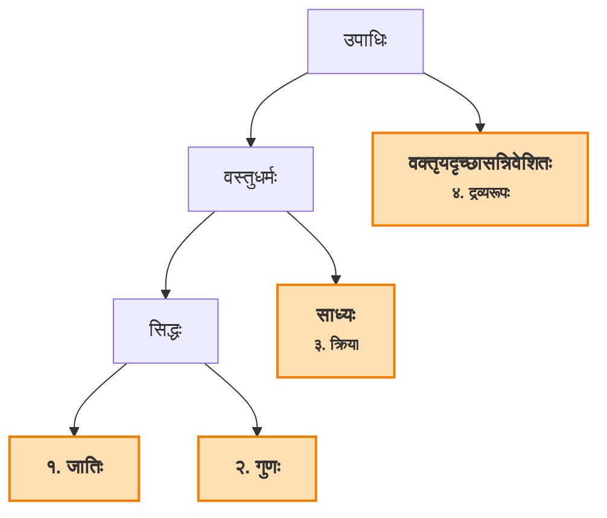
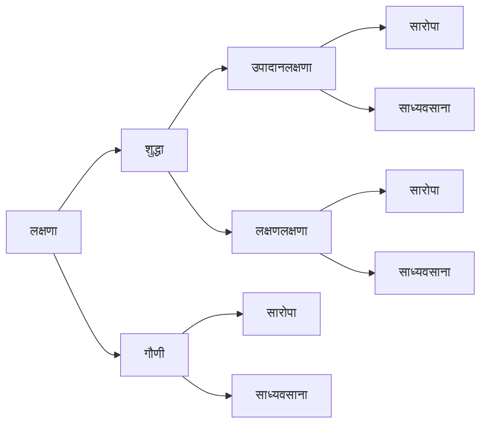

## शब्दभेदाः

क्रमेण शब्दार्थयोः स्वरूपमाह -

[सू ५] स्याद्वाचको लाक्षणिकः शब्दोऽत्र व्यञ्जकस्त्रिधा ।

अत्रेति काव्ये। एषां स्वरुपं वक्ष्यते ।  
<notes>
अत्रावधेयं यत्र पदार्थभेदो नास्ति, शब्द एक एव, उपाधिभेदात् 
अभिदोपधिकः वाचकः, लक्षणोपाधिकः लाक्षणिकः, व्यञ्जनोपाधिकः  (शब्दः तु एक एव) ।
</notes>व्यञ्जकः

[सू० ६] वाच्यादयस्तदर्थाः स्युः  

वाच्य-लक्ष्य-व्यङ्ग्याः ॥

[सू० ७] तात्पर्यार्थोऽपि केषुचित् ॥६॥

## वाक्यस्वरूपम्
<notes>
आकाङ्क्षायोग्यतासन्निधिमतां पदानां समूहः वाक्यम् ।  
वाक्यं स्याद्योग्यताकाङ्क्षासत्तियुक्तः पदोच्चयः । (सा०द०)  

* आकाङ्क्षा – <topic name="परिभाषाः" define="आकाङ्क्षा">प्रतिपत्तुः जिज्ञासा (त०भा०)।</topic> <topic name="परिभाषाः" define="आकाङ्क्षा">प्रतीतिपर्यवसानविरहः आकाङ्क्षा (सा०द०)।</topic> <i>गौरश्वः पुरुषो हस्तिः</i>
* योग्यता – <topic name="परिभाषाः" define="योग्यता">पदार्थानां परस्परसंसर्गे बाधाभावः (तर्क०) ।</topic> <topic name="परिभाषाः" define="योग्यता">अर्थबाधाविरहस्तु योग्यता (सा०द०) ।</topic> <i>वह्निना सिञ्चति</i>
* सन्निधिः – <topic name="परिभाषाः" define="सन्निधिः">अव्यवधानेन अन्वयप्रत्योग्युपस्थितिः (तर्क०) ।</topic> <topic name="परिभाषाः" define="सन्निधिः">पदानाम् अव्यवधानं सन्निधिः (आसत्तिः वा) (सा०द०) ।</topic> <i>गाम् ... आनय</i>

भाट्टाः, नैयायिकाश्च तात्पर्यार्थम् अङ्गीकुर्वन्ति (नान्ये) ।  
भाट्टाः – अभितान्वयवादिनः ।

* शाब्दबोधप्रक्रिया – वाक्यश्रवणम्, अभिधाशक्त्या प्रतिपदार्थबोधः, तात्पर्यशक्त्या वाक्यस्य अन्वितार्थः (स एव तात्पर्यार्थः) ।

प्राभाकराः – अन्विताभिधानवादिनः ।

* शाब्दबोधप्रक्रिया – वाक्यश्रवणम्, अभिधाशक्त्या प्रतिपदार्थबोधः, अभिधाशक्त्या एव अन्वयबोधः । तात्पर्यशक्तिः इति नाङ्गीक्रियते ।
</notes>

आकाङ्क्षायोग्यतासंनिधिवशाद्वक्ष्यमाणस्वरूपाणां पदार्थानां समन्वये तात्पर्यार्थो विशेषवपुरपदार्थोऽपि वाक्यार्थः
समुल्लसतीत्यभिहिनान्वयवादिनां मतम्।  
<notes>
समुल्लसति = अनुभवविषयः ।  
वाच्यार्थः वाक्यार्थः नास्ति । तात्पर्यार्थ एव वाक्यार्थः ।
</notes>
वाच्य एव वाक्यार्थ इत्यन्विताभिधानवादिनः ॥  

## अर्थस्य व्यञ्जकत्वम्

[सू० ८] सर्वेषां प्रायशोऽर्थानां व्यञ्जकत्वमपीष्यते।

<notes>
अपि इति पदस्य अन्वयः द्विधा भवितुमर्हति ।

* अर्थानाम् अपि । शब्दानां व्यञ्जकत्वमस्त्येव, अर्थानामपि वर्तते ।
* अर्थानां व्यञ्जकत्वमपि अस्ति । अर्थानां प्रतिपाद्यत्वं तु विद्यत एव, व्यञ्जकत्वमप्यस्ति ।
* `प्रायशः` इत्यस्य आशयः यत् अन्ते पर्यवसितः/प्रधानः व्यङ्ग्यार्थः तस्य इतोऽपि
  व्यञ्जकत्वं नेष्यते (अनवस्थानं स्यात्) ।
</notes>
तत्र वाच्यस्य यथा –
<udaharana>
मातर्गृहोपकरणमद्य खलु नास्तीति साधितं त्वया ।  
तद्भण किं करणीयमेवमेव न वासरः स्थायी ॥
</udaharana>
अत्र स्वैरविहारार्थिनीति व्यज्यते।

लक्ष्यस्य यथा –
<udaharana>
साधयन्ती सखि सुभगं क्षणे क्षणे दूनासि मत्कृते।  
सद्भावस्नेहकरणीयसदृशकं तावद्विरचितं त्वया ॥
</udaharana>
अत्र मत्प्रियं रमयन्त्या त्वया शत्रुत्वमाचरितमिति लक्ष्यम्, तेन च कामुकविषयं सापराधत्वप्रकाशनं व्यङ्ग्यम्।

व्यङ्ग्यस्य यथा –
<udaharana>
पश्य निश्चलनिष्पंदा बिसिनीपत्रे राजते बलाका ।  
निर्मलमरतकभाजनपरिस्थिता शंखशुक्तिरिव ॥ 
</udaharana>
<notes>
* निर्मलं चेदं मर्कतभाजनम्, तस्मिन् परिस्थिता निर्मलमर्कतभाजनपरिस्थिता ।
</notes>

अत्र निष्पन्दत्वेन, आश्वस्तत्वम्, तेन च जनरहितत्वम्, अतः संकेतस्थानमेतदिति
कयाचित् कश्चित्प्रत्युच्यते। अथवा मिथ्या वदसि न त्वमत्रागतोऽभूरिति व्यज्यते ॥
<notes>
* निष्पदत्वम् (वाच्यार्थः) ⇒ जनराहित्यम् (व्यङ्ग्यार्थः) ⇒ सङ्केतस्थानम् (व्यङ्ग्यार्थः) ।
* [प्रसङ्गान्तरम्] निष्पदत्वम् (वाच्यार्थः) ⇒ जनराहित्यम् (व्यङ्ग्यार्थः) ⇒ तस्मात् त्वमत्र नागतः (व्यङ्ग्यार्थः) ।
</notes>

## वाचकस्य स्वरूपम्
<!-- ९/२८ -->
वाचकादीनां क्रमेण स्वरूपमाह –

[सू० ९] साक्षात्सङ्केतितं योऽर्थमभिधत्ते स वाचकः ॥७॥

इहागृहीतसङ्केतस्य शब्दस्यार्थप्रतीतेरभावात्संकेतसहाय एव शब्दोऽर्थविशेषं प्रतिपादयतीति यस्य यत्राव्यवधानेन संकेतो गृह्यते स तस्य वाचकः।

[सूत्र १०] सङ्केतितश्चतुर्भेदो जात्यादिर्जातिरेव वा ।

<notes>
* मीमांसकानां मते सङ्केतितस्य एकः एव भेदः - जातिः इति ।
* वैयाकरणानां मते तु चत्वारः - जातिः, गुणः, क्रिया, यदृच्छा ।
</notes>

यद्यप्यर्थक्रियाकारितया प्रवृत्तिनिवृत्तियोग्या व्यक्तिरेव, तथाप्यानन्त्याद्व्यभिचाराच्च तत्र संकेतः
कर्तुं न युज्यते, इति 'गौः शुक्लश्चलो डित्थः' इत्यादीनां विषयविभागो न प्राप्नोतीति च तदुपाधावेव संकेतः।

उपाधिश्च द्विविधः - वस्तुधर्मो वक्तृयदृच्छासन्निवेशितश्च। वस्तुधर्मोऽपि द्विविधः – सिद्धः साध्यश्च।
सिद्धोऽपि द्विविधः - पदार्थस्य प्राणप्रदो विशेषाधानहेतुश्च। तत्राद्यो जातिः उक्तं हि वाक्यपदीये
'*न हि गौः स्वरूपेण गौर्नाप्यगौः, गोत्वाभिसम्बन्धात्तु गौः*' इति।

द्वितीयो गुणः। शुक्लादिना हि लब्धसत्ताकं वस्तु विशिष्यते। साध्यः पूर्वापरीभूतावयवः क्रियारूपः।
डित्थादिशब्दानामन्त्यबुद्धिनिर्ग्राह्यं संहृतक्रमं स्वरूपं वक्त्रा यदृच्छया डित्थादिष्वर्थेषूपाधित्वेन
सन्निवेश्यत इति सोऽयं संज्ञारूपो यदृच्छात्मक इति।

'*गौःशुक्लश्वलो डित्थ इत्यादौ चतुष्टयी शब्दानां प्रवृत्तिः*' इति महाभाष्यकारः।

<notes>

* १\. जातिः । प्राणप्रदत्वम् = यावत्स्थितिसम्बन्धित्वम्, व्यवहारयोग्यतानिर्वाहकत्वम् वा ।
* २\. गुणः । विशेषाधानहेतुः = सजातीयेभ्यः व्यावर्तनं विशेषः, तस्य आधानं ज्ञानम्, तस्य हेतुः कारणम्।
    * घटस्य प्राणप्रदः धर्मः घटत्वम् । विशेषाधानहेतुः गुणः रक्तत्वम् इत्यादिः । गुणेन व्यावर्तनं (सजातीयेभ्यः) ।
* ३\. साध्यो नाम क्रियारूपः पदार्थः यस्य अवान्तरव्यापाराः अवयवभूताः सन्ति । (यथा पाकक्रियायां
  नैके अवान्तरव्यापाराः सन्ति)
* ४\. सोऽयं संज्ञारूपः यदृच्छात्मकः । (यथा डित्थः)

लब्धसत्ताकम् = लब्धा सत्ता यस्य तत्।
पूर्वापरीभूतावयवः = क्रमिकाः अवयवाः यस्य तथाभूतः।
अन्तबुद्धिनिर्प्राह्यम् = अन्तिमवर्णज्ञानेन निःशेषतया धार्यम्।
संह्यतक्रमम् = वर्णक्रमग्रहशून्यम्, स्वरूपम् = स्फोटाख्यशब्दस्वरूपम्।

</notes>

<notes>
दुग्धादिप्रयोजनसिद्ध्यै गोव्यक्तेरेव आनयनादिक्रियाः भवन्ति।
प्रवृत्तिनिवृत्तियोग्या = ग्रहणत्यागयोः विषयीभूतः जात्याद्याश्रयः एव।
तथापि तत्र सङ्केतः नास्ति।
१. आनन्त्याद्
, २. व्यभिचाराद् इति।
</notes>

परमाण्वादीनां तु गुणमध्यपाठात् पारिभाषिकं गुणत्वम्। गुणक्रियायदृच्छानां वस्तुत एकरूपाणामप्याश्रयभेदाद्भेद इव लक्ष्यते।
यथैकस्य <dict syns="मुकुर">मुखस्य खड्गमुकुरतैलाद्यालम्बनभेदात्।</dict>

हिमपयःशङ्खाद्याश्रयेषु परमार्थतो भिन्नेषु शुक्लादिषु यद्वशेन शुक्लः शुक्ल इत्याद्यभिन्नाभिधानप्रत्ययोत्पत्तिस्तत् शुक्लत्वादि सामान्यम्।

गुडतण्डुलादिपाकादिष्वेवमेव पाकत्वादि। बालवृद्धशुकाद्युदीरितेषु डित्थादिशब्देषु च प्रतिक्षणं भिद्यमानेषु
डित्थाद्यर्थेषु वा डित्थत्वाद्यस्तीति सर्वेषां शब्दानां जातिरेव प्रवृत्तिनिमित्तमित्यन्ये। तद्वान् अपोहो वा
शब्दार्थः कैश्विदुक्त इति ग्रन्थगौरवभयात् प्रकृतानुपयोगाच्च न दर्शितम्॥

<notes>
* परमाणुः परममहत् इति जातिशब्दाः एव, तत्र वैशेषिकनयानुसारेण तत्र गुणशब्दव्यवहारः लाक्षणिकः अस्ति।
* न बहवः शुक्लाः, एक एव किन्तु बहुत्वेन दृश्यते आश्रयभेदात् (शुक्लं युतकम्, शुक्लं पत्रम्, ...)
</notes>

[सू० ११] स मुख्योऽर्थस्तत्र मुख्यो व्यापारोऽस्याभिधोच्यते ॥८॥

स इति साक्षात्संकेतितः। अस्येति शब्दस्य॥

## लक्षणा

[सू० १२] मुख्यार्थबाधे तद्योगे रूढितोऽथ प्रयोजनात्।  
अन्योऽर्थो लक्ष्यते यत्सा लक्षणारोपिता क्रिया ॥९॥

"कर्मणि कुशलः" इत्यादौ दर्भग्रहणाद्ययोगात् "गङ्गायां घोषः" इत्यादौ च गङ्गादीनां घोषाद्याधारत्वासंभवोत् मुख्यार्थस्य बाधे विवेचकत्वादौ सामीप्ये च संबन्धे रूढितः प्रसिद्धेः, तथा गङ्गातटे घोष इत्यादेः प्रयोगात् येषां न तथा प्रतिपत्तिः, तेषां पावनत्वादीनां धर्माणां तथाप्रतिपादनात्मनः प्रयोजनत्वाच्च मुख्येन अमुख्योऽर्थो लक्ष्यते यत् स आरोपितः शब्दव्यापारः सान्तरार्थनिष्ठो लक्षणा।

<notes>
लक्षणाव्यापारे हेतुत्रितयं स्यात् ।

* मुख्यार्थबाधः ।
* मुख्यार्थयोगः ।
* रूढिः प्रयोजनं वा ।
</notes>

### लक्षणाभेदाः

[सू० १३] स्वसिद्धये पराक्षेपः परार्थं स्वसमर्पणम्।  
उपादानं लक्षणं चेत्युक्ता शुद्धैव सा द्विधा ॥ १० ॥

<notes>
* स्व - मुख्यार्थः । परः - लक्ष्यार्थः ।
</notes>
"कुन्ताः प्रविशन्ति" "यष्टयः प्रविशन्ति" इत्यादौ कुन्तादिभिरात्मनः प्रवेशसिद्ध्यर्थं स्वसंयोगिनः पुरुषा
आक्षिप्यन्ते। तत उपादानेनेयं लक्षणा।

 
*(मण्डनमिश्रमतम्)*  
"गौरनुबन्ध्यः" इत्यादौ श्रुतिचोदितमनुबन्धनं कथं मे स्यादिति
जात्या व्यक्तिराक्षिप्यते न तु शब्देनोच्यते "विशेष्यं नाभिधा गच्छेत् क्षीणशक्तिर्विशेपणे"
इति न्यायात् ।

 
इत्युपादानलक्षणा तु नोदाहर्तव्या। न ह्यत्र प्रयोजनमस्ति न वा रुढिरियम्। व्यक्त्यविनाभावित्वात्तु जात्या व्यक्तिराक्षिप्यते।

<notes>
* लक्षणायाः हेतुत्रितयं नास्ति । अतः लक्षणा नास्ति । अत्र अनुमानाद् एव अर्थावगमनम् ।
</notes>

यथा क्रियतामित्यत्र कर्ता। कुर्वित्यत्र कर्म। प्रविश पिण्डमित्यादौ गृहं भक्षयेत्यादि च।
"पीनो देवदत्तो दिवा न भुङ्क्ते" इत्यत्र च रात्रिभोजनं न लक्ष्यते श्रुतार्थापत्तेरर्थापत्तेर्वा
तस्य विषयत्वात्।

"गङ्गायां घोषः" इत्यत्र तटस्य घोषाधिकरणत्वसिद्धये गङ्गाशब्दः
स्वार्थमर्पयति, इत्येवमादौ लक्षणेनैषा लक्षणा।

#### शुद्धगौण्योः भेदः
उभयरुपा चेयं शुद्धा। उपचारेणामिश्रितत्वात्। अनयोर्लक्ष्यस्य लक्षकस्य च न भेदरूपं
ताटस्थयम्। तटादीनां गङ्गादिशब्दैः प्रतिपादने तत्त्वप्रतिपत्तौ हि
प्रतिपिपादयिषितप्रयोजनसंप्रत्ययः।

गङ्गासंबन्धमात्रप्रातीतौ तु गङ्गातटे घोष इति मुख्यशब्दाभिधानाल्लक्षणायाः को भेदः॥

<notes>
* यत्र लक्ष्यलक्षकयोः सादृश्यसम्बन्दः सा गौणीलक्षणा, सादृश्येतरसम्बन्धः यत्र सा शुद्धालक्षणा (मम्मटः) ।
* यत्र अभेदप्रतीतिः सा गौणीलक्षणा, यत्र भेदप्रतीतिः सा शुद्धालक्षणा (मुकुलभट्टः) ।
* तत्त्वप्रतिपत्तौ = भेदरूपज्ञानम् ।
* सम्प्रत्ययः = ज्ञानम् ।
* सादृश्यसम्बन्धप्रतीतिः उपचारः ।
</notes>

#### सारोपा लक्षणा
 

[सू० १४] सारोपान्या तु यत्रोक्तौ विषयी विषयस्यथा॥

आरोप्यमाणः, आरोपविषयश्व यत्रानपह्नुतभेदौ सामानाधिकरण्येन निर्दिश्येते सा लक्षणा सारोपा॥

<notes>
* गौर्वाहिकः । (आरोपविषयः वाह्हिकः । विषयी आरोप्यमाणः वा -  गौः ।)
</notes>

 

[सू० १५] विषय्यन्तःकृतेऽन्यस्मिन् सा स्यात्साध्यवसानिका ॥ ११ ॥

विषयिणारोप्यमाणेनान्तःकृते निगीर्णे, अन्यस्मिन्नारोपविषये सति साध्यवसाना स्यात्॥

 

[सू० १६] भेदाविमौ च सादृश्यात्संबन्धान्तरतस्तथा। गौणौ शुद्धौ च विज्ञेयौ

इमावारोपाध्यवसानरूपौ सादृश्यहेतू भेदौ "गौर्वाहीकः" इत्यत्र "गौरयम्" इत्यत्र च।

<notes>
* गौरयम् , अत्र वाहिकस्य प्रतीतिः कथम्? मतत्रयम् अधः ।
</notes>
*(प्रथममतम्)*  
अत्र हि स्वार्थसहचारिणो गुणा जाड्यमान्द्यादयो लक्ष्यमाणगोशब्दस्य परार्थाभिधाने प्रवृत्तिनिमित्तत्वमुपयान्ति, इति केचित्।
<notes>
* लक्षणाशक्त्याः गोः गुणानां प्रतीतिः, ततः अभिधाशक्त्या (गौः इति पदेन) वाहिकस्य प्रतीतिः ।
    * आक्षेपः - तर्हि लक्षणया एव साक्षात् वाहिकस्य प्रतीतिः भवतु ।
</notes>

*(द्वितीयमतम्)*  
स्वार्थसहचारिगुणाभेदेन परार्थगता गुणा एव लक्ष्यन्ते न परार्थोऽभिधीयते, इत्यन्ये। 
<notes>
* जाड्यमान्द्यादीनां गुणानां अभेदेन परार्थगतिः ।
    * आक्षेपः - अत्र गुणानामेव प्रतीतिः न तु वाहिकस्य ।
</notes>

*(तृतीयमतम्)*  
साधारणगुणाश्रयत्वेन परार्थ एव लक्ष्यते, इत्यपरे।
<notes>
* साधारणगुणाश्रयः वाहिकः । इत्येव मम्मटसमर्थितमतम् ।
</notes>

उक्तं चान्यत्र (अन्या कारिका)  
&emsp;*अभिधेयाविनाभूतप्रतीतिर्लक्षणोच्यते।  
&emsp;लक्ष्यमाणगुणैर्योगाद्वृत्तेरिष्टा तु गौणता ॥*  
इति।

अविनाभावोऽत्र संबन्धमात्रं न तु नान्तरीयकत्वम्। तत्त्वे हि "मञ्चाः क्रोशन्ति" इत्यादौ न लक्षणा स्यात्।
अविनाभावे चाक्षेपेणैव सिद्धेर्लक्षणाया नोपयोग इत्युक्तम्।
<notes>
* उपरिलिखितं कारिकातात्पर्यम् ।
* नान्तरीयकत्वम् = व्याप्तिः ।
* अविनाभावः इत्यस्य सम्बन्धमात्रमेव अर्थः ।
</notes>

"आयुर्घृतम्" "आयुरेवेदम्" इत्यादौ च
सादृश्यादन्यत् कार्यकारणभावादि संबन्धान्तरम्। एवमादौ च कार्यकारणभावादिलक्षणपूर्वे, आरोपाध्यवसाने।

 
अत्र गौणभेदयोर्भेदेऽपि ताद्रूप्यप्रतीतिः सर्वथैवाभेदावगमश्च प्रयोजनम्। शुद्धभेदयोस्त्वन्यवैलक्षण्येनाव्यभिचारेण च कार्यकारित्वादि। व्कचित् तादर्थ्यादुपचारः। यथा, इन्द्रार्था स्थूणा, इन्द्रः। क्वचित् स्वस्वामिभावात्। यथा, राजकीयः पुरुषो राजा। क्वचित्, अवयवावयविभावात्। यथा, अग्रहस्त इत्यत्राग्रमात्रेऽवयवे हस्तः। क्वचित् तात्कर्म्यात् यथा, अतक्षा तक्षा॥
<notes>
* शुद्धालक्षणायाः कार्यकारणेतरसम्बन्धाः अपि भवितुमर्हन्ति ।
</notes>

 

[सू० १७] लक्षणा तेन षड्विधा ॥ १२ ॥

आद्यभेदाभ्यां सह॥
<notes>

</notes>

## व्यञ्जना

### लक्षणामूलाव्यञ्जना

सा च
 

[सू० १८] व्यङ्ग्येन रहिता रूढौ सहिता तु प्रयोजने। प्रयोजनं हि व्यञ्जनव्यापारगम्यमेव॥

 

[सू० १९] तच्च गूढमगूढं वा। तच्चेति व्यङ्ग्यम्।

गूढं यथा
<udaharana>
<dict syns="तरुणिमा, यौवन">
मुखं विकसितस्मितं वशितवक्रिम प्रेक्षितं  
समुच्छलितविभ्रमा गतिरपास्तसंस्था मतिः।  
उरो मुकुलितस्तनं जघनमंसबन्धोद्धुरं  
बतेन्दुवदनातनौ तरुणिमोद्गमो मोदते ॥९॥
</dict>
</udaharana>

अगूढं यथा
<udaharana>
<dict syns="ललित, अदा, हावभाव, विभ्रम">
श्रीपरिचयाज्जडा अपि भवन्त्यभिज्ञा विदग्धचरितानाम्।  
उपदिशति कामिनीनां यौवनमद एव ललितानि ॥१०॥
</dict>
</udaharana>
अत्रोपदिशतीति॥

 

[सू० २०] तदेषा कथिता त्रिधा ॥ १३ ॥

अव्यङ्ग्या गूढव्यङ्ग्या, अगूढव्यंग्या च॥

 

[सू० २१] तदभूर्लाक्षणिकः ।

शब्द: इति संबध्यते। तद्भूस्तदाश्रयः ।

 

[सू० २२] तत्र व्यापारो व्यञ्जनात्मकः।

कुत इत्याह

 

[सू० २३] यस्य प्रतीतिमाधातुं लक्षणा समुपास्यते।  
फले शब्दैकगम्येऽत्र व्यञ्जनान्नापरा क्रिया ॥ १४॥

प्रयोजनप्रतिपिपादयिषया यत्र लक्षणया शब्दप्रयोगस्तत्र नान्यतस्तत्प्रतीतिरपि तु तस्मादेव शब्दात्। न चात्र व्यञ्जनादृतेऽन्यो व्यापारः॥ तथाहि

 

[सू० २४] नाभिधा समयाभावात्।

<notes>
* समयः = सङ्केतग्रहः
</notes>

गङ्गायां घोष इत्यादौ ये पावनत्वादयो धर्मास्तटादौ प्रतीयन्ते न तत्र गङ्गादिशब्दाः संकेतिताः॥

 

[सू० २५] हेत्वभावान्न लक्षणा ॥ १५ ॥

मुख्यार्थबाधादित्रयं हेतुः॥ तथा च

### व्यञ्जनास्वरूपम्

[सू० २६] लक्ष्यं न मुख्यं नाप्यत्र बाधो योगः फलेन नो।  
न प्रयोजनमेतस्मिन् न च शब्दः स्खलद्गतिः ॥ १६ ॥

यथा गङ्गाशब्दः स्रोतसि सबाध इति तटं लक्षयति तद्वत् यदि तटेऽपि सबाधः
स्यात् तत् प्रयोजनं लक्षयेत्। न च तटं मुख्योऽर्थः। नाप्यत्र बाधः। न च
गङ्गाशब्दार्थस्य तटस्य पावनत्वाद्यैर्लक्षणीयैः संबन्धः। नापि प्रयोजने लक्ष्ये किंचित्
प्रयोजनम्। नापि गङ्गाशब्दस्तटमिव प्रयोजनं प्रतिपादयितुमसमर्थः॥

 

[सू० २७] एवमप्यनवस्था स्याद् या मूलक्षयकारिणी।

एवमपि प्रयोजनं चेल्लक्ष्यते तत् प्रयोजनान्तरेणेति तदपि प्रयोजनान्तरेणेति प्रकृताप्रतीतिकृत् अनवस्था भवेत्॥ ननु पावनत्वादिधर्मयुक्तमेव तटं लक्ष्यते। "गङ्गायास्तटे घोषः" इत्यतोऽधिकस्यार्थस्य प्रतीतिश्च प्रयोजनमिति विशिष्टे लक्षणा तत्किं व्यञ्जनयेत्याह।

 

[सू० २८] प्रयोजनेन सहितं लक्षणीयं न युज्यते ॥ १७ ॥

कुत इत्याह 

 

[सू० २९] ज्ञानस्य विषयो ह्यन्यः फलमन्यदुदाहृतम्। प्रत्यक्षादेर्नीलादिर्विषयः फलं तु प्रकटता संवित्तिर्वा॥

[सू० ३०] विशिष्टे लक्षणा नैवं व्याख्यातम्॥ 
[सू० ३१] विशेषाः स्युस्तु लक्षिते ॥ १८ ॥

तटादौ ये विशेषाः पावनत्वादयस्ते चाभिधातात्पर्यलक्षणाभ्यो व्यापारान्तरेण गम्याः। तच्च व्यञ्जनध्वननद्योतनादिशब्दवाच्यमवश्यमेषितव्यम्॥ एवं लक्षणामूलं व्यञ्जकत्वमुक्तम्॥

### अभिधामूला व्यञ्जना

अभिधामूलं त्वाह।

 

[सू० ३२] अनेकार्थस्य शब्दस्य वाचकत्वे नियन्त्रिते।  
संयोगाद्यैरवाच्यार्थधीकृद्व्यापृतिरञ्जनम् ॥ १९ ॥

<notes>
* व्यापृतिः = व्यापारः । अञ्जनम् = व्यञ्जना ।
</notes>

*(वाक्यपदीयात् कारिका)  
&emsp;संयोगो विप्रयोगश्व साहचर्यं विरोधिता ।  
&emsp;अर्थः प्रकरणं लिङ्गं शब्दस्यान्यस्य संनिधिः।  
&emsp;सामर्थ्यमौचिती देशः कालो व्यक्तिः स्वरादयः।  
&emsp;शब्दार्थस्यानवच्छेदे विशेषस्मृतिहेतवः॥*

 
इत्युक्तदिशा *सशङ्खचक्रो हरिः*, *अशङ्खचक्रो हरिः* इत्यच्युते। *रामलक्ष्मणौ* इति दाशरथी।
*रामार्जुनगतिस्तयोः* इति भार्गवकार्तवीर्ययोः। *स्थाणुं भज भवच्छिदे* इति हरे । *सर्वं जानाति देव*
इति युष्मदर्थे। *कुपितो मकरध्वज* इति कामे। *देवस्य पुरारातेः* इति शंभौ। *मधुना मत्तः कोकिल*
इति वसन्ते। *पातु वो दयितामुखम्* इति सांमुख्ये। *भात्यत्र परमेश्वर* इति राजधानीरूपात्
देशाद्राजनि। *चित्रभानुर्विभाति* इति दिने रवौ रात्रौ वह्नौ । *मित्रं भाति* इति सुहृदि ।
*मित्रो भाति* इति रवौ।

इन्द्रशत्रुरित्यादौ वेद एव, न काव्ये, स्वरो विशेषप्रतीतिकृत्।

आदिग्रहणात्

<udaharana>
एतावन्मात्रस्तनिका एतावन्मात्राभ्यां अक्षिपत्राभ्याम् ।  
एतावन्मात्रावस्था एतावन्मात्रैः दिवसैः ॥११॥
</udaharana>

इत्यादावभिनयादयः।

इत्थं संयोगादिभिरर्धान्तराभिधायकत्वे निवारितेऽप्यनेकार्थस्य शब्दस्य यत्
क्वचिदर्थान्तरप्रतिपादनं तत्र नाभिधा नियमनात्तस्याः। न च लक्षणा
मुख्यार्थबाधाद्यभावात्। अपि त्वञ्जनं व्यञ्जनमेव व्यापारः।

यथा
<udaharana>
भद्रात्मनो दुरधिरोहतनोर्विशालवंशोन्नतेः कृतशिलीमुखसंग्रहस्य।  
यस्यानुपप्लुतगतेः परवारणस्य दानाम्बुसेकसुभगः सततं करोऽभूत्॥१२॥ 
</udaharana>

[सू० ३३] तद्युक्तो व्यञ्जकः शब्दः ।

तद्युक्तो व्यञ्जनयुक्तः ।

 

[सू० ३४] यत्सोऽर्थान्तरयुक् तथा।  
अर्थोऽपि व्यञ्जकस्तत्र सहकारितया मतः ॥ २० ॥

तथेति व्यञ्जकः॥

इति काव्यप्रकाशे शब्दार्थस्वरूपनिर्णयो नाम द्वितीय उल्लासः ॥२॥

