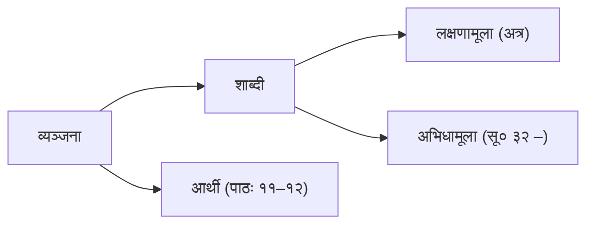

प्रस्तावना, उद्देश्यम् (पाठः १०.१–१०.२)

<vyakhyana>
अत्र काव्यप्रकाशस्य दशमे पाठे भवतः स्वागतम्। भवान् शास्त्रितृतीयवर्षे साहित्यदर्पणस्य द्वितीयपरिच्छेदे व्यञ्जनायाः स्वरूपं भेदं च पठितवान्। भवान् इमां कारिकां पुनः स्मरतु –
</vyakhyana>

> **विरतास्वभिधाद्यासु ययाऽर्थो बोध्यते परः।**  
> **सा वृत्तिर्व्यञ्जना नाम शब्दस्यार्थादिकस्य च॥ (साहित्यदर्पणः २/१२)**

<vyakhyana>
अनन्तरम् आचार्यमम्मटोऽपि स्वकाव्यप्रकाशे व्यञ्जनायाः विशदविवेचनं कृतवान् अस्ति। तस्मिन् विषये एव आचार्यप्रथमवर्षे प्रथमपत्रे भवान् सम्प्रति अध्ययनं करिष्यति। भवान् ज्ञास्यति यत् –

* व्यञ्जना का?
* व्यञ्जनायाः कति भेदाः सन्ति?
* व्यञ्जनायाः उदाहरणानि।

संक्षेपेण वक्तुं शक्यते यत् अस्मिन्पाठे भवान् व्यञ्जनां, तस्याः भेदान्, लक्षणाप्रयोजनस्य बोधने व्यञ्जनाभिन्नव्यापाराणाम् अक्षमतां, ज्ञानस्य विषयं फलं च, लक्षणामूलव्यञ्जकम् इत्यादीनामध्ययनं करिष्यति।
</vyakhyana>

**उद्देश्यम्** – अस्य पाठस्य अध्ययनेन भवान् –

* व्यञ्जनायाः परिचयदाने समर्थो भविष्यति।
* व्यञ्जनायाः स्वरूपं, भेदम्, उदाहरणं च दातुं शक्ष्यति।
* व्यञ्जनैकगम्यत्वे लक्षणाप्रयोजनस्य कारणं वक्तुं शक्ष्यति।
* ज्ञानस्य विषयफलयोः भिन्नत्वे मीमांसकमतं, नैयायिकमतं च ज्ञातुं समर्थो भविष्यति।
* लक्षणामूलव्यञ्जकं ज्ञातुं शक्ष्यति।

### १०.३ प्रयोजनरूपोऽर्थः व्यञ्जनैकगम्यः

<vyakhyana>
भवान् जानाति यत् त्रिविधाः शब्दाः भवन्ति – वाचकलाक्षणिकव्यञ्जकाश्च। त्रयश्चार्थाः – वाच्यलक्ष्यव्यङ्ग्याश्च एवं च तिस्रः शक्तयः – अभिधा, लक्षणा, व्यञ्जना च।

शब्दस्य आद्या शक्तिः अभिधा, अपरा लक्षणा अन्या (तृतीया) च व्यञ्जना। यत्र लक्षणया अभीष्टार्थः न प्राप्यते तत्र प्रयोजनसिद्धये व्यञ्जनाव्यापारः भवति। आचार्यमम्मटेन उक्तम् –
</vyakhyana>

> **यस्य प्रतीतिमाधातुं लक्षणा समुपास्यते।**  
> **फले शब्दैकगम्येऽत्र व्यञ्जनान्नापरा क्रिया॥ (सू० २३, १०.३.४ द्रष्टव्यम्)**

<vyakhyana>
प्रयोजनं हि व्यञ्जनाव्यापारगम्यमेव।
</vyakhyana>

#### १०.३.१ प्रयोजनात्मकस्य व्यङ्ग्यस्य द्वैविध्यम्

सा च –

[सू० १८] व्यङ्ग्येन रहिता रूढौ सहिता तु प्रयोजने।

प्रयोजनं हि व्यञ्जनव्यापारगम्यमेव।

<vyakhyana>
मम्मटाचार्यः प्रथमतः पूर्वपाठे लक्षणायाः (उपाधिकृतान्) षड्भेदान् प्रतिपादितवान् – ‘लक्षणा तेन षड्विधा।’ व्यञ्जनादृष्ट्या लक्षणायाः द्वैविध्यं स्वीकर्तुं शक्यते –

1. अव्यङ्ग्या
2. सव्यङ्ग्या

रूढिवशाज्जायमाना लक्षणा अव्यङ्ग्या। तत्र प्रसिद्धिमात्रकारणात् लक्षणा भवति; यथा – ‘कर्मणि कुशलः।’ अत्र नास्ति किञ्चित् लक्षणायाः प्रयोजनम्। अतएव व्यङ्ग्यं नास्ति। सप्रयोजनलक्षणा व्यङ्ग्यसहिता अथवा सव्यङ्ग्या भवति। प्रयोजनस्य अभिव्यक्तिः व्यञ्जनया एव भवति, न तु अभिधया लक्षणावृत्त्या वा। एतस्मात् प्रयोजनवती लक्षणा सर्वत्र व्यङ्ग्यसहिता एव भवति। यथा – ‘गङ्गायां घोषः।’ अत्र शैत्यादिप्रतीतिः प्रयोजनमस्ति। या च व्यञ्जनाव्यापारेण भवति। वस्तुतः प्रयोजनप्रतीतिः एव व्यङ्ग्यार्थस्य मुख्यं कार्यम्।
</vyakhyana>

[सू० १९] तच्च गूढमगूढं वा

तच्चेति व्यङ्ग्यम्।

<vyakhyana>
सव्यङ्ग्यायां लक्षणायां व्यङ्ग्यार्थः द्विविधः भवति –

1. गूढः
2. अगूढः

गूढव्यङ्ग्या अतिगम्भीरा, सहृदयजनसंवेद्या च भवति। अगूढव्यङ्ग्या च प्रकटप्रतीतिः, सामान्यजनसम्वेद्या भवति।
</vyakhyana>

#### १०.३.२ गूढव्यङ्ग्यस्य उदाहरणम्

गूढं यथा –

<udaharana>
मुखं विकसितस्मितं वशितवक्रिम प्रेक्षितं  
समुच्छलितविभ्रमा गतिरपास्तसंस्था मतिः।  
उरो मुकुलितस्तनं जघनमंसबन्धोद्धुरं  
बतेन्दुवदनातनौ तरुणिमोद्गमो मोदते ॥९॥
</udaharana>

<anvaya>
इन्दुवदनातनौ (बत) तरुणिमोद्गमः मोदते – मुखं विकसितस्मितम्, प्रेक्षितं वशितवक्रिम, गतिः समुच्छलितविभ्रमा, मतिः अपास्तसंस्था, उरः मुकुलितस्तनम्, जघनम् अंसबन्धोद्धुरम्।
</anvaya>

<vyakhyana>
कश्चित् युवा कांचित् युवतीम् अवलोक्य कथयति –

इन्दुवदनायाः तनौ=शरीरे तरुणिम्नः=तारुण्यस्य उद्गमः=आविर्भावः मोदते=स्फीतो भवति। प्रकृत्या एव इयम् इन्दुवदना, तत्रापि एवं नवयौवनविजृम्भणमित्यतिकष्टम् आपतितं विदग्धयुवजनस्य इत्येवं खेदे ‘बत’ इति। अहो रमणीयतातिशय इति विस्मये वा। अहो भाग्येन परमोत्सवस्थानम् उपसम्पन्नं युवजननयनानामिति हर्षे वा।

मुखं=वक्त्रं विकसितस्मितं=प्रसृतस्मितम्। एवं प्रेक्षितम्=अवलोकनम्, वशितः=वशीकृतः (स्वाधीनीकृतः) वक्रिमा=वक्रत्वं (तिर्यग्गामित्वं) येन तादृशम्। गतिः=गमनं, समुच्छलिताः=निरन्तरमतिशयेन प्रादुर्भूताः विभ्रमाः=हावभेदाः यस्यां सा। मतिः=बुद्धिः, अपास्ता=त्यक्ता संस्था=परिमितविषयकत्वं यया तथाभूता, अनेकविषयसञ्चारिणीति यावत्। उरः=वक्षःस्थलं, मुकुलितौ=मुकुलाकारौ (ईषदुन्नतौ) स्तनौ यत्र तादृशम्। जघनम्=ऊरुमूलभागः, (मांस)बन्धेन=अवयवानां दृढबन्धेन उद्धुरं=विलक्षणरतियोग्यम्। अथवा अंसबन्धो नाम रतिबन्धविशेषः, तत्र योग्यम् इत्यर्थः। तथा च सर्वत्र स्मिताद्युन्मेषः स्फुटमेव यौवनोद्गमम् अवगमयति इति भावः।

अस्मिन्श्लोके पृथ्वीछन्दः।

अत्र विकासस्य पुष्पधर्मस्य स्मिते वशीकरणस्य चेतनधर्मस्य प्रेक्षिते, ऊर्ध्वगतिविशेषरूपसमुच्छलनस्य मूर्तद्रव्यधर्मस्य विभ्रमे, संस्थायाः मर्यादायाः त्यागस्य चेतनाधर्मस्य मतौ, मुकुलितत्वस्य पुष्पधर्मस्य स्तनयोः, उद्धुरत्वस्य उत्कृष्टधुरावत्वरूपस्य चेतनधर्मस्य जघने, मोदस्य चेतनधर्मस्य यौवनोद्गमे बाधितत्वात् विकसितादिपदैः उपदर्शिताः पदार्थाः लक्ष्यन्ते (लक्षणया बोध्यन्ते)।

अत्र विकसितेति पदेन असंकुचितत्वसम्बन्धेन ‘सातिशयत्वं’ लक्ष्यते तत्प्रयोजनरूपं च व्यङ्ग्यं मुखगतं सौरभादि। ‘वशित’ इत्यनेन अभिमतविषयप्रवृत्तिरूपसम्बन्धेन ‘स्वाधीनत्वं’ लक्ष्यते, तत्प्रयोजनरूपं व्यङ्ग्यञ्च युक्तानुरागित्वम्। ‘समुच्छलित’ इत्यनेन प्रयोज्यप्रयोजकभावसम्बन्धेन बहुलता लक्ष्यते, व्यङ्ग्यं च सकलजनमनोहारित्वम्, ‘अपास्तसंस्था’ इत्यनेन हेतुहेतुमद्भावसम्बन्धेन ‘अधीरत्वं’ लक्ष्यते, अनुरागातिशयश्च व्यङ्ग्यम्, ‘मुकुलित’ इत्यनेन निबिडावयवत्वसम्बन्धेन स्तनयोः काठिन्यम् उद्भिन्नत्वं वा लक्ष्यते, आलिङ्गनयोग्यत्वं च व्यङ्ग्यम्। ‘उद्धुर’ इत्यनेन भारसहनक्षमत्वसम्बन्धेन विलक्षणरतियोग्यत्वं लक्ष्यते, रमणीयत्वञ्च जघनयोः व्यङ्ग्यम्, ‘मोदते’ इत्यनेन जन्यजनकभावसम्बन्धेन उत्कर्षः लक्ष्यते, तारुण्यस्य स्पृहणीयत्वञ्च व्यङ्ग्यम्। एवमत्र पद्ये विद्यमानानां व्यङ्ग्यानां प्रतीतिः काव्यवासनापरिपक्वमतीनां विदुषामेव सम्भवति न तु साधारणसहृदयानामत इदं गूढव्यङ्ग्यस्योदाहरणम्।
</vyakhyana>

<notes>
| पदम् | बाधः (मुख्यार्थः) | लक्ष्यार्थः | व्यङ्ग्यम् (प्रयोजनम्) |
|---|---|---|---|
| विकसित (स्मितम्) | विकासः पुष्पधर्मः | सातिशयत्वम् | मुखगतं सौरभादि |
| वशित (प्रेक्षितम्) | वशीकरणं चेतनधर्मः | स्वाधीनत्वम् | युक्तानुरागित्वम् |
| समुच्छलित (विभ्रमाः) | ऊर्ध्वगमनं मूर्तद्रव्यधर्मः | बहुलता | सकलजनमनोहारित्वम् |
| अपास्तसंस्था (मतिः) | मर्यादात्यागः चेतनधर्मः | अधीरत्वम् | अनुरागातिशयः |
| मुकुलित (स्तनम्) | पुष्पधर्मः | काठिन्यम् / उद्भिन्नत्वम् | आलिङ्गनयोग्यत्वम् |
| उद्धुर (जघनम्) | धुरावत्त्वं चेतनधर्मः | विलक्षणरतियोग्यत्वम् | रमणीयत्वम् |
| मोदते (तरुणिमोद्गमः) | मोदः चेतनधर्मः | उत्कर्षः | तारुण्यस्य स्पृहणीयत्वम् |

* **गूढम्** – काव्यवासनापरिपक्वमतीनां (सहृदयानाम्) एव वेद्यम्।
* 🤔 पुस्तके अन्वये/व्याख्याने ‘इन्द्रवदना’, ‘असम्बन्ध(ोद्धुरम्)’ – शोधितम् (इन्दुवदना, अंसबन्ध ; श्लोके पुस्तकेऽपि ‘जघनमंसबन्धोद्धुरं’)। पाठान्तरम् ‘मांसबन्धोद्धुरम्’।
</notes>

#### १०.३.३ अगूढव्यङ्ग्यस्य उदाहरणम्

अगूढं यथा –

<udaharana>
श्रीपरिचयाज्जडा अपि भवन्त्यभिज्ञा विदग्धचरितानाम्।  
उपदिशति कामिनीनां यौवनमद एव ललितानि ॥१०॥
</udaharana>

अत्रोपदिशतीति।

<anvaya>
जडाः अपि श्रीपरिचयात् विदग्धचरितानाम् अभिज्ञाः भवन्ति। यौवनमदः एव कामिनीनां ललितानि उपदिशति।
</anvaya>

<vyakhyana>
जडाः=अनभिज्ञाः अपि जनाः श्रियः=लक्ष्म्याः परिचयः=प्रथमः सम्बन्धः, तस्मादेव विदग्धानां=चतुराणां यानि चरितानि=चरित्राणि तेषाम् अभिज्ञाः=ज्ञातारो भवन्ति इत्यर्थः। यौवनस्य मदः=हर्षः, स एव कामिनीनां=स्त्रीणां ललितानि उपदिशति=आविष्करोति इत्यर्थः। ललितं नाम सुकुमारतया अङ्गानां विन्यासः।

अत्र ज्ञानानुकूलशब्दप्रयोगरूपोपदेशकर्तृत्वस्य चेतनधर्मस्य अचेतने यौवनमदे बाधात् सामान्यविशेषभावसम्बन्धेन आविष्कारमात्रं लक्ष्यम्। अनायासेन ललितज्ञानं व्यङ्ग्यम्। इदं सहृदयेतरैरपि अभिधेयवत् वेद्यम् इति अगूढम्। अतो लक्षणामूलागूढाख्यगुणीभूतव्यङ्ग्यमिदम्।
</vyakhyana>

<notes>
* ‘अत्रोपदिशतीति’ – ‘उपदिशति’ इति पदं लाक्षणिकम् : उपदेशः (ज्ञानानुकूलशब्दप्रयोगः) चेतनधर्मः, अचेतने यौवनमदे बाधितः → **आविष्करणम्** लक्ष्यम् ; **अनायासेन ललितज्ञानम्** व्यङ्ग्यम् – सर्वैः (असहृदयैरपि) वाच्यवत् वेद्यम् → **अगूढम्** (अतः गुणीभूतव्यङ्ग्यम्)।
* <small>🤔 msp-मूलग्रन्थे न मुद्रितम् – प्रसिद्धपाठात् (`kp2-01.md`) योजितम्।</small>
</notes>

#### १०.३.४ लक्षणाप्रयोजनस्य व्यञ्जनैकगम्यत्वे कारणम्

<vyakhyana>
काव्यस्य उत्कृष्टता व्यङ्ग्यार्थस्य प्रधानतायाम् उपरि निर्भरा भवति। अतएव आचार्यमम्मटः लक्षणायाः भेदं व्यङ्ग्यदृष्ट्या अपि कृतवानस्ति।
</vyakhyana>

[सू० २०] तदेषा कथिता त्रिधा ॥१३॥

अव्यङ्ग्या, गूढव्यङ्ग्या, अगूढव्यङ्ग्या च।

<vyakhyana>
अत्रायं भावः – तत्=तस्मात् कारणात्, एषा=लक्षणा त्रिधा। रूढौ व्यङ्ग्यरहितत्वेन, प्रयोजनवत्यां गूढव्यङ्ग्यत्वेनागूढव्यङ्ग्यत्वेन च त्रिप्रकारा।
</vyakhyana>

[सू० २१] तद्भूर्लाक्षणिकः

शब्द इति सम्बध्यते। **तद्भूस्तदाश्रयः**।

<vyakhyana>
एवं प्रसङ्गतः अवान्तरभेदं लक्षणायाः निरूप्य तद्द्वारा पूर्वोपदिष्टं लाक्षणिकशब्दं लक्षयति ‘तद्भूः’ इति।

‘स्याद्वाचको लाक्षणिकः’ इत्यनेन वाचकलाक्षणिकौ शब्दौ पूर्वं कथितौ दूरव्यवहितौ तावेव स्मारयितुं वृत्तौ ‘शब्द इति सम्बध्यते’ इत्युक्तम्।

तथा च ‘तद्भूर्लाक्षणिकः शब्दः’ इति लब्धम्। तत्र लाक्षणिकः शब्दः इत्यनेन लक्ष्यम्, ‘तद्भूः’ इत्यनेन तस्य लक्षणं प्रतिपादितम्। अत्र लक्षणे ‘तद्भूः’ इत्यत्र ‘तस्माद् भवति इति तद्भूः’ इति व्युत्पत्तिमाश्रित्य ‘शब्दात् लक्षणा भवति’ इति भ्रमो न कस्यचिदपि भवेत्, इत्येतदर्थं वृत्तौ ‘तद्भूः’ इत्यस्य ‘तदाश्रयः’ इति व्याख्यानं कृतम्। एवञ्च लक्षणायाः आश्रयः लाक्षणिकः शब्दः। अत्रायं भावः – प्रवाहरूपो वाच्यार्थो भवति वस्तुतो लक्षणाश्रयः तथापि प्रवाहरूपमुख्यार्थस्य प्रतिपादकत्वात् शब्दोऽपि लक्षणारूपव्यापाराश्रय उपचारात् व्यवह्रियते।
</vyakhyana>

[सू० २२] तत्र व्यापारो व्यञ्जनात्मकः

कुत इत्याह –

[सू० २३] यस्य प्रतीतिमाधातुं लक्षणा समुपास्यते।
फले शब्दैकगम्येऽत्र व्यञ्जनान्नापरा क्रिया ॥१४॥

प्रयोजनप्रतिपिपादयिषया यत्र लक्षणया शब्दप्रयोगस्तत्र नान्यतस्तत्प्रतीतिरपि तु तस्मादेव शब्दात्। **न चात्र व्यञ्जनादृतेऽन्यो व्यापारः**।

<vyakhyana>
व्यञ्जकं लक्षयितुं तदुपाधौ व्यञ्जनायां वादिविप्रतिपत्तिनिरासाय आह – ‘तत्र’ इत्यादि। तत्र=पावनत्वादिप्रयोजनविषये व्यापारः शब्दस्य वृत्तिः, व्यञ्जनात्मकः=व्यञ्जनस्वरूपः इति।

अत्र लक्षणा इति पदं लक्षणया लाक्षणिकशब्दपरम्। तथा च यस्य शैत्यपावनत्वादिरूपफलस्य, प्रतीतिम्=अनुभवरूपाम्, आधातुं=जनयितुं, लक्षणा=लाक्षणिकशब्दः, समुपास्यते=आश्रीयते। शब्दैकगम्ये=लाक्षणिकशब्दमात्रगम्ये (न तु अनुमानादिगम्ये) तस्मिन् फले (शैत्यपावनत्वादिविषये) व्यञ्जनात् व्यञ्जनां विहाय (व्यञ्जनां विना) अपरा क्रिया=अन्यो व्यापारो नेत्यर्थः। किन्तु व्यञ्जनात्मक एव व्यापार इति भावः। कारिकास्थ ‘यस्य प्रतीतिमाधातुम्’ इत्यस्य व्याख्यानं वृत्तौ ‘(प्रयोजन)प्रतिपिपादयिषया’ इति कृतम्। एवं च यस्य=प्रयोजनस्य, प्रतिपिपादयिषया=प्रतिपादनेच्छया।

अत्रेदं बोध्यम् – कारिकास्थस्य ‘यस्य प्रतीतिमाधातुम्’ इत्यंशस्य व्याख्यानं वृत्तौ मम्मटेन ‘प्रयोजनप्रतिपिपादयिषया’ इति कृतम्। तच्चेत्थम् – यस्य=प्रयोजनस्य प्रतीतिम्=अनुभवरूपाम्, आधातुं=जनयितुम् प्रतिपादयितुमित्यर्थः। एवञ्च प्रतिपादयितुमिष्टं प्रयोजनमेव। अत उक्तं ‘प्रयोजनप्रतिपिपादयिषया’। अग्रे कारिकास्थस्य ‘लक्षणा समुपास्यते’ इत्यंशस्य वृत्तौ व्याख्यानं ‘यत्र लक्षणया शब्दप्रयोगः’ इति कृतम्। अर्थात् लाक्षणिकशब्दस्य प्रयोगः क्रियते। तथाहि शैत्यपावनत्वादिप्रतिपादनेच्छया एव ‘गङ्गायां घोषः’ इति लाक्षणिकशब्दस्य प्रयोगः क्रियते न तु ‘गङ्गातटे घोषः’ इत्यर्थं प्रतिपादयितुम्। अग्रे ‘फले शब्दैकगम्येऽत्र’ इत्यंशस्य व्याख्यानं वृत्तौ ‘तत्र नान्यतस्तत्प्रतीतिरपि तु तस्मादेव शब्दात्’ इति कृतम्। तत्र लाक्षणिकप्रयोगस्थले तत्प्रतीतिः=प्रयोजनप्रतीतिः, नान्यतः अनुमानादिना, अपितु तस्मादेव शब्दात्=लाक्षणिकादेव शब्दात्।

अग्रे कारिकास्थस्य ‘अत्र व्यञ्जनान्नापरा क्रिया’ इत्यंशस्य वृत्तौ ‘न चात्र व्यञ्जनादृतेऽन्यो व्यापारः’ इति व्याख्यानं कृतम्। अस्यायं भावः – अत्र=लाक्षणिकशब्दप्रयोगाद् जायमानायां प्रयोजनप्रतीतौ, व्यञ्जनात्=व्यञ्जनाख्यव्यापाराद्, ऋते=विना, अन्यो व्यापारः=अभिधा लक्षणारूपो वा व्यापारः न=नास्ति। अपितु व्यञ्जनात्मक एव व्यापारः।
</vyakhyana>

<notes>
| लक्षणा | हेतुः | व्यङ्ग्यम् | उदाहरणम् |
|---|---|---|---|
| **अव्यङ्ग्या** | रूढिः | नास्ति | कर्मणि कुशलः |
| **गूढव्यङ्ग्या** | प्रयोजनम् | सहृदयैकवेद्यम् | मुखं विकसितस्मितम् … (॥९॥) |
| **अगूढव्यङ्ग्या** | प्रयोजनम् | सर्ववेद्यम् (अतिस्फुटम्) | श्रीपरिचयाज्जडा अपि … (॥१०॥) |

* **तद्भूः = तदाश्रयः** – लक्षणाया आश्रयः लाक्षणिकः शब्दः (न तु ‘तस्माद् भवति’)। वस्तुतः लक्षणा अर्थाश्रया (९.५ ‘आरोपिता क्रिया’), शब्दे उपचारात्।
* **तत्र** (प्रयोजने) व्यापारः **व्यञ्जनात्मकः** – (१) प्रयोजनप्रतीतिः लाक्षणिकशब्दादेव (न अनुमानादेः), (२) सा न अभिधया न लक्षणया (१०.४) → व्यञ्जना।
</notes>

#### बोधप्रश्नाः (१–३)

**१.** सव्यङ्ग्या लक्षणा का भवति?

उत्तरम्

प्रयोजनसहिता (प्रयोजनवती) लक्षणा सव्यङ्ग्या।

**२.** अव्यङ्ग्या लक्षणा का?

उत्तरम्

प्रयोजनरहिता (रूढिमूला) लक्षणा अव्यङ्ग्या।

**३.** सव्यङ्ग्या लक्षणायाः कति भेदाः?

उत्तरम्

सव्यङ्ग्यालक्षणायाः द्वौ भेदौ – गूढव्यङ्ग्या, अगूढव्यङ्ग्या च।

<small>[मूलग्रन्थः (सङ्कलितः) →](kp99-99.md#p10-3)</small>

### १०.४ लक्षणाप्रयोजनस्य बोधने व्यञ्जनान्यव्यापारस्य अक्षमता

तथाहि –

<vyakhyana>
लक्षणया प्रयोजनस्य सिद्धिः न भवितुं शक्यते। लक्षणा तु मुख्यार्थस्य अन्वयोपपत्त्यर्थम् उपयुक्तम् अर्थान्तरमेव बोधयति। वक्तुः लाक्षणिकप्रयोगे प्रयोजनं निश्चितं भवति। तद्बोधने लक्षणामतिरिच्य व्यञ्जनाव्यापारः एव सक्षमः भवति। अतएव व्यञ्जनादतिरिच्य नास्ति कोऽपि व्यापारः प्रयोजनस्य सिद्ध्यर्थम्।
</vyakhyana>

#### १०.४.१ प्रयोजनस्य अनभिधेयता

[सू० २४] नाभिधा समयाभावात्

गङ्गायां घोष इत्यादौ ये पावनत्वादयो धर्मास्तटादौ प्रतीयन्ते **न तत्र गङ्गादिशब्दाः सङ्केतिताः**।

<vyakhyana>
अभिधावृत्तिद्वारा मुख्यार्थबोधः भवति। तत्र सङ्केतग्रहः अपेक्षितो भवति। न च शैत्यपावनत्वादिषु अर्थेषु गङ्गाशब्दस्य अस्ति सङ्केतः। अतः गङ्गापदम् अभिधावृत्त्या न हि प्रयोजनरूपं शैत्यपावनत्वाद्यर्थं प्रतिपादयितुं समर्थम्।
</vyakhyana>

#### १०.४.२ प्रयोजनबोधे लक्षणाऽसामर्थ्यम्

[सू० २५] हेत्वभावान्न लक्षणा ॥१५॥

मुख्यार्थबाधादित्रयं हेतुः। तथा च –

[सू० २६] लक्ष्यं न मुख्यं नाप्यत्र बाधो योगः फलेन नो।
न प्रयोजनमेतस्मिन् न च शब्दः स्खलद्गतिः ॥१६॥

यथा गङ्गाशब्दः स्रोतसि सबाध इति तटं लक्षयति तद्वत् यदि तटेऽपि सबाधः स्यात् तत् प्रयोजनं लक्षयेत्। **न च तटं मुख्योऽर्थः**। **नाप्यत्र बाधः**। न च गङ्गाशब्दार्थस्य तटस्य **पावनत्वाद्यैर्लक्षणीयैः सम्बन्धः**। **नापि प्रयोजने लक्ष्ये किञ्चित् प्रयोजनम्**। नापि गङ्गाशब्दस्तटमिव प्रयोजनं **प्रतिपादयितुमसमर्थः**।

<vyakhyana>
कारिकायां यदुक्तं – ‘लक्ष्यं न मुख्यम्’ इति, तद्वृत्तौ – ‘यथा गङ्गाशब्दः स्रोतसि सबाध इति तटं लक्षयति, तद्वत् यदि तटेऽपि सबाधः स्यात् तत् प्रयोजनं लक्षयेत्। न च तटं मुख्योऽर्थः’ इति व्याख्यातम्। यस्य अयं भावः – ‘गङ्गायां घोषः’ इत्यत्र ‘गङ्गा’ शब्दः स्वमुख्ये स्रोतोरूपे अर्थे सबाधः बाधितोऽस्ति। यतः घोषाधिकरणत्वं स्रोतसि न सम्भवतीति गङ्गाशब्दस्य मुख्यार्थस्य प्रवाहस्य अधिकरणत्वेन घोषे अन्वयो बाधित इति लक्षणया गङ्गाशब्दः तटरूपमर्थं बोधयति। तद्वदेव यदि गङ्गाशब्दः तटरूपेऽर्थे सबाधः स्यात् अर्थात् गङ्गाशब्दप्रतिपाद्यस्य तटरूपस्यार्थस्यापि यदि अधिकरणत्वेन घोषेऽन्वयः सम्भवो न स्यात् तदा तत्=तटरूपं लक्ष्यम् अर्थात् तटरूपोऽर्थः प्रयोजनम्=शैत्यपावनत्वादिकम्, लक्षयेदपि। परन्तु वस्तुस्थितिः तादृशी नास्ति। न हि तटरूपस्य अर्थस्य अधिकरणत्वेन घोषेऽन्वयः असम्भवः, तटं तु घोषस्य अधिकरणं भवितुमर्हति एव। एवं तटरूपेण लक्ष्यार्थेन लक्षणया शैत्यपावनत्वादिप्रतीतौ प्रथमो यो हेतुः ‘मुख्यार्थबाधः’ तत्र ‘बाध’ रूपो हेत्वंशः नास्ति इति प्रतिपादितम्। एवञ्च ‘न च तटं मुख्योऽर्थः’ अर्थात् गङ्गाशब्दस्य तटरूपेऽर्थे शक्त्यभावात् नहि अभिधया गङ्गाशब्दः तटरूपमर्थं प्रतिपादयति। अतः गङ्गाशब्दस्य मुख्योऽर्थः तटं नास्ति एवमाहत्य निर्गलितं यत् – गङ्गाशब्दस्य मुख्योऽर्थः तटं नास्ति अपितु लक्ष्यार्थः अस्ति, तस्य च लक्ष्यार्थस्य घोषेऽधिकरणत्वेन अन्वये बाधो नास्तीति मुख्यार्थबाधरूपः प्रथमो हेतुः नास्ति। अतः तटरूपेण अर्थेन शैत्यपावनत्वादिप्रयोजनस्य प्रतीतिः गङ्गाशब्देन लक्षणया भवितुं नार्हति। 

कारिकायां यदुक्तं ‘नाप्यत्र बाधः’ इति। तद् वृत्तौ व्याख्यातम् ‘नाप्यत्र बाधः’ इत्यनेन। अस्य तात्पर्यं तु पूर्वमुक्तमेव। तटरूपस्यार्थस्य घोषेऽधिकरणत्वेन अन्वये नास्ति असम्भवरूपो बाध इति। 

लक्षणायाः द्वितीयं हेतुं ‘मुख्यार्थयोगम्’ निरसयितुं कारिकायां यदुक्तं ‘योगः फलेन नो’ इति। वृत्तौ तद् ‘न च गङ्गाशब्दार्थस्य तटस्य पावनत्वाद्यैर्लक्षणीयैः सम्बन्धः’ इति व्याख्यातम्। अत्रायं भावः – भवान् जानाति एव यत् लक्षणावृत्त्या स एव अर्थः उपस्थितो भवति यस्य अर्थस्य मुख्यार्थेन सह साक्षात् सम्बन्धो भवति। यथा – ‘गङ्गायां घोषः’ इत्यत्र गङ्गापदस्य यो मुख्योऽर्थः प्रवाहोऽस्ति, तेन सह तटरूपस्य लक्ष्यार्थस्य अस्ति साक्षात् सामीप्यरूपः सम्बन्धः, प्रवाहतटयोः सामीप्यात्। तथैव यदि तटरूपेण अर्थेन सह, लक्षणीयार्थस्य=लक्षणया प्रतिपादयितुमिष्टस्य, शैत्यपावनत्वादिकस्य यदि साक्षात् सम्बन्धः स्यात् तदा तटरूपेण अर्थेन शैत्यपावनत्वादीनां लक्षणया प्रतीतिः सम्भवेदपि। परन्तु नास्ति शैत्यपावनत्वादीनां तटेन सह योगः=सम्बन्धः। शैत्यपावनत्वादिकं तु प्रवाहे भवति, न तु तटे। अतः तटरूपस्य लक्षकस्य लक्ष्यार्थेन=शैत्यपावनत्वादिना सम्बन्धो नास्ति। अतः मुख्यार्थयोगरूपद्वितीयहेत्वभावादपि लक्षणया शैत्यपावनत्वादिप्रयोजनानां प्रतीतिः न सम्भवति।

प्रयोजनवत्या लक्षणायाः यः तृतीयः हेतुः भवति – ‘प्रयोजनम्’, तं निरसितुं कारिकायां यदुक्तं ‘न प्रयोजनमेतस्मिन्’ इति। वृत्तौ तस्य ‘नापि प्रयोजने लक्ष्ये किञ्चित् प्रयोजनम्’ इति व्याख्यानं कृतम्। अस्य अयं भावः – लक्षणया लक्ष्यार्थस्य प्रतिपादने वक्तुः किमपि प्रयोजनं भवति प्रतिपिपादयिषितम्। यथा – ‘गङ्गातटे घोषः’ इत्येवमनुक्त्वा यः ‘गङ्गायां घोषः’ इति वदति तस्य वक्तुः गङ्गापदेन तटरूपस्य लक्ष्यार्थस्य प्रतिपादने तटस्य शैत्यपावनत्वादिकं प्रतिपिपादयिषितं भवति। अतः किमपि प्रयोजनं प्रतिपादयितुं लक्षणावृत्त्या लक्ष्यार्थस्य प्रतिपादनं क्रियते। अस्यां स्थितौ यथा शैत्यपावनत्वादिप्रतीतिरूपप्रयोजनाय गङ्गाशब्दस्य तटरूपोऽर्थः लक्षणया स्वीक्रियते तथैव यदि किमपि एतादृशं प्रयोजनं स्यात् यस्य प्रतीत्यर्थं तटरूपस्यार्थस्य ‘शैत्यपावनत्वादिकेऽर्थे’ लक्षणा स्वीकर्त्तव्या भवेत्। परन्तु ‘गङ्गायां घोषः’ अत्र नास्ति किमपि तादृशं विशिष्टं प्रयोजनम्। अतः प्रयोजनविरहात् न हि शैत्यपावनत्वादिप्रयोजनस्य लक्ष्यार्थत्वं स्वीकर्तुं शक्यते।

शैत्यपावनत्वादिप्रयोजनस्य लक्ष्यत्वं निराकर्तुं कारिकायां यदुक्तं ‘न च शब्दः स्खलद्गतिः’ इति। वृत्तौ तस्य ‘नापि गङ्गाशब्दः तटमिव प्रयोजनं प्रतिपादयितुमसमर्थः’ इति व्याख्यानं कृतम्। अस्य अयं भावः – यथा ‘गङ्गायां घोषः’ इत्यत्र गङ्गाशब्दः मुख्यार्थबाधं, मुख्यार्थयोगं, प्रयोजनं च विना तटरूपमर्थं लक्षणया प्रतिपादयितुम् असमर्थो भवति अर्थात् गङ्गाशब्दस्य गतिः=प्रवृत्तिः मुख्यार्थबाधादिकं विना लक्ष्यार्थप्रतिपादने यथा स्खलिता=असमर्था भवति। न तथा गङ्गाशब्दस्य गतिः शैत्यपावनत्वादि प्रयोजनप्रतिपादने स्खलिता भवति। अर्थात् मुख्यार्थबाधादिकं विनाऽपि गङ्गाशब्दः शैत्यपावनत्वादि प्रयोजनरूपम् अर्थं प्रतिपादयितुं समर्थो भवति। अतः शैत्यपावनत्वादिरूपप्रयोजनस्य प्रतीतिः लक्षणया न स्वीकर्तुं शक्यते। यतस्तत्र मुख्यार्थबाधादीनाम् अपेक्षाम् अकृत्वैव गङ्गाशब्दः यया वृत्त्या शैत्यपावनत्वादि प्रयोजनरूपम् अर्थं प्रतिपादयति सा एव वृत्तिः व्यञ्जना। अतः व्यञ्जनावृत्तिः स्वीकर्तव्यैवेति आशयः मम्मटभट्टपादानाम्।
</vyakhyana>

#### अनवस्थादोषः

[सू० २७] एवमप्यनवस्था स्याद् या मूलक्षयकारिणी

एवमपि प्रयोजनं चेल्लक्ष्यते तत् प्रयोजनान्तरेणेति तदपि प्रयोजनान्तरेणेति **प्रकृताप्रतीतिकृत्** अनवस्था भवेत्।

<vyakhyana>
एतावता ग्रन्थेन प्रयोजनस्य लक्ष्यत्वं निराकृतम्। इदानीं यदि प्रयोजनस्य अपि प्रयोजनान्तरं स्वीकृत्य प्रथमप्रयोजनस्य कश्चित् लक्ष्यत्वं स्वीकुर्यात्। तन्मतमपाकर्तुं कारिकायाम् उक्तम् – ‘एवमप्यनवस्था स्याद् या मूलक्षयकारिणी’ इति। वृत्तौ तस्य व्याख्यानम् –

एवमपि=प्रयोजनं यदि लक्ष्यमिति स्वीक्रियते, तर्हि, तत्=प्रयोजनम्=शैत्यपावनत्वादिकम्, प्रयोजनान्तरेण=केनचित् अन्येन प्रयोजनेन। अर्थात् किमपि अन्यत् प्रयोजनं प्रतिपादयितुं, शैत्यपावनत्वादिरूपप्रयोजनस्य लक्ष्यत्वं स्वीकर्तव्यम्। तथा सति तदपि=प्रयोजनान्तरमपि, प्रयोजनान्तरेण लक्ष्यं स्वीकर्तव्यं स्यात्। एवं प्रयोजनपरम्परायां लक्षणास्वीकारे अनवस्था भवेत्। सा च अनवस्था न बीजाङ्कुरवत् अदुष्टा अपितु ‘मूलक्षयकारिणी’। अस्यैव व्याख्यानं वृत्तौ कृतम् ‘प्रकृताप्रतीतिकृत्’। अर्थात् प्रकृतस्य=शैत्यपावनत्वादेः प्रयोजनस्य, तटादेर्वा लक्ष्यस्य अप्रतीतिकृत्=बोधबाधिका अनवस्था भवेत्। यतः प्रयोजनपरम्परायां लक्षणायां प्रयोजनान्वेषणस्य अपर्यवसानेन प्रकृतस्य शैत्यपावनत्वादेः बोधानुदयः स्यात्।
</vyakhyana>

<notes>
**प्रयोजनं (पावनत्वादि) न लक्ष्यम्** – तटं मुख्यार्थं मत्वा लक्षणाहेतूनां परीक्षा :

| कारिकांशः | लक्षणाहेतुः | ‘गङ्गा → तटम्’ | ‘तटम् → पावनत्वादि’ (कल्पिता) |
|---|---|---|---|
| लक्ष्यं न मुख्यम् ; नाप्यत्र बाधः | मुख्यार्थबाधः | प्रवाहः मुख्यः, घोषाधारत्वे **बाधः** ✓ | तटं न मुख्यार्थः, तटे घोषान्वये **बाधो नास्ति** ✗ |
| योगः फलेन नो | मुख्यार्थयोगः | प्रवाहतटयोः **सामीप्यम्** ✓ | पावनत्वादि प्रवाहे, न तटे – **सम्बन्धो नास्ति** ✗ |
| न प्रयोजनमेतस्मिन् | प्रयोजनम् | पावनत्वादिप्रतीतिः ✓ | प्रयोजनस्य प्रयोजनं **नास्ति** ✗ |
| न च शब्दः स्खलद्गतिः | (अशक्तिः) | गङ्गाशब्दः तटबोधे स्खलद्गतिः ✓ | पावनत्वादिबोधे **न स्खलति** ✗ |

* प्रयोजनान्तरं कल्प्यते चेत् → तस्यापि प्रयोजनान्तरम् … **अनवस्था** – न बीजाङ्कुरवत् अदुष्टा, अपि तु **मूलक्षयकारिणी** (प्रकृताप्रतीतिकृत् : पावनत्वादेः तटस्य च अप्रतीतिः)।
* **समयः** = सङ्केतः – गङ्गाशब्दस्य पावनत्वादौ सङ्केताभावात् **नाभिधा**।
* ‘एवमपि प्रयोजनं चेल्लक्ष्यते …’ (वृत्तिः) – <small>🤔 msp-मूलग्रन्थे न मुद्रितम् – प्रसिद्धपाठात् (`kp2-01.md`) योजितम्।</small>
</notes>

#### बोधप्रश्नाः (४–५)

**४.** लक्षणाप्रयोजनस्य बोधने कः समर्थः?

उत्तरम्

लक्षणाप्रयोजनस्य बोधने व्यञ्जना समर्था भवति।

**५.** प्रयोजनबोधे लक्षणा कथम् अशक्ता?

उत्तरम्

प्रयोजनबोधे लक्षणा हेतोः अभावात् असमर्था भवति। लक्षणायाः त्रयः हेतवः सन्ति –

1. मुख्यार्थबाधः
2. मुख्यार्थयोगः
3. रूढिः अथवा प्रयोजनम्

<small>[मूलग्रन्थः (सङ्कलितः) →](kp99-99.md#p10-4)</small>

### १०.५ ज्ञानस्य विषयफलयोः भिन्नत्वे शास्त्रान्तरसम्मतिः

ननु पावनत्वादिधर्मयुक्तमेव तटं लक्ष्यते, ‘गङ्गायास्तटे घोषः’ इत्यतोऽधिकस्यार्थस्य प्रतीतिश्च प्रयोजनमिति **विशिष्टे लक्षणा**, तत्किं व्यञ्जनयेत्याह –

[सू० २८] प्रयोजनेन सहितं लक्षणीयं न युज्यते ॥१७॥

कुत इत्याह –

[सू० २९] ज्ञानस्य विषयो ह्यन्यः फलमन्यदुदाहृतम्

प्रत्यक्षादेर्नीलादिर्विषयः, फलं तु **प्रकटता संवित्तिर्वा**।

<vyakhyana>
प्रयोजनं केवलं व्यञ्जनाव्यापारस्य एव विषयः भवति। अतः प्रयोजनविशिष्टं तटं लक्षणाव्यापारस्य विषयः न भवितुं शक्यते यतोहि ज्ञानस्य विषयः भिन्नः भवति फलं च भिन्नम्। एतद्विषये नैयायिकमीमांसकयोः मतम् भिन्नं भिन्नं वर्तते।
</vyakhyana>

#### १०.५.१ मीमांसकमतम्

<vyakhyana>
यथा ज्ञानस्य विषयः ज्ञानाद् अन्यः, तथा ज्ञानस्य फलमपि ज्ञानाद् अन्यद् फलफलिनोः समसमयोत्पादासम्भवात्। अयं भावः – पूर्वमीमांसकमते ‘अयं घटः’ इति ज्ञानानन्तरं ‘ज्ञातो घटः’ इति ज्ञानं जायते। एवं च ‘अयं घटः’ इति ज्ञानस्य विषयो घटः, स च ‘अयं घटः’ इति ज्ञानाद् भिन्नः। घटस्य भूतलवृत्तित्वं, ज्ञानस्य च आत्मवृत्तित्वं सुस्पष्टमेव।

तथैव ‘अयं घटः’ इति ज्ञानात् विषये ‘घटे’ ज्ञातता उत्पद्यते। तत्र प्रमाणं तु ‘ज्ञातो घटः’ इति सर्वानुभव एव। इयं ज्ञातता तु ‘घटे’ तिष्ठति। ज्ञातस्य भावः ज्ञातता इति व्युत्पत्त्या ज्ञाते घटे विद्यमानो धर्मः ज्ञातता। ज्ञानं च आत्मवृत्तिधर्मः। अतः ज्ञानज्ञाततयोः भेदः सुस्पष्टः। एवं मीमांसकमते ज्ञानस्य विषयः घटः, तथा ज्ञानस्य फलम्=ज्ञातता=घटवृत्तिधर्मः, उभयमपि ज्ञानात् ‘अयं घटः’ इति ज्ञानात् भिन्नम्।
</vyakhyana>

#### १०.५.२ नैयायिकमतम्

<vyakhyana>
‘अयं घटः’ इति घटज्ञानानन्तरं ‘घटमहं जानामि’ इति प्रत्ययरूपा, अनुव्यवसायापरपर्याया संवित्तिः जायते। एवं ज्ञातृधर्मः संवित्तिः तार्किकैः प्रत्यक्षादिज्ञानस्य फलमित्युच्यते इति भावः। विषयो घटादिः ज्ञानस्य कारणं भवति। ज्ञानोत्पत्तेः प्राक् यदि विषयो न स्यात् ज्ञानमेव न जायेत अतो यथा कारणत्वेन ज्ञानाद् विषयो भिद्यते तथा कार्यत्वेन ज्ञातता-अनुव्यवसायादिरूपं फलमपि भिद्यते इत्यर्थः। एवञ्च यदि शैत्यपावनत्वादिप्रयोजनविशिष्टे तटे लक्षणा स्वीक्रियते तर्हि प्रयोजनज्ञानस्य लक्षणाजन्यज्ञानविषयत्वेन लक्षणाजन्यज्ञानस्यैव फलज्ञानात्मकत्वं जातम्। अस्यां स्थितौ प्रयोजनज्ञानस्य=शैत्यपावनत्वादिज्ञानस्य लक्षणाजन्यज्ञानफलत्वं न स्यात्। तच्च लोकानुभवविरुद्धम्। लोके शैत्यपावनत्वादिप्रयोजनप्रतीत्यर्थमेव ‘गङ्गायां घोषः’ इति लाक्षणिकं वाक्यं प्रयुज्यते। अतः लक्षणाजन्यज्ञानस्य फलं शैत्यपावनत्वादिप्रतीतिः इति लोकसिद्धम्। तच्च प्रयोजनविशिष्टे लक्षणास्वीकारे नोपपद्येत। अतः विशिष्टे अर्थात् प्रयोजनविशिष्टे लक्षणा न स्वीकर्तुं शक्यते।

**सारांशः** – ज्ञानस्य कारणं भवति विषयः। ज्ञानस्य कार्यं भवति फलम्। यतः विषयः ज्ञानात् पूर्वं भवति। विषयं विना ज्ञानमेव उत्पत्तुं नार्हति। अतः विषयः कारणम्। ज्ञातता अनुव्यवसायो वा व्यवसायात्मकज्ञानानन्तरं जायते। अतः ज्ञातता अनुव्यवसायो वा व्यवसायात्मकज्ञानस्य फलम्। एवं वक्तुं शक्यते यत् यो भवति ज्ञानस्य विषयः स कदापि ज्ञानस्य फलं भवितुं नार्हति। अतः प्रयोजनविशिष्टे लक्षणायां प्रयोजनमपि लक्षणाजन्यज्ञानविषयो भविष्यति एवं च तस्य ज्ञानम्, लक्षणाजन्यज्ञानस्य फलं न सेत्स्यतीति भावः।
</vyakhyana>

<notes>
| | **मीमांसकाः** (भाट्टाः) | **नैयायिकाः** (तार्किकाः) |
|---|---|---|
| ज्ञानम् (व्यवसायः) | ‘अयं घटः’ (आत्मवृत्ति) | ‘अयं घटः’ |
| विषयः | घटः (नीलादिः) – ज्ञानात् पूर्वम्, **कारणम्** | घटः – **कारणम्** |
| फलम् | **प्रकटता / ज्ञातता** – ‘ज्ञातो घटः’ (विषये घटे वर्तते) | **संवित्तिः = अनुव्यवसायः** – ‘घटमहं जानामि’ (ज्ञातरि वर्तते) |

* उभयमते **विषयः ≠ फलम्** (कारणं कार्यं च)। विशिष्टे (पावनत्वादिविशिष्टे तटे) लक्षणा चेत्, पावनत्वादि लक्षणाजन्यज्ञानस्य **विषयः** स्यात्, अतः तत्प्रतीतिः तस्य **फलं** न स्यात् – लोकानुभवविरुद्धम् (फलार्थमेव ‘गङ्गायां घोषः’ प्रयुज्यते)।
* ‘गङ्गायास्तटे’ (मूले) – msp ‘गङ्गा्याः तटे’ ; ‘नीलादिर्विषयः’ – msp ‘नीलादिविषयः’ (उभयत्र `kp2-01.md`-पाठः स्वीकृतः)।
</notes>

#### बोधप्रश्नाः (६–८)

**६.** प्रयोजनेन सहितं किं न युज्यते?

उत्तरम्

प्रयोजनेन सहितं लक्षणीयं (तटादि) न युज्यते।

**७.** ज्ञानफलविषये मीमांसकमतस्य विवरणं ददातु।

उत्तरम्

मीमांसकमते ज्ञानस्य विषयः ज्ञानाद् अन्यः ज्ञानस्य फलं च ज्ञानाद् अन्यद् भवति। यथा – घटं दृष्ट्वा ‘अयं घटः’ इति ज्ञानं किन्तु ज्ञानस्य विषयः तस्मात् ज्ञानात् अन्यः भवति। घटं दृष्ट्वा ‘मया घटः ज्ञातः’ इति प्रत्ययात् तज्ज्ञानेन तस्मिन् घटे ज्ञातता जायते। घटज्ञानस्य विषयः घटः अस्ति तथा फलमस्ति – घटे ज्ञानेन उत्पन्ना ज्ञातता। ज्ञातता धर्मः घटज्ञानस्य पूर्वं घटे नासीत्। घटज्ञानानन्तरम् आगतः।

**८.** अनुव्यवसायसिद्धान्तः किमस्ति?

उत्तरम्

अनुव्यवसायसिद्धान्तः नैयायिकानां मतम् अस्ति। तन्मते घटनीलादिपदार्थानां ज्ञानं प्रत्यक्षादिप्रमाणैः भवति, यथा ‘अयं घटः’ इति एवं प्रकारेण ज्ञानम्। तत्पश्चात् ‘घटविषयकज्ञानवानहम्’ अथवा ‘घटमहं जानामि’ इति द्वितीयं ज्ञानम् अनुव्यवसायात्मकं ज्ञानम् उच्यते। अस्य अपरनाम संवित्तिः इति यः घटज्ञानस्य फलमस्ति। अर्थात् घटज्ञानस्य विषयात् घटात् तस्य घटज्ञानस्य फलम् अनुव्यवसायः भिन्नः अस्ति। अतएव विषयफलयोः द्वयोः समकालीना उपस्थितिः न भवति।

<small>[मूलग्रन्थः (सङ्कलितः) →](kp99-99.md#p10-5)</small>

### १०.६ लक्षणामूलं व्यञ्जकत्वम्

[सू० ३०] विशिष्टे लक्षणा नैवम्

व्याख्यातम्।

[सू० ३१] विशेषाः स्युस्तु लक्षिते ॥१८॥

तटादौ ये विशेषाः पावनत्वादयस्ते चाभिधातात्पर्यलक्षणाभ्यो **व्यापारान्तरेण गम्याः**। तच्च **व्यञ्जनध्वननद्योतनादिशब्दवाच्यमवश्यमेषितव्यम्**।

एवं **लक्षणामूलं व्यञ्जकत्व**मुक्तम्।

<vyakhyana>
अत्रेदं बोध्यम्=व्यञ्जना प्रथमं द्विविधा शाब्दी आर्थी च।

शाब्दीव्यञ्जनायाः भेदद्वयम्=लक्षणामूलाव्यञ्जना अभिधामूलाव्यञ्जना च।

तत्र लक्षणामूलाव्यञ्जनाम् उपस्थापयन् आचार्यमम्मटः कथयति – ‘विशेषाः स्युस्तु लक्षिते’। अत्रायं भावः – विशिष्टे लक्षणाभावात् पावनत्वादयो यदि न लक्ष्याः तर्हि कथं ज्ञायन्ते? तत्राह – ‘विशेषाः’ इति।

कारिकायां यदुक्तं=‘लक्षिते’ इति, तस्यैव विवरणं वृत्तौ ‘तटादौ’ इति कृतम्। एवञ्च लक्षणया बोधिते तटादौ अर्थे इति तात्पर्यार्थः। कारिकायां यदुक्तं ‘विशेषा’ इति, तस्यैव वृत्तौ विवरणं कृतम्=‘पावनत्वादयः’। अत्र ‘प्रतीयन्ते’ इत्यनुषञ्जनीयम्। तथा च तटादौ ये पावनत्वादयो विशेषाः प्रतीयन्ते, इत्यर्थो लब्धः। कारिकायां यत् ‘स्युः’ इति उक्तम्, तस्य वृत्तिस्थेन ‘व्यापारान्तरेण गम्याः’ इत्यन्तेन अन्वयः। एवञ्च ‘तटादौ ये पावनत्वादयो विशेषाः प्रतीयन्ते, ते अभिधातात्पर्यलक्षणाभ्यो व्यापारान्तरेण गम्याः स्युः’ इत्यर्थो लब्धः। अत्र जिज्ञासा भवति किं च तत् व्यापारान्तरम्? तत्रोत्तरमाह वृत्तौ ‘तच्च व्यञ्जनध्वननद्योतनादिशब्दवाच्यमवश्यमेषितव्यम्’ इति।

एवञ्चात्र इदमायातं=लक्षणया बोधिते तटादौ ये पावनत्वादयो विशेषाः प्रतीयन्ते ते नैव अभिधया, नापि तात्पर्यया, न च लक्षणया अपितु आभ्यः तिसृभ्यः शब्दशक्तिभ्यः विलक्षणेन शब्दव्यापारेण गम्याः सन्ति। स च विलक्षणो व्यापारः व्यञ्जनध्वननद्योतनादिशब्देन व्यवह्रियमाणो अवश्यं स्वीकार्यः। यतः पावनत्वादिप्रयोजनप्रतीतिस्तु भवत्येव तत्र स्थले, परं सा प्रतीतिः अभिधा-तात्पर्य-लक्षणाभिः जनयितुं न शक्यते। अतो येन शब्दव्यापारेण प्रयोजनस्य पावनत्वादेः प्रतीतिः भवति सः व्यञ्जन-ध्वनन-द्योतनाद्याख्यः व्यापारः अवश्यं स्वीकर्तव्यः। एवञ्च अत्र गङ्गाशब्दस्य शैत्यपावनत्वादिव्यञ्जकत्वे यतो लक्षणा एव मूलम्, अतो लक्षणामूला व्यञ्जना ‘विशेषाः स्युस्तु लक्षिते’ इत्यनेन प्रतिपादिता। सति प्रयोजने व्यङ्ग्ये लक्षणा, लक्षणाभावे व्यङ्ग्यप्रयोजनप्रतीत्यभावः इत्यन्वयव्यतिरेकाभ्यां लक्षणानुविधायि व्यङ्ग्यम्। अतो लक्षणामूलव्यङ्ग्यमिदम्।
</vyakhyana>

<notes>

* **अन्वयव्यतिरेकौ** – सति प्रयोजने (व्यङ्ग्ये) लक्षणा, लक्षणाभावे व्यङ्ग्यप्रयोजनप्रतीत्यभावः → व्यङ्ग्यं लक्षणानुविधायि → **लक्षणामूलम्**।
* अभिधा मुख्या, तथापि मम्मटः प्रथमं लक्षणामूलां विवेचयति – प्रकृते लक्षणाप्रयोजनप्रसङ्गात्।
* ‘व्याख्यातम्’, ‘एवं लक्षणामूलं व्यञ्जकत्वमुक्तम्’ – <small>🤔 msp-मूलग्रन्थे न मुद्रितम् – प्रसिद्धपाठात् (`kp2-01.md`) योजितम्।</small>
</notes>

#### बोधप्रश्नाः (९–११)

**९.** व्यञ्जनायाः कति प्रकाराः?

उत्तरम्

**१०.६ (१)** व्यञ्जना द्विविधा – अभिधामूलाव्यञ्जना, लक्षणामूलाव्यञ्जना च। <small>🤔 इदं शाब्दीव्यञ्जनायाः द्वैविध्यम् ; व्यञ्जना तु प्रथमं शाब्दी आर्थी च (१०.६)।</small>

**१०.** लक्षणामूला व्यञ्जना का?

उत्तरम्

प्रयोजनस्य प्रतीतिः अभिधया न भवति, नैव तात्पर्यवृत्त्या, न च लक्षणया। तद्धेतोः (प्रयोजनस्य प्रतीतिहेतोः) एतदतिरिक्तं शब्दस्य अन्या वृत्तिः स्वीकरणीया या व्यञ्जना उच्यते।

**११.** ‘विशेषा’ इति कोऽर्थः?

उत्तरम्

‘विशेषाः’ इत्यस्य अर्थः – प्रयोजनम् (तटादौ पावनत्वादयः धर्माः)।

<small>[मूलग्रन्थः (सङ्कलितः) →](kp99-99.md#p10-6)</small>

### पुनरावलोकनम्

#### सारांशः (१०.७)

<vyakhyana>
शब्दस्य अन्तिमा वृत्तिः शक्तिर्वा व्यञ्जना। सा द्विविधा – शाब्दी व्यञ्जना आर्थी व्यञ्जना च। शाब्दी व्यञ्जना अपि द्विविधा – अभिधामूला लक्षणामूला च। यद्यपि अभिधा मुख्यवृत्तिः लक्षणाश्रया च अतः पूर्वं विवेचनीया अभिधामूला व्यञ्जना तथापि ‘तत्र व्यापारो व्यञ्जनात्मकः’ इत्यादि द्वारा ग्रन्थकारः मम्मटाचार्यः प्रथमतः लक्षणामूलाव्यञ्जनायाः विवेचनं कृतवान् यतोहि ‘गङ्गायां घोषः’ इत्यादौ लाक्षणिकशब्दानां प्रयोगस्य प्रयोजनमस्ति शैत्यपावनत्वादिबोधनम्। एतत् प्रयोजनं गूढव्यङ्ग्यरूपे अगूढव्यङ्ग्यरूपे च प्रकटितो भवति, किन्तु अस्याः प्रतीतिः सर्वत्र लाक्षणिकशब्देन एव भवति। लाक्षणिकशब्दः व्यञ्जनाव्यापारेण एव प्रयोजनस्य अथवा फलस्य प्रतीतिः कारयति, अतः लक्षणामूलाव्यञ्जनायाः स्वीकृतिः अनिवार्या।

विश्वनाथ कविराजः अपि स्वीकृतवान् एवम् –
</vyakhyana>

> **लक्षणोपास्यते यस्य कृते तत्तु प्रयोजनम्।**  
> **यया प्रत्याय्यते सा स्याद् व्यञ्जना लक्षणाश्रया॥ (साहित्यदर्पणः २/१५)**

<vyakhyana>
प्रयोजनस्य प्रतीतिकारयित्री व्यञ्जना एव, यतो हि अभिधया प्रयोजनप्रतीतिः भवितुं न शक्यते। हेतोः अभावे लक्षणा अपि न सक्षमा।
</vyakhyana>

#### शब्दावली (१०.८)

| शब्दः | अर्थः |
|---|---|
| व्यङ्ग्येन | व्यङ्ग्यार्थेन। |
| विभ्रमाः | हावभेदाः। |
| मुकुलितम् | मुकुलाकारम् (ईषदुन्नतम्)। |
| मोदते | हृष्यति, स्फीतो भवति। |
| गूढम् | गूढव्यङ्ग्यम्। |
| विदग्धानाम् | चतुराणाम्। |
| कामिनीनाम् | सुन्दरीणाम्, स्त्रीणाम्। |
| व्यापारः | शब्दस्य वृत्तिः। |
| समुपास्यते | आश्रीयते। |
| सङ्केतिताः | गृहीतसङ्केताः, बोधकशब्दाः। |
| स्खलद्गतिः | स्खलन्ती (प्रतिहता) गतिः यस्य सः। |
| युज्यते | उपपद्यते, युक्तं भवति। |

#### सर्वे बोधप्रश्नाः (१०.११ उत्तराणि)

**१.** सव्यङ्ग्या लक्षणा का भवति? *(→ १०.३)*

उत्तरम्

प्रयोजनसहिता (प्रयोजनवती) लक्षणा सव्यङ्ग्या।

**२.** अव्यङ्ग्या लक्षणा का? *(→ १०.३)*

उत्तरम्

प्रयोजनरहिता (रूढिमूला) लक्षणा अव्यङ्ग्या।

**३.** सव्यङ्ग्या लक्षणायाः कति भेदाः? *(→ १०.३)*

उत्तरम्

सव्यङ्ग्यालक्षणायाः द्वौ भेदौ – गूढव्यङ्ग्या, अगूढव्यङ्ग्या च।

**४.** लक्षणाप्रयोजनस्य बोधने कः समर्थः? *(→ १०.४)*

उत्तरम्

लक्षणाप्रयोजनस्य बोधने व्यञ्जना समर्था भवति।

**५.** प्रयोजनबोधे लक्षणा कथम् अशक्ता? *(→ १०.४)*

उत्तरम्

प्रयोजनबोधे लक्षणा हेतोः अभावात् असमर्था भवति। लक्षणायाः त्रयः हेतवः सन्ति –

1. मुख्यार्थबाधः
2. मुख्यार्थयोगः
3. रूढिः अथवा प्रयोजनम्

**६.** प्रयोजनेन सहितं किं न युज्यते? *(→ १०.५)*

उत्तरम्

प्रयोजनेन सहितं लक्षणीयं (तटादि) न युज्यते।

**७.** ज्ञानफलविषये मीमांसकमतस्य विवरणं ददातु। *(→ १०.५)*

उत्तरम्

मीमांसकमते ज्ञानस्य विषयः ज्ञानाद् अन्यः ज्ञानस्य फलं च ज्ञानाद् अन्यद् भवति। यथा – घटं दृष्ट्वा ‘अयं घटः’ इति ज्ञानं किन्तु ज्ञानस्य विषयः तस्मात् ज्ञानात् अन्यः भवति। घटं दृष्ट्वा ‘मया घटः ज्ञातः’ इति प्रत्ययात् तज्ज्ञानेन तस्मिन् घटे ज्ञातता जायते। घटज्ञानस्य विषयः घटः अस्ति तथा फलमस्ति – घटे ज्ञानेन उत्पन्ना ज्ञातता। ज्ञातता धर्मः घटज्ञानस्य पूर्वं घटे नासीत्। घटज्ञानानन्तरम् आगतः।

**८.** अनुव्यवसायसिद्धान्तः किमस्ति? *(→ १०.५)*

उत्तरम्

अनुव्यवसायसिद्धान्तः नैयायिकानां मतम् अस्ति। तन्मते घटनीलादिपदार्थानां ज्ञानं प्रत्यक्षादिप्रमाणैः भवति, यथा ‘अयं घटः’ इति एवं प्रकारेण ज्ञानम्। तत्पश्चात् ‘घटविषयकज्ञानवानहम्’ अथवा ‘घटमहं जानामि’ इति द्वितीयं ज्ञानम् अनुव्यवसायात्मकं ज्ञानम् उच्यते। अस्य अपरनाम संवित्तिः इति यः घटज्ञानस्य फलमस्ति। अर्थात् घटज्ञानस्य विषयात् घटात् तस्य घटज्ञानस्य फलम् अनुव्यवसायः भिन्नः अस्ति। अतएव विषयफलयोः द्वयोः समकालीना उपस्थितिः न भवति।

**९.** व्यञ्जनायाः कति प्रकाराः? *(→ १०.६)*

उत्तरम्

**१०.६ (१)** व्यञ्जना द्विविधा – अभिधामूलाव्यञ्जना, लक्षणामूलाव्यञ्जना च। <small>🤔 इदं शाब्दीव्यञ्जनायाः द्वैविध्यम् ; व्यञ्जना तु प्रथमं शाब्दी आर्थी च (१०.६)।</small>

**१०.** लक्षणामूला व्यञ्जना का? *(→ १०.६)*

उत्तरम्

प्रयोजनस्य प्रतीतिः अभिधया न भवति, नैव तात्पर्यवृत्त्या, न च लक्षणया। तद्धेतोः (प्रयोजनस्य प्रतीतिहेतोः) एतदतिरिक्तं शब्दस्य अन्या वृत्तिः स्वीकरणीया या व्यञ्जना उच्यते।

**११.** ‘विशेषा’ इति कोऽर्थः? *(→ १०.६)*

उत्तरम्

‘विशेषाः’ इत्यस्य अर्थः – प्रयोजनम् (तटादौ पावनत्वादयः धर्माः)।

#### अभ्यासप्रश्नाः (१०.१२)

1. प्रयोजनात्मकव्यङ्ग्यस्य अर्थं स्पष्टयतु। *(→ १०.३)*
2. सहृदयजनसंवेद्यव्यङ्ग्या व्याख्यायताम्। *(→ १०.३.२)*
3. ‘अभिधासमयाभावात्’ इत्यस्य कोऽर्थः? *(→ १०.४.१)*
4. व्यङ्ग्यदृष्ट्या लक्षणायाः कति भेदाः? *(→ १०.३.४)*
5. ‘ज्ञानस्य विषयो ह्यन्यः फलमन्यदुदाहृतम्’ इति व्याख्यायताम्। *(→ १०.५)*