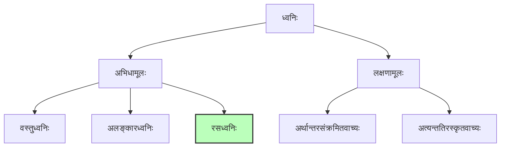
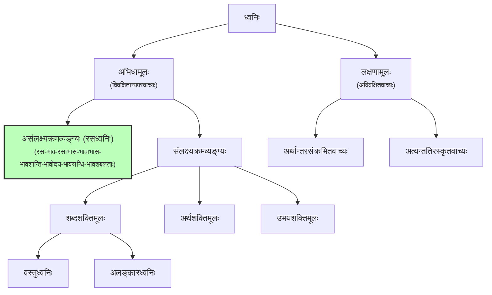

<!--
मुख्यविषयः: अभिधा, लक्षणा, व्यञ्जना च।
विशेषध्यानम्: शब्दार्थयोः स्वरूपनिरूपणं शक्तितत्त्वम् च।
-->

तत्र ध्वनेरुत्तमोत्तमस्यासंख्यभेदस्यापि सामान्यतः केऽपि भेदा निरूप्यन्ते – द्विविधो ध्वनिः,
अभिधामूलो लक्षणामूलश्च। तत्राद्यस्त्रिविधः। रसवस्त्वलङ्कारध्वनिभेदात्।
रसध्वनिरित्यलक्ष्यक्रमोपलक्षणाद्रसभावतदाभासभावशान्तिभावोदयभावसन्धिभावशबलत्वानां
ग्रहणम्। द्वितीयश्च द्विविधः। अर्थान्तरसंक्रमितवाच्योऽत्यन्ततिरस्कृतवाच्यश्च। एवं पञ्चात्मके
ध्वनौ परमरमणीयतया रसध्वनेस्तदात्मा रसस्तावदभिधीयते।

<notes>

**विस्तृतभेदाः**

</notes>
