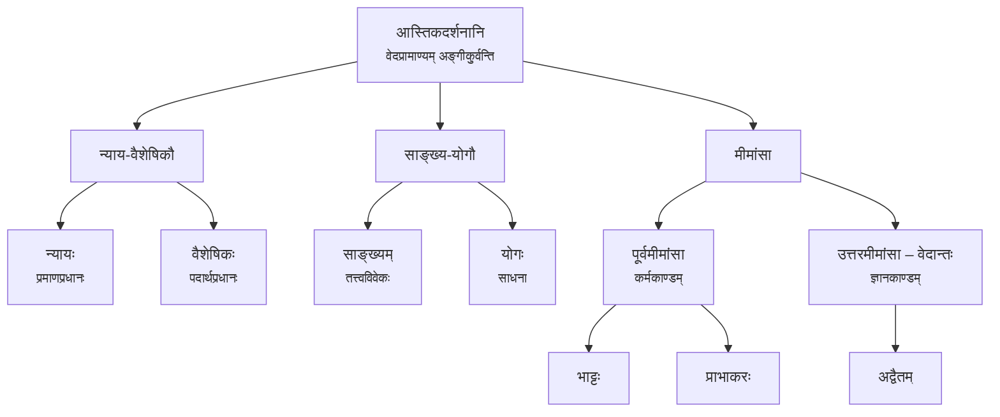

## परिचयः

षण्णाम् आस्तिकदर्शनानां तुलनात्मकं सारसङ्ग्रहणम् । मीमांसायां भाट्ट-प्राभाकरयोः बहुषु विषयेषु मतभेदात् तौ पृथक् गण्येते, अतः सप्त स्तम्भाः । वेदान्ते अद्वैतमतं गृहीतम् ।

| संक्षेपः | दर्शनम् |
| --- | --- |
| न्यायः | [न्यायदर्शनम्]({{ xref("shastra/vividha/nyaya/01") }}) |
| वैशेषिकः | [वैशेषिकदर्शनम्]({{ xref("shastra/vividha/vsk/01") }}) |
| साङ्ख्यम् | [साङ्ख्यदर्शनम्]({{ xref("shastra/vividha/sankhya/01") }}) |
| योगः | [योगदर्शनम्]({{ xref("shastra/vividha/yoga/01") }}) |
| भाट्टः | [मीमांसादर्शनम्]({{ xref("shastra/vividha/mimamsa/01") }}) – कुमारिलभट्टमतम् |
| प्राभाकरः | [मीमांसादर्शनम्]({{ xref("shastra/vividha/mimamsa/01") }}) – प्रभाकरमिश्रमतम् (गुरुमतम्) |
| अद्वैतम् | [वेदान्तदर्शनम्]({{ xref("shastra/vividha/vedanta/01") }}) – शाङ्करम् अद्वैतमतम् |

**समानतन्त्राणि (दर्शनयुग्मानि)** – न्याय-वैशेषिकौ, साङ्ख्य-योगौ, पूर्वमीमांसा-उत्तरमीमांसे (वेदान्तः) ।

## आचार्याः ग्रन्थाश्च

| | न्यायः | वैशेषिकः | साङ्ख्यम् | योगः | भाट्टः | प्राभाकरः | अद्वैतम् |
| --- | --- | --- | --- | --- | --- | --- | --- |
| **सूत्रकारः / प्रवर्तकः** | गौतमः (अक्षपादः) | कणादः | कपिलः | पतञ्जलिः (आदिप्रवर्तकः हिरण्यगर्भः) | जैमिनिः | जैमिनिः | बादरायणः (व्यासः) |
| **मूलग्रन्थः** | न्यायसूत्राणि | वैशेषिकसूत्राणि | साङ्ख्यसूत्राणि; साङ्ख्यकारिका (ईश्वरकृष्णः) | योगसूत्राणि (४ पादाः) | मीमांसासूत्राणि (१२ अध्यायाः) | मीमांसासूत्राणि (१२ अध्यायाः) | ब्रह्मसूत्राणि (४ अध्यायाः) |
| **भाष्यकारः** | वात्स्यायनः | प्रशस्तपादः | — (कारिकायाः गौडपादभाष्यम्) | व्यासः | शबरस्वामी | शबरस्वामी | शङ्कराचार्यः |
| **मतप्रवर्तकः / प्रमुखव्याख्याकाराः** | उद्योतकरः, वाचस्पतिमिश्रः, उदयनः, जयन्तः; नव्यन्याये गङ्गेशः | श्रीधरः (न्यायकन्दली), उदयनः (किरणावली) | वाचस्पतिमिश्रः (तत्त्वकौमुदी), विज्ञानभिक्षुः | वाचस्पतिमिश्रः (तत्त्ववैशारदी), विज्ञानभिक्षुः | कुमारिलभट्टः (श्लोकवार्त्तिकम्, तन्त्रवार्त्तिकम्), पार्थसारथिमिश्रः | प्रभाकरमिश्रः (बृहती), शालिकनाथमिश्रः | सुरेश्वरः, पद्मपादः, वाचस्पतिमिश्रः (भामती), मधुसूदनसरस्वती |
| **नामान्तराणि** | आन्वीक्षिकी, तर्कशास्त्रम् | औलूक्यदर्शनम्, काणादम् | कापिलम् | पातञ्जलदर्शनम् | पूर्वमीमांसा, कर्ममीमांसा | गुरुमतम् | उत्तरमीमांसा, ब्रह्ममीमांसा |

## प्रमाणानि

| प्रमाणम् | न्यायः | वैशेषिकः | साङ्ख्यम् | योगः | भाट्टः | प्राभाकरः | अद्वैतम् |
| --- | --- | --- | --- | --- | --- | --- | --- |
| प्रत्यक्षम् | ✓ | ✓ | ✓ | ✓ | ✓ | ✓ | ✓ |
| अनुमानम् | ✓ | ✓ | ✓ | ✓ | ✓ | ✓ | ✓ |
| उपमानम् | ✓ | ✗ | ✗ | ✗ | ✓ | ✓ | ✓ |
| शब्दः (आगमः) | ✓ | ✗ | ✓ | ✓ | ✓ | ✓ | ✓ |
| अर्थापत्तिः | ✗ | ✗ | ✗ | ✗ | ✓ | ✓ | ✓ |
| अनुपलब्धिः | ✗ | ✗ | ✗ | ✗ | ✓ | ✗ | ✓ |
| **सङ्ख्या** | **४** | **२** | **३** | **३** | **६** | **५** | **६** |
| **अन्येषाम् अन्तर्भावः** | अर्थापत्त्यादयः चतुर्षु एव | शब्दोपमानादयः अनुमाने | उपमानादयः त्रिषु एव | साङ्ख्यवत् | — | अभावः अधिकरणात्मकः, अतः अनुपलब्धिः अनपेक्षिता | व्यवहारे भाट्टवत्; ब्रह्मणि श्रुतिः मुख्या |

**विशेषाः** –

* **परार्थानुमानस्य अवयवाः** – न्यायवैशेषिकयोः पञ्च (प्रतिज्ञा, हेतुः, उदाहरणम्, उपनयः, निगमनम्); मीमांसकानां त्रयः (प्रतिज्ञा-हेतु-उदाहरणानि अथवा उदाहरण-उपनय-निगमनानि) ।
* **साङ्ख्यपरिभाषा** – दृष्टम्, अनुमानम्, आप्तवचनम् ।

## तत्त्वमीमांसा

| | न्यायः | वैशेषिकः | साङ्ख्यम् | योगः | भाट्टः | प्राभाकरः | अद्वैतम् |
| --- | --- | --- | --- | --- | --- | --- | --- |
| **पदार्थाः / तत्त्वानि** | १६ पदार्थाः (प्रमाणप्रमेयादयः) | ७ पदार्थाः (द्रव्यगुणकर्मसामान्यविशेषसमवायाभावाः) | २५ तत्त्वानि | २६ तत्त्वानि (२५ + ईश्वरः) | ५ पदार्थाः (द्रव्यं, जातिः, गुणः, कर्म, अभावः) | ८ पदार्थाः (द्रव्यं, जातिः, गुणः, कर्म, सङ्ख्या, सादृश्यं, शक्तिः, समवायः) | ब्रह्म एकम् एव सत् (व्यवहारे पदार्थविभागः अनपेक्षितः) |
| **द्रव्याणि** | ९ | ९ | — | — | ११ (९ + तमः, शब्दः) | ९ | — |
| **जगतः कारणम्** | परमाणवः (उपादानम्), ईश्वरः (निमित्तम्) | परमाणवः (उपादानम्), ईश्वरः (निमित्तम्) | प्रकृतिः | प्रकृतिः (ईश्वराधिष्ठिता) | — (जगत् अनादि, आत्यन्तिकप्रलयो नास्ति) | — (जगत् अनादि) | ब्रह्म (अभिन्ननिमित्तोपादानकारणम्), मायासहितम् |
| **कार्यकारणवादः** | असत्कार्यवादः (आरम्भवादः) | असत्कार्यवादः (परमाण्वारम्भवादः) | सत्कार्यवादः (परिणामवादः) | सत्कार्यवादः (परिणामवादः) | सदसत्कार्यवादः (भेदाभेदः) | असत्कार्यवादः | सत्कार्यवादः (विवर्तवादः) |
| **ईश्वरः** | स्वीकृतः – जगत्कर्ता, वेदकर्ता | स्वीकृतः | न स्वीकृतः (निरीश्वरसाङ्ख्यम्) | स्वीकृतः – क्लेशकर्मविपाकाशयैरपरामृष्टः पुरुषविशेषः | जगत्कर्ता न स्वीकृतः | जगत्कर्ता न स्वीकृतः | सगुणं ब्रह्म = ईश्वरः (व्यावहारिकः) |
| **वेदाः** | पौरुषेयाः (ईश्वरप्रणीताः) | पौरुषेयाः (ईश्वरप्रणीताः) | अपौरुषेयाः (कर्तुः पुरुषस्य अभावात्), न तु नित्याः | प्रमाणम् (आगमः) | अपौरुषेयाः, नित्याः | अपौरुषेयाः, नित्याः | अपौरुषेयाः (ईश्वरनिःश्वसितम्, प्रवाहनित्याः) |

## ज्ञानमीमांसा

| | न्यायः | वैशेषिकः | साङ्ख्यम् | योगः | भाट्टः | प्राभाकरः | अद्वैतम् |
| --- | --- | --- | --- | --- | --- | --- | --- |
| **ख्यातिवादः (भ्रमः)** | अन्यथाख्यातिः | अन्यथाख्यातिः | सदसत्ख्यातिः | सदसत्ख्यातिः | विपरीतख्यातिः | अख्यातिः (विवेकाख्यातिः) | अनिर्वचनीयख्यातिः |
| **प्रामाण्यवादः** | परतः प्रामाण्यम्, परतः अप्रामाण्यम् | परतः प्रामाण्यम्, परतः अप्रामाण्यम् | स्वतः प्रामाण्यम्, स्वतः अप्रामाण्यम् | स्वतः प्रामाण्यम्, स्वतः अप्रामाण्यम् | स्वतः प्रामाण्यम्, परतः अप्रामाण्यम् | स्वतः प्रामाण्यम्, परतः अप्रामाण्यम् | स्वतः प्रामाण्यम्, परतः अप्रामाण्यम् |
| **ज्ञानस्य ग्रहणम्** | अनुव्यवसायेन (मानसप्रत्यक्षेण) | अनुव्यवसायेन | बुद्धिवृत्तिः पुरुषप्रतिबिम्बेन प्रकाशते | बुद्धिवृत्तिः पुरुषप्रतिबिम्बेन प्रकाशते | अतीन्द्रियम्, ज्ञाततालिङ्गकानुमेयम् | स्वप्रकाशम् (त्रिपुटीप्रत्यक्षम्) | साक्षिभास्यम्; चैतन्यं स्वप्रकाशम् |
| **वाक्यार्थबोधः** | — | — | — | — | अभिहितान्वयवादः | अन्विताभिधानवादः | अभिहितान्वयवादः (भाट्टवत्) |

## आत्मा मोक्षश्च

| | न्यायः | वैशेषिकः | साङ्ख्यम् | योगः | भाट्टः | प्राभाकरः | अद्वैतम् |
| --- | --- | --- | --- | --- | --- | --- | --- |
| **आत्मस्वरूपम्** | द्रव्यम्, विभुः; ज्ञानम् आगन्तुकः गुणः | द्रव्यम्, विभुः; ज्ञानम् आगन्तुकः गुणः | पुरुषः – चेतनः, निर्गुणः, अकर्ता, भोक्ता | पुरुषः – शुद्धचैतन्यस्वरूपः, द्रष्टा | द्रव्यम्, विभुः, कर्ता; चिदचिद्रूपः | द्रव्यम्, जडः, विभुः; ज्ञानम् आगन्तुकः गुणः | सच्चिदानन्दस्वरूपः, ब्रह्माभिन्नः |
| **आत्मसङ्ख्या** | अनेके | अनेके | अनेके (पुरुषबहुत्वम्) | अनेके | अनेके | अनेके | एकः (जीवभेदः औपाधिकः) |
| **बन्धकारणम्** | मिथ्याज्ञानम् | मिथ्याज्ञानम् | अविवेकः (प्रकृतिपुरुषयोः) | अविद्यादयः पञ्च क्लेशाः | काम्यनिषिद्धकर्माणि | काम्यनिषिद्धकर्माणि | अविद्या (अज्ञानम्) |
| **मोक्षस्वरूपम्** | अपवर्गः – आत्यन्तिकदुःखनिवृत्तिः (आनन्दो नास्ति) | आत्यन्तिकदुःखनिवृत्तिः (विशेषगुणोच्छेदः) | कैवल्यम् – दुःखत्रयात्यन्तनिवृत्तिः | कैवल्यम् – पुरुषस्य स्वरूपप्रतिष्ठा | आत्यन्तिकदुःखनिवृत्तिः, शरीरेन्द्रियवियोगः | आत्यन्तिकदुःखनिवृत्तिः (आनन्दानुभवो नास्ति) | ब्रह्मभावः – आनन्दस्वरूपावस्थानम् |
| **मोक्षसाधनम्** | षोडशपदार्थतत्त्वज्ञानम् | सप्तपदार्थानां साधर्म्यवैधर्म्याभ्यां तत्त्वज्ञानम् | विवेकख्यातिः (व्यक्ताव्यक्तज्ञविज्ञानम्) | अभ्यासवैराग्याभ्यां चित्तवृत्तिनिरोधः, अष्टाङ्गयोगः, विवेकख्यातिः | ज्ञानकर्मसमुच्चयः (काम्यनिषिद्धत्यागः, नित्यनैमित्तिकानुष्ठानम्, आत्मज्ञानम्) | कर्मानुष्ठानम्, आत्मज्ञानं च (ज्ञानं कर्माङ्गम्) | ज्ञानादेव तु कैवल्यम् (साधनचतुष्टयम्, श्रवणमनननिदिध्यासनानि) |

## भाट्टप्राभाकरयोः भेदाः

| विषयः | भाट्टः (कुमारिलः) | प्राभाकरः (प्रभाकरः) |
| --- | --- | --- |
| प्रमाणानि | ६ (अनुपलब्धिसहितम्) | ५ |
| पदार्थाः | ५ | ८ |
| द्रव्याणि | ११ | ९ |
| अभावः | पृथक् पदार्थः, अनुपलब्धिग्राह्यः | अधिकरणात्मकः, न पृथक् |
| भ्रमः | विपरीतख्यातिः | अख्यातिः |
| ज्ञानम् | अतीन्द्रियम्, ज्ञाततया अनुमेयम् | स्वप्रकाशम् (त्रिपुटीप्रत्यक्षम्) |
| वाक्यार्थः | अभिहितान्वयवादः | अन्विताभिधानवादः |
| अपूर्वम् | यागजन्या शक्तिः | नियोगः (कार्यम्) |
| प्रत्यक्षम् | निर्विकल्पकं सविकल्पकं च | साक्षात्प्रतीतिः, निर्विकल्पकं सविकल्पकं च |
| मोक्षसाधनम् | ज्ञानकर्मसमुच्चयः | कर्म प्रधानम्, ज्ञानं तदङ्गम् |
