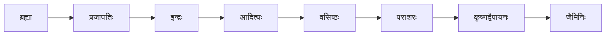
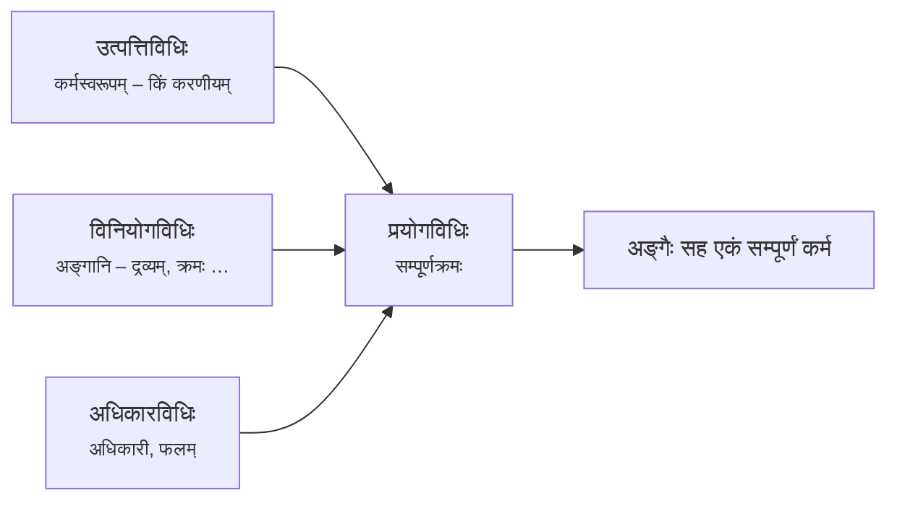
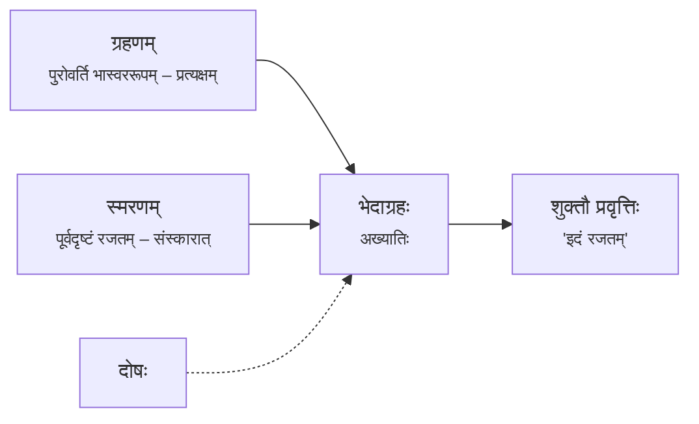
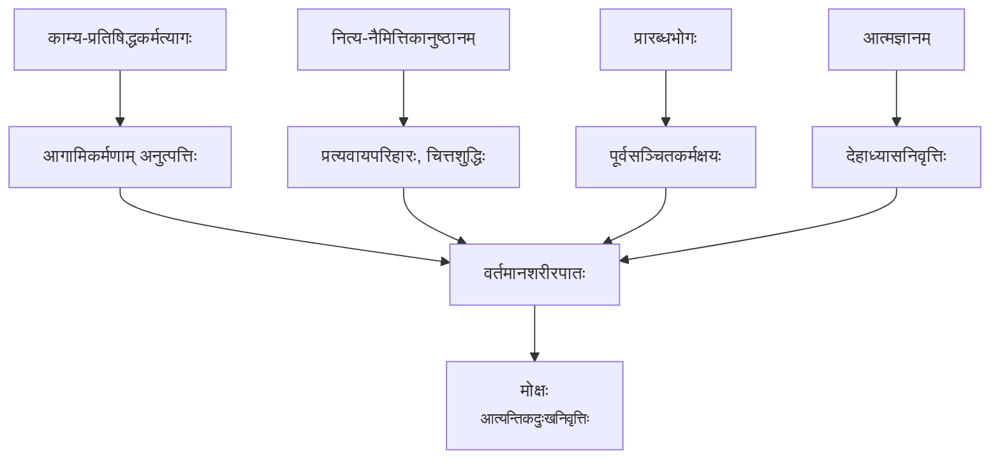

## परिचयः

* मीमांसा = पूजितविचारः ।
* √मान (पूजायाम्) + सन् + अ + टाप् = मीमांसा ।
* मीमांसाशास्त्रम् = धर्माधर्मयोः (वेदवाक्ययोः) विचारः यस्मिन् शास्त्रे ।
* धर्मे प्रमाणं वेदः ।

**नामान्तराणि** – तन्त्रम्, तर्कः, वाक्यशास्त्रम्, धर्मशास्त्रम्, कर्ममीमांसा, धर्ममीमांसा, विचारशास्त्रम्, द्वादशलक्षणी, अध्वरमीमांसा ।

### प्रयोजनम्

* वेदाः अपौरुषेयाः ।
* वेदप्रामाण्यप्रतिष्ठापनद्वारा धर्माधर्मज्ञानप्राप्तिः इति प्रयोजनम् ।

## आचार्याः

* **सूत्रकारः** – महर्षिः जैमिनिः (~500 BC)
* **भाष्यकारः** – शबरस्वामी (200-300 AD)
    * कुमारिलभट्टः (600-660 AD)
    * प्रभाकरगुरुः (610-680 AD)
* **वार्त्तिककारः** – महर्षिः उपवर्षः
    * मुरारिमिश्रः

**अपरे आचार्याः तेषां ग्रन्थाश्च**

| आचार्यः | कालः | ग्रन्थाः |
| --- | --- | --- |
| मण्डनमिश्रः (भाट्टमतानुयायी) | 620-710 AD | विधिविवेकः, विभ्रमविवेकः, भावनाविवेकः, मीमांसानुक्रमणिका, स्फोटसिद्धिः, ब्रह्मसिद्धिः, नैष्कर्म्यसिद्धिः, बृहदारण्यकभाष्यम्, तैत्तिरीयोपनिषद्भाष्यम् |
| उम्बेकः | 700 AD | श्लोकवार्त्तिकस्य टीका |
| वाचस्पतिमिश्रः | 800-900 AD | न्यायसूत्रनिबन्धः, तत्त्वबिन्दुः, न्यायवार्त्तिकटीका, विधिविवेकटीका |
| पार्थसारथिमिश्रः | 1100 AD | न्यायरत्नमाला, तन्त्ररत्नम्, शास्त्रदीपिका, न्यायरत्नाकरः |
| माधवाचार्यः | 1200-1300 AD | पराशरस्मृतिव्याख्या, कालनिर्णयः, जैमिनीयन्यायमालाविस्तरः, यजुर्वेदभाष्यम्, ऋग्वेदभाष्यम्, सामसंहिताभाष्यम्, पञ्चविंशतिब्राह्मणभाष्यम् |
| अप्पयदीक्षितः | 1500 AD | न्यायरत्नमालायाः व्याख्या |

### प्रस्थानानि

कुमारिलभट्टस्य तदनुयायिनां च मतं, मीमांसादर्शने मुख्यतः प्रस्थानद्वयं विद्यते –

* **भाट्टमतम्** – श्रीकुमारिलभट्टेन प्रवर्तितम् ।
* **गुरुमतम् (प्राभाकरमतम्)** – श्रीकुमारिलभट्टस्य मेधाविना शिष्येण श्रीप्रभाकरमिश्रेण प्रवर्तितम् ।
* **मुरारिमतम्** – "मुरारेस्तृतीयः पन्थाः" इति वाक्यबलेन मुरारिमिश्रस्यापि किमपि मतान्तरम् आसीदिति केचन मन्वते, तथापि तस्य ग्रन्थानाम् अनुपलब्धिकारणतः तस्य शास्त्रीयसिद्धान्तपक्षे के विचाराः आसन् इति वक्तुं न शक्यते ।

### आचार्यपरम्परा ग्रन्थपरम्परा च

श्लोकवार्त्तिकव्याख्याने पार्थसारथिः मीमांसापरम्परामित्थमाह –

> ब्रह्मा प्रजापतये प्रोवाच सोऽपीन्द्राय सोऽप्यादित्याय स च वसिष्ठाय सोऽपि पराशराय पराशरः कृष्णद्वैपायनाय । सोऽपि जैमिनये इति । (न्यायरत्नाकरः, श्लोकः २४)

तत्पूर्ववर्ती सुचरितमिश्रस्त्वित्थमाह –

> इहैव कैश्चिदुक्तो ब्रह्मा महेश्वरो वा मीमांसां प्रजापतये प्रोवाच प्रजापतिरिन्द्राय । इन्द्र आदित्यायेत्येवमादि इति । (काशिका, प्रतिज्ञाश्लोकः २४)

**मतद्वयम्**

| | भाट्टप्रस्थानम् | प्राभाकरप्रस्थानम् |
| --- | --- | --- |
| **मूलम्** | जैमिनिसूत्राणि → शाबरभाष्यम् | जैमिनिसूत्राणि → शाबरभाष्यम् |
| **प्रवर्तकः** | कुमारिलभट्टः – श्लोकवार्त्तिकम्, तन्त्रवार्त्तिकम्, टुप्टीका | प्रभाकरमिश्रः – बृहती, लघ्वी |
| **प्रमुखटीकाः** | उम्बेकः – तात्पर्यटीका; सुचरितमिश्रः – काशिका; पार्थसारथिमिश्रः – न्यायरत्नाकरः; सोमेश्वरः – न्यायसुधा | शालिकनाथमिश्रः – ऋजुविमला (बृहत्याः टीका), दीपशिखा (लघ्व्याः टीका) |
| **प्रकरणग्रन्थाः** | पार्थसारथिमिश्रः – शास्त्रदीपिका; खण्डदेवमिश्रः – भाट्टदीपिका; आपदेवः – मीमांसान्यायप्रकाशः; लौगाक्षिभास्करः – अर्थसङ्ग्रहः; नारायणभट्टः – मानमेयोदयः | शालिकनाथमिश्रः – प्रकरणपञ्चिका; भवनाथः – नयविवेकः; रामानुजाचार्यः – तन्त्ररहस्यम् |

## वेदाः

**अपौरुषेयं वाक्यं वेदः ।** स च विधि-मन्त्र-नामधेय-निषेध-अर्थवादभेदात् पञ्चविधः ।

मीमांसाशास्त्रीयवेदविभागाः (वाक्यगतभेदाः / अर्थगतभेदाः) –

| विभागः | लक्षणम् (अर्थसङ्ग्रहानुसारम्) | उदाहरणम् |
| --- | --- | --- |
| विधिः | अज्ञातार्थज्ञापको वेदभागो विधिः । | अग्निहोत्रं जुहुयात् स्वर्गकामः । |
| मन्त्रः | प्रयोगसमवेतार्थस्मारकाः मन्त्राः । | अग्नये जुष्टं निर्वपामि । |
| नामधेयम् | विधेयार्थपरिच्छेदकतया अर्थवत्त्वं नामधेयानाम् । | उद्भिदा यजेत पशुकामः । |
| निषेधः | पुरुषस्य अनर्थकरात् कर्मणः निवर्तकं वाक्यं निषेधः । | न कलञ्जं भक्षयेत् । |
| अर्थवादः | प्राशस्त्यनिन्दान्यतरलक्षणया विध्यर्थवादः, विधिशेषत्वेनैव अर्थवत्त्वम् । | वायुर्वै क्षेपिष्ठा देवता । |

अन्यत्र वेदविभागः काण्डशः क्रियते –

* **संहिता** – यागापेक्षिताः मन्त्राः ।
* **ब्राह्मणम्** – अर्थनिरूपणपरभागः ।
* **आरण्यकम्** – अर्थनिरूपणपरभागः (अरुणप्रश्नः, उत्तरोत्तरक्रियादिषु उपयुज्यमानाः मन्त्राः) ।
* **उपनिषद्** – ज्ञानकाण्डम् ।

### विधिः

* अज्ञातार्थज्ञापको वेदभागो विधिः ।
* प्रयोजनवत्त्वे सति अप्राप्तार्थप्रापकत्वं विधेः लक्षणम् । (वेदाः एव प्रमाणम्)

विधिश्चतुर्विधः – उत्पत्ति-विनियोग-प्रयोग-अधिकारविधिश्चेति ।

| विधिः | विषयः |
| --- | --- |
| **उत्पत्तिविधिः** | किं करणीयम् |
| **विनियोगविधिः** | किं द्रव्यम्, कः विधिः, क्रमः, … |
| **प्रयोगविधिः** | कर्मणः सम्पूर्णक्रमः – यागात् पूर्वं किम्, अनन्तरं किम्, … |
| **अधिकारविधिः** | अधिकारी, फलम् |

### अधिकारविधिः, कर्मणां स्वरूपं च

कर्मजन्यफलस्वाम्यबोधको विधिः अधिकारविधिः ।

| कर्म | उदाहरणम् |
| --- | --- |
| **नित्यकर्म** | अहरहः सन्ध्यामुपासीत । |
| **नैमित्तिककर्म** | यस्याहिताग्नेरग्निर्गृहान् दहेत् सोऽग्नये क्षामवतेऽष्टाकपालं निर्वपेत् । |
| **काम्यकर्म** | यजेत स्वर्गकामः । |

## अधिकरणस्य स्वरूपम्

विषयो विशयश्चैव पूर्वपक्षस्तथोत्तरम् ।  
सङ्गतिश्चेति पञ्चाङ्गं शास्त्रेऽधिकरणं विदुः ॥

1. **विषयः** – विचार्यं वेदवाक्यम् ।
2. **विशयः (संशयः)** – वेदवाक्यस्य समन्वयः कथं कर्तव्यः, इत्यादि संशयः ।
3. **पूर्वपक्षः**
4. **उत्तरम् (सिद्धान्तः)**
5. **सङ्गतिः**

## धर्मः

वेदे प्रतिपादितः स्यात्, सप्रयोजनोऽपि स्यात् ।

* चोदनालक्षणोऽर्थो धर्मः । (जै० सू० १।१।२)
* वेदप्रतिपाद्यः प्रयोजनवदर्थो धर्मः ।
* यागादिरेव धर्मः ।

### यागस्वरूपम्

| | लक्षणम् | उदाहरणम् |
| --- | --- | --- |
| **यागः** | देवतोद्देशेन द्रव्यत्यागप्रधानकः प्रक्षेपाङ्गकः यागः । | इष्टियागः, राजसूययागः, अश्वमेधयागः, सोमयागः |
| **होमः** | देवतोद्देशेन द्रव्यत्यागाङ्गकः प्रक्षेपप्रधानकः होमः । | रुद्रहोमः, शान्तिहोमः |

## मीमांसादर्शनस्य प्रमुखाः सिद्धान्ताः

1. **प्रमाणसिद्धान्तः** – मीमांसादर्शने पञ्च (भाट्टमते षट्) प्रमाणानि स्वीकृतानि सन्ति । तानि च प्रत्यक्षम्, अनुमानम्, उपमानम्, शब्दः, अर्थापत्तिश्च (भाट्टमते अनुपलब्धिश्च) ।
2. **यागस्य द्विरूपत्वम्** – यागस्य द्वे रूपे द्रव्यं देवता च इत्यस्ति मीमांसकानां सिद्धान्तः । यागे यदि द्रव्यं न भवति तदा यागो न विधीयते, यदि वा यागे देवतायाः ज्ञानं न भवति तदा अपि यागो न विधीयते । अतः यागस्य द्रव्यरूपत्वं देवतारूपत्वं च विद्यते ।
3. **वेदापौरुषेयत्वम्** – मीमांसादर्शने वेदाः अपौरुषेयाः सन्ति । अर्थात् वेदाः न केनापि पुरुषेण कृताः रचिताः वा । वेदाः अनादयः सन्ति । ईश्वरः अपि वेदं स्मृत्वा एव उपदिशति । स्मरणं ज्ञातस्य एव पदार्थस्य भवति । ईश्वरः यं पदार्थं स्मरति, सः पदार्थस्तु ईश्वरात् प्रागेव स्यात् । स चार्थः वर्तते वेद एव ।
4. **संसारस्य अनादित्वम्** – मीमांसादर्शनमते संसारः अनादिः वर्तते । प्रलयस्य, तत्रापि आत्यन्तिकस्य प्रलयस्य स्वीकारः मीमांसादर्शने नास्ति । संसारः अनादिः अस्ति अत एव वेदोऽपि अनादिः एव भवति ।
5. **आख्यातार्थः** – मीमांसादर्शनं शाब्दबोधप्रसङ्गे प्रत्ययार्थेन भावना वाच्या भवतीति स्वीकरोति ।

## प्रमाणानि

प्रमेयसिद्धिः प्रमाणात् हि इत्यस्ति कश्चन नियमः, अर्थात् प्रमेयस्य सिद्धिः प्रमाणसिद्धेः परमेव भवति ।

भाट्टमते प्रमाणानि षट् – प्रत्यक्षानुमानोपमानशब्दार्थापत्त्यनुपलब्धिभेदात् । प्रभाकरमते पञ्चैव ।

| प्रमाणम् | भाट्टमतम् | प्राभाकरमतम् |
| --- | --- | --- |
| प्रत्यक्षम् | ✓ | ✓ |
| अनुमानम् | ✓ | ✓ |
| उपमानम् | ✓ | ✓ |
| शब्दः | ✓ | ✓ |
| अर्थापत्तिः (दृष्टार्थापत्तिः, श्रुतार्थापत्तिः) | ✓ | ✓ |
| अनुपलब्धिः | ✓ | ✗ |
| **सङ्ख्या** | **६** | **५** |

### प्रत्यक्षम्

प्राभाकराः वदन्ति यत् 'साक्षात्प्रतीतिः प्रत्यक्षम्' इति । अर्थात् 'अबाधितेन्द्रियार्थसन्निकर्षजन्यज्ञानमेव प्रत्यक्षं' भवति । प्रत्यक्षं द्विविधं भवति – निर्विकल्पकं सविकल्पकं च । साक्षात् या प्रतीतिः भवति तदेव प्रत्यक्षं भवति । कुमारिलभट्टमते तु कारणदोषरहितम् इन्द्रियार्थसन्निकर्षजं ज्ञानं प्रत्यक्षम् ।

### अनुमानम्

न्यायदर्शननिभं मीमांसा अपि अनुमानं स्वीकरोति, किन्तु **परार्थानुमाने त्रयः एव अवयवाः** मीमांसामते स्वीक्रियन्ते (प्रतिज्ञा + हेतुः + उदाहरणम् अथवा उदाहरणम् + उपनयः + निगमनम्) ।

### उपमानम्

अत्रापि न्यायदर्शने यथा उपमानं स्वीकृतं वर्तते तथैव मीमांसायामपि वर्तते । उपमानप्रमाणं सादृश्यज्ञानमूलकं भवति । मीमांसकानां मते उपमानतया स्मृतस्य गोः दृश्यमानगवयेन सादृश्यज्ञानमेव उपमानं भवति ।

### शब्दः

यस्य श्रवणात् परम् अर्थबोधो जायते स शब्दः । शब्दप्रमाणं द्विविधं भवति – पौरुषेयम् अपौरुषेयं च । पौरुषेयम् आप्तवाक्यं भवति, अपौरुषेयं च वेदवाक्यं भवति । मीमांसामते शब्दः नित्यः भवति । शब्दस्य अर्थेन सह यः सम्बन्धः सोऽपि नित्यः एव ।

### अर्थापत्तिः

अनुपपद्यमानार्थदर्शनात् तदुपपादकार्थकल्पनम् अर्थापत्तिः । सा द्विविधा – दृष्टार्थापत्तिः, श्रुतार्थापत्तिः च ।

* **दृष्टार्थापत्तिः** – "पीनो देवदत्तो दिवा न भुङ्क्ते" इति दृष्टे, पीनत्वस्य अन्यथानुपपत्त्या "रात्रौ भुङ्क्ते" इति कल्पनम् ।
* **श्रुतार्थापत्तिः** – "पीनो देवदत्तो दिवा न भुङ्क्ते" इति वाक्ये श्रुते, तदर्थानुपपत्त्या "रात्रौ भुङ्क्ते" इति वाक्यस्य कल्पनम् ।

### अनुपलब्धिः (केवलं भाट्टमते)

योग्यानुपलब्धिः अभावस्य ग्राहकं प्रमाणम् । "भूतले घटो नास्ति" इति ज्ञानं, यदि घटः स्यात् तर्हि उपलभ्येत, न उपलभ्यते, अतः नास्ति – इत्येवं घटाभावः अनुपलब्ध्या गृह्यते । भाट्टमते अभावः पृथक् पदार्थः, तस्य ग्राहकं च पृथक् प्रमाणम् ।

## पदार्थाः

| भाट्टमतम् (५) | प्राभाकरमतम् (८) |
| --- | --- |
| द्रव्यम् | द्रव्यम् |
| जातिः | जातिः |
| गुणः | गुणः |
| कर्म | कर्म |
| अभावः | — |
| — | सङ्ख्या |
| — | सादृश्यम् |
| — | शक्तिः |
| — | समवायः |

**कुमारिलभट्टमते पदार्थाः**

द्रव्यं जातिर्गुणः कर्माप्यभावश्चेति पञ्चधा ।  
प्रमेयं विभजन्त्येते कुमारिलमतानुगाः ॥

**प्राभाकरमते पदार्थाः**

द्रव्यजातिगुणाः कर्म सङ्ख्यासादृश्यशक्तयः ।  
समवाय इतीमेऽष्टौ पदार्था गुरुसम्मताः ॥

### द्रव्याणि

| भाट्टमतम् (११) | प्राभाकरमतम् (९, यथा न्यायमते) |
| --- | --- |
| पृथिवी | पृथिवी |
| जलम् | जलम् |
| तेजः | तेजः |
| वायुः | वायुः |
| आकाशः | आकाशः |
| कालः | कालः |
| दिक् | दिक् |
| आत्मा | आत्मा |
| मनः | मनः |
| तमः | — |
| शब्दः | — |

**कुमारिलभट्टमते द्रव्याणि** – क्षित्यप्तेजोमरुद्व्योमदिक्कालात्ममनस्तमःशब्दभेदेन द्रव्यमेकादशविधम् ।

पृथिवी सलिलं तेजः पवमानस्तमस्तथा ।  
व्योमकालदिगात्मानो मनः शब्द इति क्रमात् ॥

**प्राभाकरमते द्रव्याणि** – द्रव्याणि च पृथिव्यप्तेजोवाय्वाकाशकालदिगात्ममनांसि च नवैव ।

भूजलाग्निमरुद्व्योमकालदिक्चित्तचेतनाः ।  
नव द्रव्याणि लक्ष्यन्ते स्वात्मजारम्भकत्वतः ॥

## प्राभाकरमतस्य प्रमुखाः सिद्धान्ताः

मीमांसादर्शने आचार्यप्रभाकरमिश्रप्रणीतं मतं प्राभाकरमतम् (अथवा 'गुरुमतम्') इति विश्रुतम् अस्ति । कुमारिलभट्टपादैः सह शास्त्रार्थे बहुषु विषयेषु वैषम्यं धारयत् इदं मतं स्वकीयया सूक्ष्मदृष्ट्या तार्किकदृढतया च प्रसिद्धम् । प्राभाकरमतस्य प्रमुखाः सिद्धान्ताः अत्र विस्तरेण प्रस्तूयन्ते –

### १. अख्यातिवादः (भ्रान्तिस्वरूपम्)

ज्ञानस्य याथार्थ्यविषये प्रभाकराणां सिद्धान्तः अख्यातिवादः इति उच्यते ।

* **सर्वेषां ज्ञानानां यथार्थत्वम्** – प्रभाकरमते भ्रान्तिर्नाम किञ्चित् विपरीतमसद् वा ज्ञानं न, अपि तु ज्ञानाभावः (विवेकाख्यातिः) एव । सर्वेऽपि प्रत्ययाः यथार्थाः सन्ति ("यथार्थं सर्वविज्ञानम्" इति प्राभाकरघोषः) ।
* **शुक्तिरजतदृष्टान्तः** – शुक्तौ यदा "इदं रजतम्" इति ज्ञानं जायते, तदा वस्तुतः ज्ञानद्वयं वर्तते –
    1. पुरोवर्तिनः भास्वररूपमात्रस्य ग्रहणम् (प्रत्यक्षम्) ।
    2. पूर्वदृष्टस्य रजतस्य स्मरणम् (संस्कारात्) ।
* **दोषः विवेकस्याग्रहः** – अत्र दोषवशात् तयोः ग्रहणस्मरणयोः भेदः (विवेकः) न गृह्यते । अस्य भेदाग्रहस्य (अख्यातेः) कारणेनैव पुरुषः रजते इव शुक्तौ प्रवृत्तो भवति । अतः विपरीता ख्यातिः (अन्यथाख्यातिः) नास्ति, केवलं भेदस्याग्रहः एव अस्ति ।

### २. त्रिपुटीप्रत्यक्षवादः (स्वप्रकाशत्वम्)

ज्ञानस्य प्रकाशविषये प्राभाकराः त्रिपुटीप्रत्यक्षवादं स्वीकुर्वन्ति ।

**त्रिपुटी** – यस्मिन् कस्मिन्नपि ज्ञाने युगपदेव त्रयः अंशाः प्रकाश्यन्ते –

1. ज्ञाता (आत्मा)
2. ज्ञेयम् (घटादिविषयः)
3. ज्ञानम् (स्वयम्)

**ज्ञानं स्वप्रकाशम्** – ज्ञानं स्वस्य प्रकाशाय अन्यज्ज्ञानं नापेक्षते; यथा दीपः घटं प्रकाशयन् आत्मानमपि स्वयमेव प्रकाशयति । भट्टमते ज्ञानम् अतीन्द्रियं ज्ञाततालिङ्गकानुमेयं च, किन्तु प्रभाकरमते ज्ञानं प्रत्यक्षं स्वप्रकाशं च भवति ।

### ३. अन्विताभिधानवादः (वाक्यार्थविचारः)

शब्दानाम् अर्थबोधविषये प्रभाकरैः अन्विताभिधानवादः प्रतिष्ठापितः ।

<notes>सर्वाणि पदानि स्वीयार्थेषु प्रागेव समन्वितानि सन्ति, ततः ज्ञानं जनयन्ति ।</notes>

* **संसृष्टार्थबोधकत्वम्** – भट्टानाम् 'अभिहितान्वयवादे' पदानि पृथक् पृथक् स्वमर्थमभिदधति, पश्चाद् आकाङ्क्षादिभिः वाक्यार्थः संसृज्यते । किन्तु प्रभाकराणां मते पृथक्पदार्थानां पृथक् सत्ता नास्ति ।
* **कार्यान्वितपदार्थः** – पदानि स्वार्थम् इतरान्वितमेव अभिदधति । बालः वृद्धव्यवहारं दृष्ट्वा (यथा – "गामानय") कार्यान्वितेष्वेव वाक्येषु पदशक्तिं गृह्णाति । अतः पदैः अन्वितः एव अर्थः अभिधीयते, न तु असम्बद्धः ।

### ४. पञ्चप्रमाणानि

भाट्टमीमांसकाः षट् प्रमाणानि स्वीकुर्वन्ति, किन्तु प्रभाकराः पञ्च एव प्रमाणानि अङ्गीकुर्वन्ति –

1. **प्रत्यक्षम्** – इन्द्रियार्थसन्निकर्षजन्यं ज्ञानम् ।
2. **अनुमानम्** – व्याप्तिज्ञानाधीनम् ।
3. **उपमानम्** – सादृश्यज्ञानम् (अत्र भाट्टमतात् किञ्चित् भेदः अस्ति, यत्र सादृश्यं ज्ञायते) ।
4. **शब्दः** – आप्तोपदेशः तथा वेदवाक्यम् ।
5. **अर्थापत्तिः** – अनुपपद्यमानार्थदर्शनात् तदुपपादकार्थकल्पनम् ।

**अनुपलब्धेः निरासः** – प्रभाकराः अनुपलब्धिं पृथक् प्रमाणत्वेन न मन्यन्ते । तेषां मते अभावो नाम न कश्चित् पृथक् पदार्थः, अपि तु 'अधिकरणात्मकः' एव । भूतले घटाभावः इत्युक्ते केवलं केवलभूतलस्यैव प्रत्यक्षं भवति ।

### ५. अपूर्वस्वरूपम् (कार्यनियोगः)

कर्ममीमांसायां यागादिकर्मणः फलप्राप्तये 'अपूर्वम्' उभयोरपि सम्मतम्, किन्तु तस्य व्याख्याने भेदः –

* **नियोगः (कार्यम्)** – प्रभाकराणां मते वैदिकलिङादिश्रवणेन यत् प्रतीयते, तत् "इदं मया कर्तव्यम्" इति कार्यम् (नियोगः) एव ।
* इदं कार्यं यागस्य विनष्टेऽपि तिष्ठति, अत एव इदं 'अपूर्वम्' इति कथ्यते । एष एव नियोगः प्रेरयिता सन् कर्त्रे स्वर्गं वा फलान्तरं प्रयच्छति ।
* वेदानां मुख्यं प्रयोजनं कार्यप्रतिपादनमेव, न तु सिद्धवस्तुप्रतिपादनम् ।

### ६. आत्मस्वरूपं मोक्षश्च

* **आत्मा जडः विभुश्च** – प्राभाकरनये आत्मा स्वतो ज्ञानरूपः न भवति, अपि तु जडः द्रव्यात्मा च । ज्ञानम् अस्य नित्यगुणो न, अपि तु मनसा आत्मनः संयोगात् शरीरे उत्पद्यमानः आगन्तुकः गुणः ।
* **मोक्षः** – मोक्षावस्थायां शरीरेन्द्रियादिवियोगात् आत्मनः सर्वे विशेषगुणाः (सुख-दुःख-ज्ञानादयः) विनश्यन्ति । अतः मोक्षे आनन्दानुभवः नास्ति; आत्यन्तिकदुःखनिवृत्तिरेव, आत्मनः स्वभावावस्थानमेव च मोक्षः ।

<notes>प्रभाकरमते आत्मा ज्ञानरूपो न भवति, यदा पदार्थसंयोगः तदा एव ज्ञानम् उदेति – ज्ञानम् आगन्तुकः गुणः । मोक्षः = दुःखनिवृत्तिः, न तु आनन्दानुभवः ।</notes>

## मोक्षः तत्प्रापकसाधनानि च

मीमांसादर्शने (विशेषतः पूर्वमीमांसायां) मोक्षस्य विचारः, तस्य स्वरूपं, तत्प्राप्तेः साधनानि च अत्यन्तं वैशिष्ट्यपूर्णानि सन्ति । प्रारम्भे जैमिनिसूत्रेषु मुख्यतया धर्मस्य, यज्ञयागादिकर्मणां, स्वर्गप्राप्तेश्च विचारः आसीत् । किन्तु उत्तरकाले कुमारिलभट्टेन (भाट्टमते) तथा प्रभाकरमिश्रेण (प्राभाकरमते) मोक्षस्य आत्यन्तिकं स्वरूपं प्रतिपाद्य तदुपयोगीनि साधनानि विशदीकृतानि ।

मीमांसकमते आत्यन्तिकी दुःखनिवृत्तिः, आत्मनः शरीरेन्द्रियैः सह सर्वथा वियोगः, स्वस्वरूपे अवस्थानं च 'मोक्षः' इति उच्यते । तस्य प्राप्तेः प्रमुखाणि साधनानि अत्र निरूप्यन्ते ।

### १. काम्यप्रतिषिद्धकर्मपरित्यागः

मोक्षार्थी पुरुषः सर्वाणि कर्माणि न त्यजति, अपि तु कर्मणां विवेकपूर्वकं त्यागम् आचरणं च करोति ।

* **काम्यकर्मत्यागः** – स्वर्गादि-ऐहिक-पारलौकिकसुखप्राप्तये विहितानि कर्माणि (यथा – ज्योतिष्टोमादयः) काम्यकर्माणि उच्यन्ते । काम्यकर्मणां करणेन जन्मान्तराणां बन्धनं दृढं भवति । अतः मोक्षार्थी सर्वाणि काम्यकर्माणि परित्यजेत् ।
* **प्रतिषिद्धकर्मत्यागः** – शास्त्रनिषिद्धानि कर्माणि (यथा – कलञ्जभक्षणं, हिंसादयः), येषां करणे नरकपातलक्षणं पातकं भवति, तानि सर्वाणि प्रतिषिद्धकर्माणि सर्वथा वर्जयेत् ।
* **फलम्** – एतेन कर्मद्वयत्यागेन आगामिनः शरीरेन्द्रियभोगस्य (नवीनजन्मनः) कारणानि नश्यन्ति ।

### २. नित्यनैमित्तिककर्मणाम् अनुष्ठानम्

मीमांसादर्शनस्य एषः अत्यन्तं दृढः सिद्धान्तः यत् मोक्षार्थिना कर्मणां संन्यासो न कार्यः, अपि तु विशिष्टकर्मणाम् अनिवार्यतया अनुष्ठानं करणीयम् ।

* **प्रत्यवायपरिहारार्थम्** – सन्ध्यावन्दन-अग्निहोत्रादीनि नित्यकर्माणि, जातकर्म-श्राद्धादीनि नैमित्तिककर्माणि च पुरुषेण अवश्यं करणीयानि ।

### ३. प्रारब्धभोगेन पूर्वसञ्चितकर्मक्षयः

* शरीरधारणस्य कारणं पूर्वजन्मसञ्चितानि कर्माणि एव सन्ति ।
* यानि कर्माणि फलप्रदानाय प्रवृत्तानि (प्रारब्धकर्माणि), तेषां क्षयः केवलं भोगेनैव भवति ("नाभुक्तं क्षीयते कर्म कल्पकोटिशतैरपि" इति न्यायेन) ।
* मोक्षार्थी सुखदुःखादीन् प्रसन्नतया भुक्त्वा प्रारब्धं समापयति । नूतनकर्मणाम् अनुत्पादात् (काम्यप्रतिषिद्धत्यागात्) तथा पूर्वकर्मणां भोगेनावसाने सति जन्मान्तरकारणं न अवशिष्यते ।

### ४. आत्मज्ञानम् (आत्मस्वरूपविचारः)

कर्ममीमांसायां कर्मैव प्रधानं चेदपि उत्तरकालीनैः मीमांसकैः आत्मज्ञानम् आवश्यकं स्वीकृतम् ।

* **अनात्मबुद्धिनिवृत्तिः** – देहातिरिक्तस्य, नित्यस्य, विभोः, कर्तुः, भोक्तुश्च आत्मनः यथार्थं ज्ञानं कर्मप्रवृत्तये तथा संसारनिवृत्तये उपकरोति ।
* शरीरे इन्द्रियेषु च "अहम्-मम" इति भ्रान्तेः निवृत्तये उपनिषद्वाक्यविचारद्वारा आत्मज्ञानं सम्पादनीयम् ।
* **ज्ञानस्य अङ्गभावः** – वेदान्तिनः इव मीमांसकाः ज्ञानमेव साक्षात् मोक्षसाधनं न मन्यन्ते, अपि तु ज्ञानं कर्मणः अङ्गत्वेन, अनात्मवैराग्यार्थं च सहकारित्वेन वर्तते ।

### ५. ज्ञानकर्मसमुच्चयः (भाट्टदृष्ट्या)

कुमारिलभट्टस्य मते केवलेन ज्ञानेन वा केवलेन कर्मणा मोक्षो न सिध्यति ।

* यथा पक्षिणः द्वाभ्यां पक्षाभ्यामेव आकाशे उड्डयनं सम्भवति, तथैव कर्मणा ज्ञानेन च उभयोः समुच्चयेन मोक्षः प्राप्यते ।
* कर्मणा अन्तःकरणस्य दोषक्षयः पापक्षयश्च भवति, ज्ञानेन च कर्तृत्व-भोक्तृत्व-यथार्थबोधेन सह आत्मनि अवस्थानं सिध्यति ।

### सारांशः

| क्रमः | साधनम् | प्रयोजनम् / परिणामः |
| --- | --- | --- |
| १ | काम्यकर्मत्यागः | नूतन-स्वर्गादि-भोगशरीरस्य अनुत्पत्तिः |
| २ | प्रतिषिद्धकर्मत्यागः | नरकपात-दुःखभोग-निवारणम् |
| ३ | नित्य-नैमित्तिकानुष्ठानम् | अकरणजन्यप्रत्यवायदोषस्य परिहारः, चित्तशुद्धिः च |
| ४ | प्रारब्धभोगः | भुक्त्वा पूर्वसञ्चितकर्मणां समूलक्षयः |
| ५ | आत्मज्ञानम् | देहाध्यासनिवृत्तिः, आत्मस्वरूपे अवस्थानम् |

एतेन विधानेन यदा वर्तमानशरीरस्य पातः भवति, तदा पूर्वकर्मणां भोगात् क्षयः जातः, नूतनानां कर्मणाम् उत्पादः न कृतः, प्रत्यवायश्च निवारितः । अतः कारणाभावात् कार्याभाववत् पुनर्जन्मनः सम्भावना नश्यति; आत्मा च प्राकृतशरीरेन्द्रियादिवियोगलक्षणम् आत्यन्तिकं मोक्षं प्राप्नोति ।
