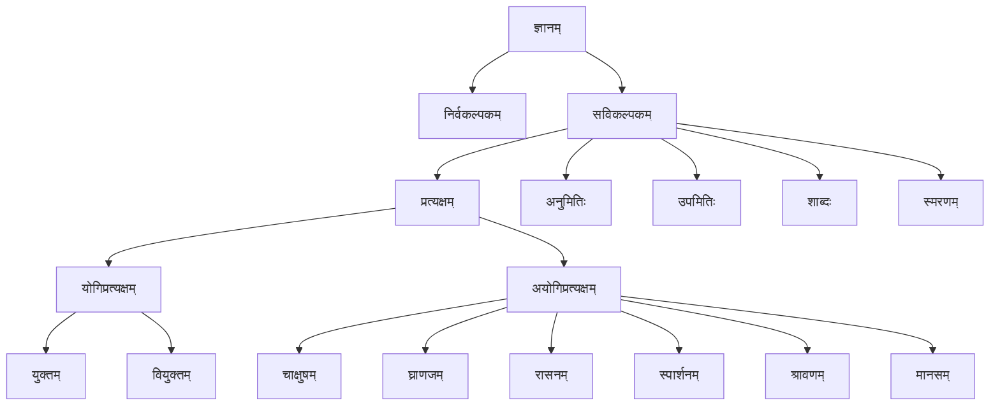

## व्युत्पत्तिः

न्यायशास्त्रम् = तर्कशास्त्रम् = आन्वीक्षिकी ।

* षोडश पदार्थानां मध्ये प्रधानतमः न्यायः ।  
  प्रतिज्ञा, हेतुः, उदाहरणं, उपनयः, निगमनं चेति पञ्चावयवानां समुदायः न्यायः ।
* नीयते अनेन इति न्यायः ।
* प्राप्यते विवक्षितार्थसिद्धिः अनेन इत्यतः विवक्षितार्थसिद्धिप्रापकः प्रतिज्ञादि-पञ्चावयवसमूहः न्यायः इत्युच्यते।
* न्यायः संशयनिवर्तकः (संशयनाशकः) एवं निर्णायकः भवति ।

## प्रयोजनम्

मोक्ष एव अस्य शास्त्रस्य परमं प्रयोजनम् । पदार्थतत्त्वज्ञानं^१ मुक्तिकारणम् ।  
संसारबन्धनस्य मूलं मिथ्याज्ञानम् (मिथ्याज्ञानं शरीरे आत्मत्वभ्रमः)।
दुःखजन्मप्रवृत्तिदोषमिथ्याज्ञानानाम् उत्तरोत्तराभावे पूर्वपूर्वविनाशेन अपवर्गो भवति^२ ।  
 
१ 'प्रमाणप्रमेयसंशयप्रयोजनदृष्टान्त-सिद्धान्तावयवतर्कनिर्णयवादजल्पवितण्डाहेत्वाभासच्छलजातिनिग्रहस्थानानां तत्त्वज्ञानाद् निःश्रेयसाधिगमः' । (न्या०सू०)  
२ 'दुःखजन्मप्रवृत्तिदोषमिथ्याज्ञानानाम् उत्तरोत्तरापाये तदनन्तरापायाद् अपवर्गः' । (न्या०सू०)  
&emsp;एवं मिथ्याज्ञान-दोष-प्रवृत्ति-जन्म-दुःखानि अविच्छेदेन
प्रवर्तमानानि संसारमनुवर्तयन्ति इति जीवानां दुर्दशा। यदा तु सदुपदेशभाजः अधिकारिणः
समाधिभावननिर्वेदवैराग्ययोगादिना प्रमेयतत्त्वज्ञानं जन्यते तदा सवासनं मिथ्याज्ञानं चिरन्तनमप्यपैति ।
मिथ्याज्ञाननाशे दोषा रागादयः अपयन्ति। दोषापाये प्रवृत्तिरपयाति। प्रवृत्यपाये जन्मापैति । जन्मापाये
दुःखमपैति । दुःखापाये चात्यन्तिको अपवर्गः - निःश्रेयसम् अधिगम्यते।

## आचार्याः

* **न्यायसूत्रकारः** – भगवान् गौतमः।
* **भाष्यकारः** – वात्स्यायनः ।
* **वार्तिकम्** – उद्योतकरः।
* **वार्तिकतात्पर्यम्** - वाचिस्पतिमिश्रः ।
* **तात्पर्यटीकापरिशुद्धिः** – उदयनाचार्यः ।
* **न्यायमञ्जरी** – जयन्तः ।
* **नव्यन्यायशास्त्रप्रवर्तकः, तत्त्वचिन्तामणिः** – गङ्गेशोपाध्यायः ।
* **दीधितिः** – रघुनाथशिरोमणिः
* **गादाधरी** – गदाधरभट्टाचार्यः

## वेदाः पौरुषेयाः

अस्मिन् दर्शने वेदः पौरुषेयोऽभ्युपगम्यते। कार्यत्वहेतुना ईश्वरसिद्धिं ब्रुवाणाः नैय्यायिकाः
सर्वज्ञेश्वरप्रणीतत्वात् वेदानां प्रामाण्यमिति सङ्गिरन्ते। अतः न्यायमते वेदाः पौरुषेयाः।

## पदार्थाः

* प्रमाण  
  प्रत्यक्षानुमानोपमानशब्दाः चत्वारि प्रमाणानि। अर्थापत्तिसम्भवादीनां चतुर्व्वव प्रमाणेषु अन्तर्भावयन्ति। 
* प्रमेय
* संशय
* प्रयोजन
* दृष्टान्त
* सिद्धान्त
* अवयव
* तर्क
* निर्णय
* वाद
* जल्प
* वितण्डा
* हेत्वाभास
* छल
* जाति
* निग्रहस्थानम्

### प्रमाणानि

प्रत्यक्षानुमानोपमानशब्दाः चत्वारि प्रमाणानि। अर्थापत्तिसम्भवादीनां चतुर्व्वव प्रमाणेषु अन्तर्भावयन्ति।

* प्रत्यक्षम्
* अनुमानम्
* उपमानम्
* शब्दः

### प्रमेयाः

द्वादश प्रमेयाः (हेयोपादेयभेदेन द्विधा परिगण्यन्ते)

* आत्मा (जीवात्मा, परमात्मा च)
* शरीरम् (चेष्टेन्द्रियार्थाश्रयः शरीरम्)
* इन्द्रियाणि (बहिर्वस्तुविषयकज्ञानसाधनमिन्द्रियम्)
* अर्थाः
* बुद्धिः (बुद्धिर्नाम ज्ञानम्)
* मनः
* प्रवृत्तिः  
  प्रयत्नजन्यं कर्म प्रवृत्तिः । (शुभमशुभं वा कर्म)  
  कायिकम्, वाचिकम्, मानसिकम् ।
* दोषाः (रागद्वेषौ इच्छाऽमर्षों। मोहो मिथ्याज्ञानम्)
* प्रेत्यभावः (जन्मान्तरं प्रति कारणम्)
* फलम् (प्रवृत्तिदोषजनितोऽर्थः फलम्)
* दुःखम्
* अपवर्गः (आत्यन्तिकदुःखनिवृत्तिः अपवर्गः)

**कथमेषामेव प्रमेयत्वम्**

* भोगसम्बन्धादेव एतेषां प्रमेयत्वम् ।
* भोगो हि संसारः। भोगो नाम सुखदुःखान्यतरसाक्षात्कारः। चक्रारपङ्किरिव अनुवर्तमानः सुखदुःखोपभोगः।
* आत्मा भोक्ता - भोगाश्रयः। तस्य भोगायतनं शरीरम्। तस्यैव भोगसाधनानि इन्द्रियाणि (आन्तरं तु मनः)।
* भोक्तव्याः - भोगविषया इन्द्रियार्थाः। 
* प्रवृत्तिः पुण्यपापात्मिका भोगनिमित्तम्।
* रागादयो दोषाः शरीरादिजन्महेतवः।

  
#### बुद्धिः (ज्ञानम्)

