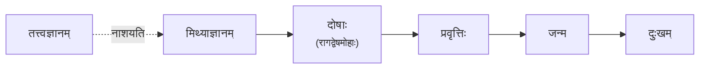
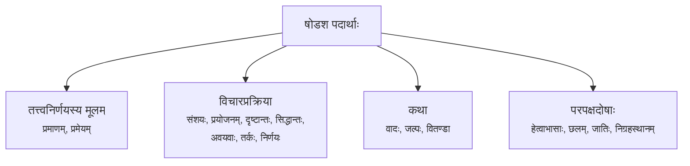
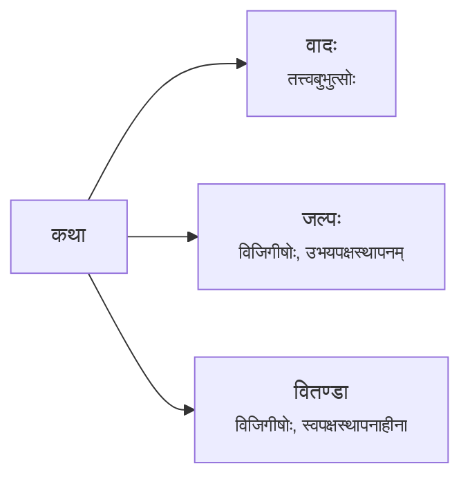
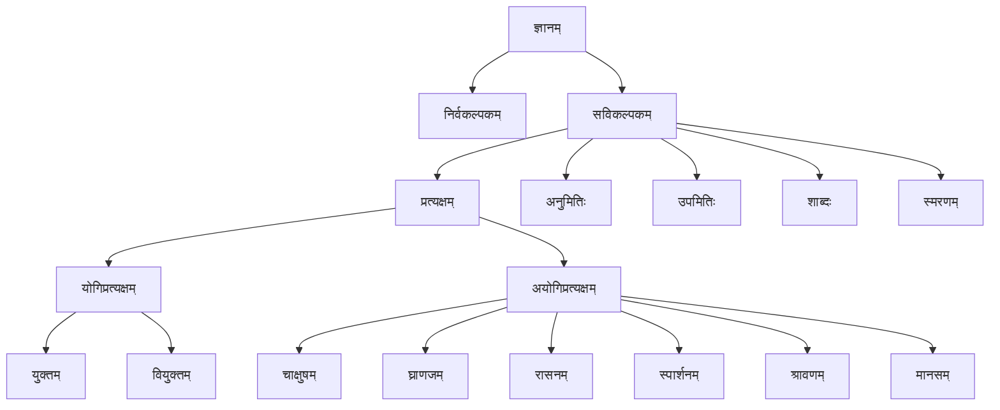

## व्युत्पत्तिः

न्यायशास्त्रम् = तर्कशास्त्रम् = आन्वीक्षिकी ।

* षोडश पदार्थानां मध्ये प्रधानतमः न्यायः ।  
  प्रतिज्ञा, हेतुः, उदाहरणं, उपनयः, निगमनं चेति पञ्चावयवानां समुदायः न्यायः ।
* नीयते अनेन इति न्यायः ।
* प्राप्यते विवक्षितार्थसिद्धिः अनेन इत्यतः विवक्षितार्थसिद्धिप्रापकः प्रतिज्ञादि-पञ्चावयवसमूहः न्यायः इत्युच्यते।
* न्यायः संशयनिवर्तकः (संशयनाशकः) एवं निर्णायकः भवति ।

## प्रयोजनम्

मोक्ष एव अस्य शास्त्रस्य परमं प्रयोजनम् । पदार्थतत्त्वज्ञानं^१ मुक्तिकारणम् ।  
संसारबन्धनस्य मूलं मिथ्याज्ञानम् (मिथ्याज्ञानं शरीरे आत्मत्वभ्रमः)।
दुःखजन्मप्रवृत्तिदोषमिथ्याज्ञानानाम् उत्तरोत्तराभावे पूर्वपूर्वविनाशेन अपवर्गो भवति^२ ।  
 
१ 'प्रमाणप्रमेयसंशयप्रयोजनदृष्टान्त-सिद्धान्तावयवतर्कनिर्णयवादजल्पवितण्डाहेत्वाभासच्छलजातिनिग्रहस्थानानां तत्त्वज्ञानाद् निःश्रेयसाधिगमः' । (न्या०सू०)  
२ 'दुःखजन्मप्रवृत्तिदोषमिथ्याज्ञानानाम् उत्तरोत्तरापाये तदनन्तरापायाद् अपवर्गः' । (न्या०सू०)  
&emsp;एवं मिथ्याज्ञान-दोष-प्रवृत्ति-जन्म-दुःखानि अविच्छेदेन
प्रवर्तमानानि संसारमनुवर्तयन्ति इति जीवानां दुर्दशा। यदा तु सदुपदेशभाजः अधिकारिणः
समाधिभावननिर्वेदवैराग्ययोगादिना प्रमेयतत्त्वज्ञानं जन्यते तदा सवासनं मिथ्याज्ञानं चिरन्तनमप्यपैति ।
मिथ्याज्ञाननाशे दोषा रागादयः अपयन्ति। दोषापाये प्रवृत्तिरपयाति। प्रवृत्यपाये जन्मापैति । जन्मापाये
दुःखमपैति । दुःखापाये चात्यन्तिको अपवर्गः - निःश्रेयसम् अधिगम्यते।

| संसारक्रमः (उत्पत्तिः) | अपवर्गक्रमः (नाशः) |
| --- | --- |
| मिथ्याज्ञानात् दोषाः | तत्त्वज्ञानेन मिथ्याज्ञाननाशः |
| दोषेभ्यः प्रवृत्तिः | मिथ्याज्ञाननाशे दोषापायः |
| प्रवृत्तेः जन्म | दोषापाये प्रवृत्त्यपायः |
| जन्मनः दुःखम् | प्रवृत्त्यपाये जन्मापायः |
| | जन्मापाये दुःखापायः → **अपवर्गः** |

## आचार्याः

| भूमिका | ग्रन्थः | आचार्यः |
| --- | --- | --- |
| **सूत्रकारः** | न्यायसूत्राणि | भगवान् गौतमः |
| **भाष्यकारः** | न्यायभाष्यम् | वात्स्यायनः |
| **वार्तिककारः** | न्यायवार्तिकम् | उद्योतकरः |
| **टीका** | न्यायवार्तिकतात्पर्यटीका | वाचस्पतिमिश्रः |
| **टीका** | तात्पर्यटीकापरिशुद्धिः | उदयनाचार्यः |
| **स्वतन्त्रग्रन्थः** | न्यायमञ्जरी | जयन्तभट्टः |
| **नव्यन्यायप्रवर्तकः** | तत्त्वचिन्तामणिः | गङ्गेशोपाध्यायः |
| **टीका** | दीधितिः | रघुनाथशिरोमणिः |
| **टीका** | गादाधरी | गदाधरभट्टाचार्यः |

## वेदाः पौरुषेयाः

अस्मिन् दर्शने वेदः पौरुषेयोऽभ्युपगम्यते। कार्यत्वहेतुना ईश्वरसिद्धिं ब्रुवाणाः नैय्यायिकाः
सर्वज्ञेश्वरप्रणीतत्वात् वेदानां प्रामाण्यमिति सङ्गिरन्ते। अतः न्यायमते वेदाः पौरुषेयाः।

## पदार्थाः

षोडश पदार्थाः (न्या० सू० १।१।१) –

| क्रमः | पदार्थः | लक्षणम् | भेदाः / उदाहरणम् |
| --- | --- | --- | --- |
| १ | **प्रमाणम्** | प्रमाकरणं प्रमाणम् । | प्रत्यक्षम्, अनुमानम्, उपमानम्, शब्दः (४) |
| २ | **प्रमेयम्** | आत्मशरीरेन्द्रियार्थबुद्धिमनःप्रवृत्तिदोषप्रेत्यभावफलदुःखापवर्गास्तु प्रमेयम् । | द्वादश (अधः द्रष्टव्यम्) |
| ३ | **संशयः** | एकधर्मिणि विरुद्धनानाधर्मावगाहि ज्ञानं संशयः । | "स्थाणुर्वा पुरुषो वा" |
| ४ | **प्रयोजनम्** | यमर्थमधिकृत्य प्रवर्तते तत् प्रयोजनम् । | सुखप्राप्तिः, दुःखनिवृत्तिः |
| ५ | **दृष्टान्तः** | लौकिकपरीक्षकाणां यस्मिन्नर्थे बुद्धिसाम्यं स दृष्टान्तः । | साधर्म्यदृष्टान्तः (महानसम्), वैधर्म्यदृष्टान्तः (महाह्रदः) |
| ६ | **सिद्धान्तः** | तन्त्राधिकरणाभ्युपगमसंस्थितिः सिद्धान्तः । | सर्वतन्त्र-प्रतितन्त्र-अधिकरण-अभ्युपगमसिद्धान्ताः (४) |
| ७ | **अवयवाः** | प्रतिज्ञाहेतूदाहरणोपनयनिगमनान्यवयवाः । | पञ्च |
| ८ | **तर्कः** | अविज्ञाततत्त्वेऽर्थे कारणोपपत्तितस्तत्त्वज्ञानार्थमूहस्तर्कः । | "यदि वह्निर्न स्यात् तर्हि धूमोऽपि न स्यात्" |
| ९ | **निर्णयः** | विमृश्य पक्षप्रतिपक्षाभ्यामर्थावधारणं निर्णयः । | |
| १० | **वादः** | तत्त्वबुभुत्सोः कथा वादः (पक्षप्रतिपक्षपरिग्रहः, प्रमाणतर्कसाधनोपालम्भः) । | गुरुशिष्ययोः कथा |
| ११ | **जल्पः** | छलजातिनिग्रहस्थानसाधनोपालम्भः, उभयपक्षस्थापनावती विजिगीषुकथा जल्पः । | |
| १२ | **वितण्डा** | स (जल्पः) प्रतिपक्षस्थापनाहीनो वितण्डा । | परपक्षखण्डनमात्रम् |
| १३ | **हेत्वाभासाः** | अहेतवो हेतुवदाभासमानाः हेत्वाभासाः । | सव्यभिचारः, विरुद्धः, प्रकरणसमः, साध्यसमः, कालातीतः (५) |
| १४ | **छलम्** | वचनविघातोऽर्थविकल्पोपपत्त्या छलम् । | वाक्छलम्, सामान्यच्छलम्, उपचारच्छलम् (३) |
| १५ | **जातिः** | साधर्म्यवैधर्म्याभ्यां प्रत्यवस्थानं जातिः (असदुत्तरम्) । | चतुर्विंशतिः |
| १६ | **निग्रहस्थानम्** | विप्रतिपत्तिरप्रतिपत्तिश्च निग्रहस्थानम् (पराजयहेतुः) । | द्वाविंशतिः |

**पदार्थानां विभागः**

**कथाभेदाः**

### प्रमाणानि

प्रत्यक्षानुमानोपमानशब्दाः चत्वारि प्रमाणानि। अर्थापत्तिसम्भवादीनां चतुर्व्वव प्रमाणेषु अन्तर्भावयन्ति।

| प्रमाणम् | लक्षणम् (न्यायसूत्रम्) | प्रमा (फलम्) |
| --- | --- | --- |
| **प्रत्यक्षम्** | इन्द्रियार्थसन्निकर्षोत्पन्नं ज्ञानमव्यपदेश्यमव्यभिचारि व्यवसायात्मकं प्रत्यक्षम् । | प्रत्यक्षम् |
| **अनुमानम्** | अथ तत्पूर्वकं त्रिविधमनुमानं पूर्ववच्छेषवत्सामान्यतोदृष्टं च । | अनुमितिः |
| **उपमानम्** | प्रसिद्धसाधर्म्यात् साध्यसाधनमुपमानम् । | उपमितिः |
| **शब्दः** | आप्तोपदेशः शब्दः । | शाब्दबोधः |

### प्रमेयाः

द्वादश प्रमेयाः (हेयोपादेयभेदेन द्विधा परिगण्यन्ते)

| क्रमः | प्रमेयम् | लक्षणम् / टिप्पणी | भोगे स्थानम् |
| --- | --- | --- | --- |
| १ | **आत्मा** | जीवात्मा, परमात्मा च । | भोक्ता (भोगाश्रयः) |
| २ | **शरीरम्** | चेष्टेन्द्रियार्थाश्रयः शरीरम् । | भोगायतनम् |
| ३ | **इन्द्रियाणि** | बहिर्वस्तुविषयकज्ञानसाधनम् इन्द्रियम् । | भोगसाधनानि |
| ४ | **अर्थाः** | इन्द्रियार्थाः (गन्धरसरूपस्पर्शशब्दाः) | भोक्तव्याः (भोगविषयाः) |
| ५ | **बुद्धिः** | बुद्धिर्नाम ज्ञानम् । | भोगः (साक्षात्कारः) |
| ६ | **मनः** | आन्तरम् इन्द्रियम् । | आन्तरं भोगसाधनम् |
| ७ | **प्रवृत्तिः** | प्रयत्नजन्यं कर्म प्रवृत्तिः (शुभम् अशुभं वा) – कायिकी, वाचिकी, मानसिकी । | भोगनिमित्तम् (पुण्यपापात्मिका) |
| ८ | **दोषाः** | रागः (इच्छा), द्वेषः (अमर्षः), मोहः (मिथ्याज्ञानम्) । | शरीरादिजन्महेतवः |
| ९ | **प्रेत्यभावः** | जन्मान्तरं प्रति कारणम् । ("पुनरुत्पत्तिः प्रेत्यभावः" – न्या० सू०) | |
| १० | **फलम्** | प्रवृत्तिदोषजनितोऽर्थः फलम् । | |
| ११ | **दुःखम्** | बाधनालक्षणं दुःखम् | |
| १२ | **अपवर्गः** | आत्यन्तिकदुःखनिवृत्तिः अपवर्गः । | उपादेयः |

**कथमेषामेव प्रमेयत्वम्**

* भोगसम्बन्धादेव एतेषां प्रमेयत्वम् ।
* भोगो हि संसारः। भोगो नाम सुखदुःखान्यतरसाक्षात्कारः। चक्रारपङ्किरिव अनुवर्तमानः सुखदुःखोपभोगः।
* आत्मा भोक्ता - भोगाश्रयः। तस्य भोगायतनं शरीरम्। तस्यैव भोगसाधनानि इन्द्रियाणि (आन्तरं तु मनः)।
* भोक्तव्याः - भोगविषया इन्द्रियार्थाः। 
* प्रवृत्तिः पुण्यपापात्मिका भोगनिमित्तम्।
* रागादयो दोषाः शरीरादिजन्महेतवः।

  
#### बुद्धिः (ज्ञानम्)

