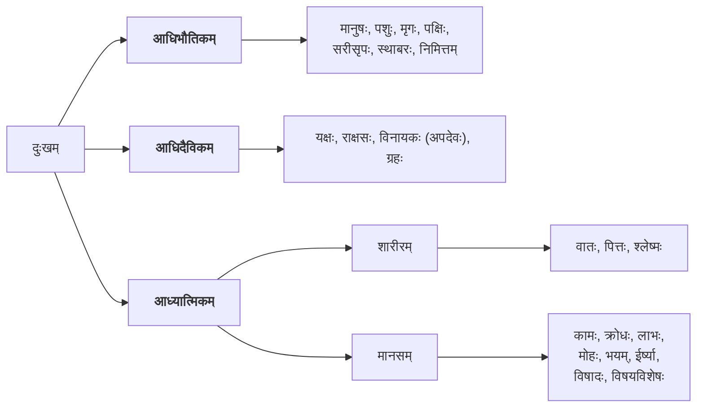
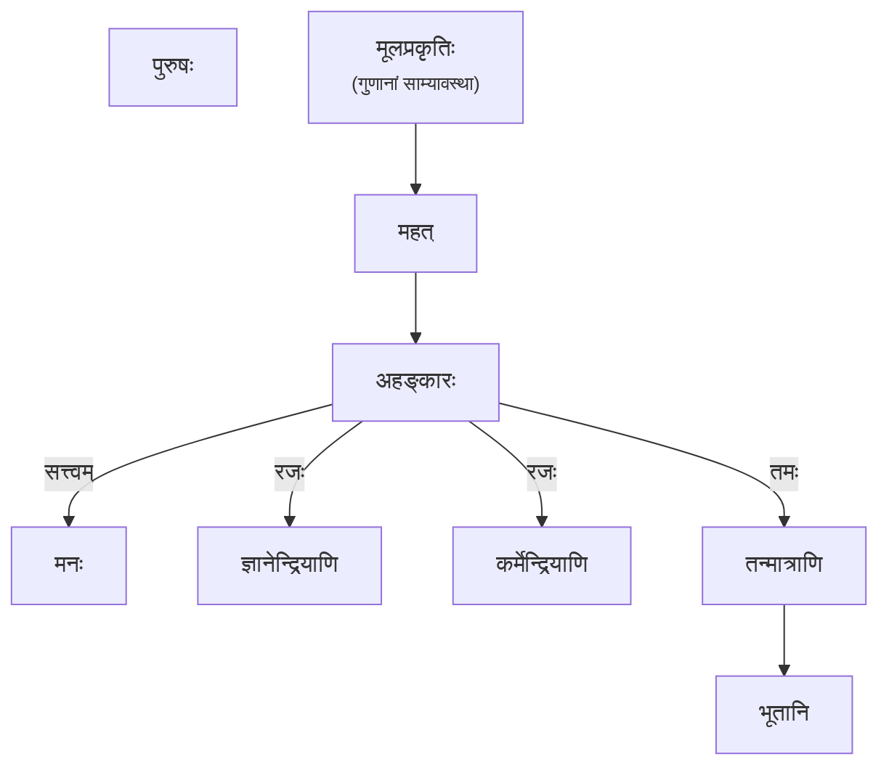
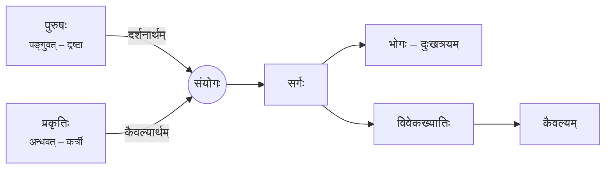
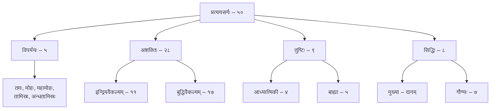

## मङ्गलम्

अजामेकां लोहितशुक्लकृष्णां बह्वीः प्रजाः सृजमानां स्वरूपाः।  
अजो ह्येको जुषमाणोऽनुशेते जहात्येनां भुक्तभोगां नुमस्तान्॥  
कपिलाय महामुनये मुनये शिष्याय तस्य चासुरये।  
पञ्चशिखाय तथेश्वरकृष्णायैते नमस्यामः ॥  
नास्ति साङ्ख्यसमं ज्ञानं, नास्ति योगसमं बलम् ।  
अत्र वः संशयो मा भूत, ज्ञानं साङ्ख्यं परं स्मृतम् ॥  
 

* सांख्यम् – सं + √ख्या (प्रकथने) + टाप् = संख्या, संख्या + अण् (तस्येदम्) = साङ्ख्यम् ।
* सांख्यम्
    * संख्यायन्ते गणयन्ते येन तत्सांख्यम्।
    * संख्यायते प्रकृतिपुरुषान्यथाख्यातिरूपः अवबोधस्सम्यज्ज्ञायते येन तत्सांख्यमिति ।
    * सङ्ख्यया चर्चा विचारणा इत्यमरः ।
    * सङ्ख्यायाः वर्णनं यत्र क्रियते तत्साङ्ख्यमिति। सम्यक् ज्ञानम् इत्यर्थः।
    * सम्यक् ख्यायते प्रकाश्यते वस्तुतत्वम् अनया इति संख्या, सम्यक् ज्ञानं तस्यां प्रकाशमानम् आत्मतत्त्वं तत् सांख्यम् इत्युच्यते। (श्रीधरस्वामिटीका)
* परम्परा
    * **महर्षिः कपिलः** ⇒ आसुरिः ⇒ पञ्चशिखः ⇒ **पतञ्जलिः** ⇒ जैगीषब्यः ⇒ वार्षगण्यः ⇒ विन्ध्यवासी ⇒ जनकः ⇒ पराशरः ⇒ **व्यासः** ⇒ **ईश्वरकृष्णः**
* मूलविषयाः
    * दुःखम्, पञ्चविशतिः तत्त्वानि, पुरुषः, प्रकृतिः, चतुर्दशलोकाः, पुरुषबहुत्त्वम्, भूतेन्द्रियाणि, प्रत्ययसर्गः, सत्कार्यवादः, प्रमाणानि ।

**ग्रन्थाः**

| ग्रन्थः | परिमाणम् | कर्ता |
| --- | --- | --- |
| सांख्यसूत्राणि | ६ अध्यायाः, ५२४ सूत्राणि | महर्षिः कपिलः |
| षष्टितन्त्रम् | — | पञ्चशिखः |
| सांख्यकारिका | ७० कारिकाः | ईश्वरकृष्णः |
| साङ्ख्यतत्त्वकौमुदी | (कारिकाव्याख्या) | वाचस्पतिमिश्रः |
| साङ्ख्यप्रवचनभाष्यम् | (सूत्रव्याख्या) | विज्ञानभिक्षुः |

## दुःखम्

## पञ्चविशतिः तत्त्वानि

* पुरुषः
* प्रकृतिः
* महत्
* अहङ्कारः
* मनः
* पञ्चतन्मात्राणि (शब्दः, स्पर्शः, रूपम्, रसः, गन्धः)
* पञ्चभूतानि (आकाशः, वायुः, तेजः, आपः, पृथ्वी)
* कर्मेन्द्रियाणि (वाक्, पाणि, पादः, पायुः, उपस्थः)
* ज्ञानेन्द्रियाणि (कर्णः, त्वक्, चक्षुः, जिह्वा, नासिका)

**तत्त्वानां चतुर्विधविभागः**

| वर्गः | अर्थः | तत्त्वानि | सङ्ख्या |
| --- | --- | --- | --- |
| **प्रकृतिः (अविकृतिः)** | कारणमेव, न कस्यापि कार्यम् | मूलप्रकृतिः | १ |
| **प्रकृतिविकृतयः** | कारणानि कार्याणि च | महत्, अहङ्कारः, पञ्च तन्मात्राणि | ७ |
| **विकाराः (विकृतयः)** | कार्याण्येव, न कस्यापि कारणम् | एकादश इन्द्रियाणि (मनः, ५ ज्ञानेन्द्रियाणि, ५ कर्मेन्द्रियाणि), पञ्च महाभूतानि | १६ |
| **न प्रकृतिर्न विकृतिः** | न कारणं न कार्यम् | पुरुषः | १ |
| | | **आहत्य** | **२५** |

**तन्मात्रेभ्यः भूतानि**

| तन्मात्रम् | महाभूतम् | ज्ञानेन्द्रियम् | कर्मेन्द्रियम् |
| --- | --- | --- | --- |
| शब्दः | आकाशः | श्रोत्रम् (कर्णः) | वाक् |
| स्पर्शः | वायुः | त्वक् | पाणिः |
| रूपम् | तेजः | चक्षुः | पादः |
| रसः | आपः | जिह्वा (रसना) | उपस्थः |
| गन्धः | पृथिवी | नासिका (घ्राणम्) | पायुः |

## पुरुषः, प्रकृतिः, सम्बन्धः
### पुरुषः

संघातपरार्थत्वात्, त्रिगुणादिविपर्ययादधिष्ठानात्।  
पुरुषोऽस्ति भोक्तृभावात्, कैवल्यार्थं प्रवृत्तेश्च ॥  
 
**पुरुषबहुत्वम्**  
जननमरणकरणानां, प्रतिनियमादयुगपत्प्रवृत्तेश्च ।  
पुरुषबहुत्वं सिद्धं, त्रैगुण्यविपर्ययाच्चैव ॥

| पुरुषसिद्धौ हेतवः (सां० का० १७) | पुरुषबहुत्वे हेतवः (सां० का० १८) |
| --- | --- |
| सङ्घातपरार्थत्वात् | जननमरणकरणानां प्रतिनियमात् |
| त्रिगुणादिविपर्ययात् | अयुगपत्प्रवृत्तेः |
| अधिष्ठानात् | त्रैगुण्यविपर्ययात् |
| भोक्तृभावात् | |
| कैवल्यार्थं प्रवृत्तेः | |

### प्रकृतिः

* प्रकृतिः = अव्यक्तः, प्रधानम् ।

सत्त्वरजस्तमसां साम्यावस्था प्रकृतिः।

सौक्ष्म्यात्तदनुपलब्धिर्नाभावात् कार्यतस्तदुपलब्धेः ।  
महदादि तच्च कार्यं प्रकृतिस्वरूपं विरूपं च ॥

### व्यक्ताव्यक्तज्ञानां तुलना

त्रिगुणमविवेकि विषयः सामान्यमचेतनं प्रसवधर्मि ।  
व्यक्तं तथा प्रधानं तद्विपरीतस्तथा च पुमान् ॥ (सां० का० ११)

| धर्मः | व्यक्तम् (महदादि) | अव्यक्तम् (प्रकृतिः) | ज्ञः (पुरुषः) |
| --- | --- | --- | --- |
| त्रिगुणम् | ✓ | ✓ | ✗ (निर्गुणः) |
| अविवेकि | ✓ | ✓ | ✗ (विवेकी) |
| विषयः (भोग्यम्) | ✓ | ✓ | ✗ (भोक्ता) |
| सामान्यम् (साधारणम्) | ✓ | ✓ | ✗ (प्रतिपुरुषं भिन्नः) |
| अचेतनम् | ✓ | ✓ | ✗ (चेतनः) |
| प्रसवधर्मि | ✓ | ✓ | ✗ (अप्रसवधर्मी) |
| हेतुमत्, अनित्यम्, अव्यापि, सक्रियम्, अनेकम् | ✓ | ✗ | ✗ |

### प्रकृतिपुरुषयोः सम्बन्धः

पुरुषस्य दर्शनार्थं कैवल्यार्थं तथा प्रधानस्य ।  
पङ्ग्वन्धवदुभयोरपि संयोगस्तत्कृतः सर्गः ॥

## प्रमाणानि

| प्रमाणम् | लक्षणम् | टिप्पणी |
| --- | --- | --- |
| **दृष्टम्** | प्रतिविषयाध्यवसायो दृष्टम् । | अध्यवसायः = प्रत्यक्षम् |
| **अनुमानम्** | लिङ्गलिङ्गिपूर्वकं ज्ञानम् अनुमानम् । | लिङ्गं = हेतुः, लिङ्गि = साध्यम् |
| **आप्तवचनम्** | आप्तश्रुतिः आप्तवचनम् । | |

## सत्कार्यवादः

कार्यं कारणे विद्यते ।

सत्कार्यवादे हेतवः –  
<small>
असदकरणाद् उपादानग्रहणात् सर्वसम्भवाभावात् ।  
शक्तस्य शक्यकरणात् कारणभावाच्च सत्कार्यम् ॥सां० का० ९॥
</small>

| हेतुः | अर्थः / उदाहरणम् |
| --- | --- |
| **असदकरणात्** | असतः सत् नोत्पद्यते । |
| **उपादानग्रहणात्** | कार्ये कारणस्य सत्ता, उपादानत्वेन । |
| **सर्वसम्भवाभावात्** | आम्रबीजात् नारिकेलवृक्षो न भवति । |
| **शक्तस्य शक्यकरणात्** | आम्रबीजात् आम्रवृक्ष एवोत्पद्यते, नान्यत् । |
| **कारणभावात्** | कार्यं कारणात् न भिन्नम् । |

## प्रत्ययसर्गः

प्रत्ययसर्गः नाम बुद्धेः परिणामः (मानसिकी सृष्टिः)। यथा महाभूतानां सर्गः 'भौतिकसर्गः'
उच्यते, तथैव बुद्धेः भावानाम्, वृत्तीनाम्, अवस्थानां च सर्गः 'प्रत्ययसर्गः' इति कथ्यते।
सत्त्वरजस्तमसाम् अङ्ग-अङ्गिभावेन (गुणवैषम्यविमर्दात्) अस्य प्रत्ययसर्गस्य ५० भेदाः भवन्ति।  
<small>
एष प्रत्ययसर्गो विपर्ययाशक्तितुष्टिसिद्धाख्यः ।  
गुणवैषम्यविमर्दात् तस्य भेदास्तु पञ्चाशत् ॥
</small>

| भेदः | सङ्ख्या | स्वरूपम् | मोक्षे भूमिका |
| --- | --- | --- | --- |
| **विपर्ययः** | **५** | अज्ञानम् / मिथ्याज्ञानम् | बन्धकः (त्याज्यः) |
| **अशक्तिः** | **२८** | इन्द्रियबुद्धिवैकल्यम् | बाधकः (हेयः) |
| **तुष्टिः** | **९** | भ्रमपूर्णः तात्कालिकसन्तोषः | वञ्चकः (अतिक्रमणीयः) |
| **सिद्धिः** | **८** | तत्त्वज्ञानम् / विवेकख्यातिः | मोक्षसाधकः (उपादेयः) |

### विपर्ययः

एते अविद्यादयः पञ्चक्लेशाः अपि उच्यन्ते –

| साङ्ख्यनाम | योगनाम (क्लेशः) | स्वरूपम् | अवान्तरभेदाः <small>(पूरितम्)</small> |
| --- | --- | --- | --- |
| **तमः** | अविद्या | अनात्मनि (प्रकृत्यादौ) आत्मबुद्धिः । | ८ |
| **मोहः** | अस्मिता | अणिमाद्यष्टसिद्धीः प्राप्य, तास्वेव मोक्षबुद्धिः । | ८ |
| **महामोहः** | रागः | शब्दादिषु पञ्चविषयेषु आसक्तिः । | १० |
| **तामिस्रः** | द्वेषः | शब्दादिपञ्चविषयाणां प्रतिघाते (विघ्ने) सति उत्पन्नः क्रोधः । | १८ |
| **अन्धतामिस्रः** | अभिनिवेशः | प्राप्तेषु विषयेषु मरणभयं वा विनाशभयम् । | १८ |
| | | | **आहत्य ६२** |

### अशक्तिः

इन्द्रियाणां तथा बुद्धेः असमर्थता वा वैकल्यम् 'अशक्तिः' इति उच्यते।

| वर्गः | सङ्ख्या | स्वरूपम् |
| --- | --- | --- |
| ज्ञानेन्द्रियवैकल्यम् | ५ | बाधिर्यम्, अन्धत्वम्, मूकत्वम् इत्यादयः |
| कर्मेन्द्रियवैकल्यम् | ५ | पङ्गुत्वम्, क्लैब्यम् इत्यादयः |
| मनसो वैकल्यम् | १ | उन्मादः / भ्रमः |
| बुद्धिवैकल्यम् | १७ | तुष्टीनाम् (९) सिद्धीनां च (८) विपर्ययात् (अतुष्टयः असिद्धयश्च) उत्पन्नाः बुद्धिबाधाः |
| **आहत्य** | **२८** | |

### तुष्टिः

तुष्टिः नाम तात्कालिकः सन्तोषः। एषा मोक्षाय अनुकूला इव दृश्यते, किन्तु वास्तविकी सिद्धिः न भवति, अतः सा अपि बन्धहेतुः एव। अस्याः द्वौ मुख्यविभागौ स्तः—

| विभागः | तुष्टिः | पारिभाषिकनाम | स्वरूपम् |
| --- | --- | --- | --- |
| **आध्यात्मिकी (४)** | प्रकृतिः | अम्भः | केवलं प्रकृतेः उपासना कार्यवती, विवेकज्ञानं स्वयमेव भविष्यति इति चिन्तनम् । |
| | उपादानम् | सलिलम् | प्रकृत्युपासना मा भूत्, संन्यासेन एव मोक्षः इति चिन्तनम् । |
| | कालः | ओघः | संन्यासेन अपि न, कालेन एव मोक्षः भविष्यति इति प्रतीक्षा । |
| | भाग्यम् | वृष्टिः | भाग्यात् एव मोक्षः लप्स्यते इति सन्तोषः । |
| **बाह्या (५)** | अर्जनदोषदर्शनात् विरक्तिः | पारम् | |
| | रक्षणदोषदर्शनात् | सुपारम् | |
| | क्षयदोषदर्शनात् | पारापारम् | |
| | भोगदोषदर्शनात् | अनुत्तमाम्भः | |
| | हिंसादोषदर्शनात् | उत्तमाम्भः | |

बाह्यतुष्टिः – विषयाणाम् (शब्द-स्पर्श-रूप-रस-गन्धानाम्) अर्जन-रक्षण-क्षय-भोग-हिंसादोषाणां दर्शनात् विरक्तिः।

### सिद्धिः

सिद्धिर्नाम ज्ञानप्राप्तिः, सफलता । मोक्षस्य साक्षात् साधनं विवेकज्ञानम् एव 'सिद्धिः' इत्युच्यते।

| विभागः | सिद्धिः | पारिभाषिकनाम | स्वरूपम् |
| --- | --- | --- | --- |
| **मुख्या** | दानम् | रम्यकम् | विवेकज्ञानस्य विशुद्धिः, येन दुःखत्रयात् अत्यन्तनिवृत्तिः भवति । |
| **गौण्यः** | ऊहः | ऊहम् | तर्क-विचार-चिन्तनैः तत्त्वज्ञानप्राप्तिः । |
| | शब्दः | शब्दः | वेदादिशास्त्रश्रवणेन ज्ञानप्राप्तिः । |
| | अध्ययनम् | तारम् | शास्त्रस्य विधिवत् अध्ययनेन ज्ञानम् । |
| | सुहृत्प्राप्तिः | रसिकम् | सद्गुरु-सत्पुरुष-सङ्गेन तत्त्वज्ञानम् । |
| | दुःखविघातः – आध्यात्मिकः | प्रमोदम् | आध्यात्मिकदुःखस्य निवृत्तिः । |
| | दुःखविघातः – आधिभौतिकः | मुदितम् | आधिभौतिकदुःखस्य निवृत्तिः । |
| | दुःखविघातः – आधिदैविकः | मोदमानम् | आधिदैविकदुःखस्य निवृत्तिः । |

!!! note "अवधेयम्"
    साङ्ख्यतत्त्वकौमुद्यां पारिभाषिकनामानि किञ्चिद्भिन्नानि –   
    • अध्ययनम् = तारम्,  
    • शब्दः = सुतारम्,  
    • ऊहः = तारतारम्,  
    • सुहृत्प्राप्तिः = रम्यकम्,  
    • दानम् = सदामुदितम्,  
    • दुःखविघातत्रयम् = प्रमोदम्, मुदितम्, मोदमानम् ।
