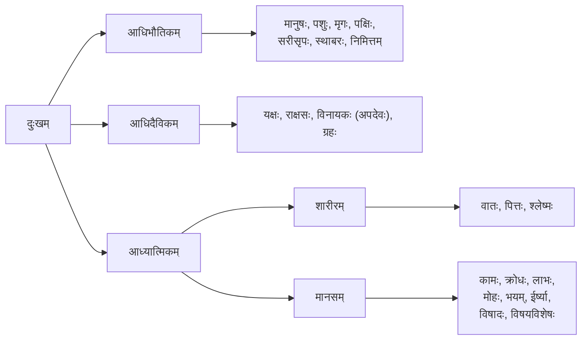
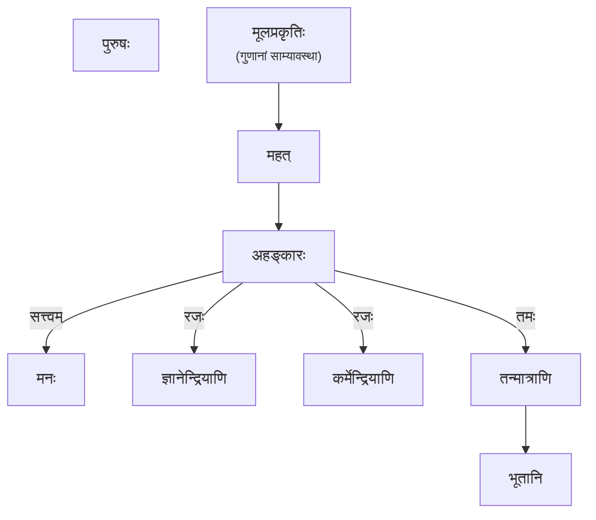

## मङ्गलम्

अजामेकां लोहितशुक्लकृष्णां बह्वीः प्रजाः सृजमानां स्वरूपाः।  
अजो ह्येको जुषमाणोऽनुशेते जहात्येनां भुक्तभोगां नुमस्तान्॥  
कपिलाय महामुनये मुनये शिष्याय तस्य चासुरये।  
पञ्चशिखाय तथेश्वरकृष्णायैते नमस्यामः ॥  
नास्ति साङ्ख्यसमं ज्ञानं, नास्ति योगसमं बलम् ।  
अत्र वः संशयो मा भूत, ज्ञानं साङ्ख्यं परं स्मृतम् ॥  
 

* सांख्यम् – सं + √ख्या (प्रकथने) + टाप् = संख्या, संख्या + अण् (तस्येदम्) = साङ्ख्यम् ।
* सांख्यम्
    * संख्यायन्ते गणयन्ते येन तत्सांख्यम्।
    * संख्यायते प्रकृतिपुरुषान्यथाख्यातिरूपः अवबोधस्सम्यज्ज्ञायते येन तत्सांख्यमिति ।
    * सङ्ख्यया चर्चा विचारणा इत्यमरः ।
    * सङ्ख्यायाः वर्णनं यत्र क्रियते तत्साङ्ख्यमिति। सम्यक् ज्ञानम् इत्यर्थः।
    * सम्यक् ख्यायते प्रकाश्यते वस्तुतत्वम् अनया इति संख्या, सम्यक् ज्ञानं तस्यां प्रकाशमानम् आत्मतत्त्वं तत् सांख्यम् इत्युच्यते। (श्रीधरस्वामिटीका)
* परम्परा
    * **महर्षिः कपिलः** ⇒ आसुरिः ⇒ पञ्चशिखः ⇒ **पतञ्जलिः** ⇒ जैगीषब्यः ⇒ वार्षगण्यः ⇒ विन्ध्यवासी ⇒ जनकः ⇒ पराशरः ⇒ **व्यासः** ⇒ **ईश्वरकृष्णः**
* ग्रन्थाः
    * सांख्यसूत्राणि [६ अध्यायाः, ५२४ सूत्राणि] (महर्षिः कपिलः)
    * सांख्यकारिका [७० कारिकाः] (ईश्वरकृष्णः)
    * साङ्ख्यतत्त्वकौमुदी (वाचस्पतिमिश्रः)
    * साङ्ख्यप्रवचनभाष्यम् (विज्ञानभिक्षुः)
    * षष्टीतन्त्रम् (पञ्चशिखः)
* मूलविषयाः
    * दुःखम्, पञ्चविशतिः तत्त्वानि, पुरुषः, प्रकृतिः, चतुर्दशलोकाः, पुरुषबहुत्त्वम्, भूतेन्द्रियाणि, प्रत्ययसर्गः, सत्कार्यवादः, प्रमाणानि ।

## दुःखम्

## पञ्चविशतिः तत्त्वानि

* पुरुषः
* प्रकृतिः
* महत्
* अहङ्कारः
* मनः
* पञ्चतन्मात्राणि (शब्दः, स्पर्शः, रूपम्, रसः, गन्धः)
* पञ्चभूतानि (आकाशः, वायुः, तेजः, आपः, पृथ्वी)
* कर्मेन्द्रियाणि (वाक्, पाणि, पादः, पायुः, उपस्थः)
* ज्ञानेन्द्रियाणि (कर्णः, त्वक्, चक्षुः, जिह्वा, नासिका)

मूलप्रकृतिरविकृतिर्महदाद्याः प्रकृतिविकृतयः सप्त।  
षोडशकस्तु विकारो न प्रकृतिर्न विकृतिः पुरुषः ॥  

* जगतो मूलकारणीभूता प्रकृतिः मूलप्रकृतिः।
कार्यहीना अविकृतिः। महदहङ्कारो पञ्चतन्मात्राणि चेति महदाद्याः सप्त। कारणानि कार्याणि च प्रकृतिविकृतयः इति। पञ्चभूतानि एकादशेन्द्रियाणि च षोडशविकारः। कार्य विकारः इत्युच्यते। न प्रकृतिः न विकृतिः पुरुषः।

## पुरुषः, प्रकृतिः, सम्बन्धः
### पुरुषः

संघातपरार्थत्वात्, त्रिगुणादिविपर्ययादधिष्ठानात्।  
पुरुषोऽस्ति भोक्तृभावात्, कैवल्यार्थं प्रवृत्तेश्च ॥  
 
**पुरुषबहुत्वम्**  
जननमरणकरणानां, प्रतिनियमादयुगपत्प्रवृत्तेश्च ।  
पुरुषबहुत्वं सिद्धं, त्रैगुण्यविपर्ययाच्चैव ॥

### प्रकृतिः

* प्रकृतिः = अव्यक्तः, प्रधानम् ।

सत्त्वरजस्तमसां साम्यावस्था प्रकृतिः।

सौक्ष्म्यात्तदनुपलब्धिर्नाभावात् कार्यतस्तदुपलब्धेः ।  
महदादि तच्च कार्य प्रकृतिस्वरूपं विरूपं च ॥

### प्रकृतिपुरुषयोः सम्बन्धः

पुरुषस्य दर्शनार्थ कैवल्यार्थ तथा प्रधानस्य ।  
पङ्गन्धवदुभयोरपि संयोगस्ततकृतः सर्गः ॥

## प्रमाणानि

* दृष्टम् – प्रतिविषयाध्यवसाय दृष्टम्। अध्यवसासः प्रत्यक्षम्।
* अनुमानम् – लिङ्गलिङ्गिपूर्वकं ज्ञानम् अनुमानम्। (लिङ्गं = हेतुः, लिङ्गि = साध्यम्) ।
* आप्तवचनम् – आप्तश्रुतिः आप्तवचनम्।

## सत्कार्यवादः

कार्यं कारणे विद्यते ।

सत्कार्यवादे हेतवः –  
<small>
असदकरणाद् उपादानग्रहणात् सर्वसम्भवाभावात् ।  
शक्तस्य शक्यकरणात् कारणभावाच्च सत्कार्यम् ॥सां० का० ९॥
</small>

* असदकरणात् (असतः सन्नोत्पद्यते) ।
* उपादानग्रहणात् (कार्ये कारणस्य सत्ता, उपादनत्वेन) ।
* सर्वसम्भवाभावात् (आम्रबीजात् नारीकेलवृक्षो न भवति) ।
* शक्तस्य शक्यकरणात् (आम्रबीजात् आम्रवृक्ष एवोत्पद्यते, नान्यत्) ।
* कारणाभावात् (कार्यं कारणात् न सम्भिन्नम्) ।

## प्रत्ययसर्गः

प्रत्ययसर्गः नाम बुद्धेः परिणामः (मानसिकी सृष्टिः)। यथा महाभूतानां सर्गः 'भौतिकसर्गः'
उच्यते, तथैव बुद्धेः भावानाम्, वृत्तीनाम्, अवस्थानां च सर्गः 'प्रत्ययसर्गः' इति कथ्यते।
सत्त्वरजस्तमसाम् अङ्ग-अङ्गिभावेन (गुणवैषम्यविमर्दात्) अस्य प्रत्ययसर्गस्य ५० भेदाः भवन्ति।  
<small>
एष प्रत्ययसर्गो विपर्ययाशक्तितुष्टिसिद्धाख्यः ।  
गुणवैषम्यविमर्दात् तस्य भेदास्तु पञ्चाशत् ॥
</small>

| भेदः | सङ्ख्या | स्वरूपम् | मोक्षे भूमिका |
| --- | --- | --- | --- |
| **विपर्ययः** | **५** | अज्ञानम् / मिथ्याज्ञानम् | बन्धकः (त्याज्यः) |
| **अशक्तिः** | **२८** | इन्द्रियबुद्धिवैकल्यम् | बाधकः (हेयः) |
| **तुष्टिः** | **९** | भ्रमपूर्णः तात्कालिकसन्तोषः | वञ्चकः (अतिक्रमणीयः) |
| **सिद्धिः** | **८** | तत्त्वज्ञानम् / विवेकख्यातिः | मोक्षसाधकः (उपादेयः) |

### विपर्ययः

एते अविद्यादयः पञ्चक्लेशाः अपि उच्यन्ते –  

* **तमः (अविद्या)** – अनात्मनि (प्रकृत्यादौ) आत्मबुद्धिः।
* **मोहः (अस्मिता)** – अणिमाद्यष्टसिद्धीः प्राप्य, तास्वेव मोक्षबुद्धिः ।
* **महामोहः (रागः)** – शब्दादिषु पञ्चविषयेषु आसक्तिः ।
* **तामिस्रः (द्वेषः)** – शब्दादिपञ्चविषयाणां प्रतिघाते (विघ्ने) सति उत्पन्नः क्रोधः ।
* **अन्धतामिस्रः (अभिनिवेशः)** – प्राप्तेषु विषयेषु मरणभयं वा विनाशभयम् ।

---

### अशक्तिः

इन्द्रियाणां तथा बुद्धेः असमर्थता वा वैकल्यम् 'अशक्तिः' इति उच्यते।

११ इन्द्रियवैक्ल्यानि

* ५ ज्ञानेन्द्रियबाधः (बाधिर्यम्, अन्धत्वम्, मूकत्वम् इत्यादयः)
* ५ कर्मेन्द्रियबाधः (पङ्गुत्वम्, क्लैब्यम् इत्यादयः)
* १ मनसो वैकल्यम् (उन्मादः/भ्रमः)

१७ बुद्धिवैकल्यानि

* तुष्टीनाम् (९) सिद्धीनां च (८) विपर्ययात् (सप्तदश विपर्ययाः असिद्धयः अतुष्टयश्च) उत्पन्नाः बुद्धिबाधाः ।

### तुष्टिः

तुष्टिः नाम तात्कालिकः सन्तोषः। एषा मोक्षाय अनुकूला इव दृश्यते, किन्तु वास्तविकी सिद्धिः न भवति, अतः सा अपि बन्धहेतुः एव। अस्याः द्वौ मुख्यविभागौ स्तः—

आध्यात्मिकी तुष्टिः –

* **प्रकृतिः (अम्भः)** – केवलं प्रकृतेः उपासना कार्यवती, विवेकज्ञानं स्वयमेव भविष्यति इति चिन्तनम्।
* **उपादानम् (सलिलम्)** – प्रकृत्युपासना मा भूत्, संन्यासेन एव मोक्षः इति चिन्तनम्।
* **कालः (मेघः:** – संन्यासेन अपि न, कालेन एव मोक्षः भविष्यति इति प्रतीक्षा।
* **भाग्यम् (वृष्टिः)** – भाग्यात् एव मोक्षः लप्स्यते इति सन्तोषः।

बाह्यतुष्टिः – विषयाणाम् (शब्द-स्पर्श-रूप-रस-गन्धानाम्) अर्जन-रक्षण-क्षय-भोग-हिंसादोषाणां दर्शनात् विरक्तिः। एतेषां पञ्चानां नामानि— **पारम्, सुपारम्, पारापारम्, अनुत्तमाम्भः, उत्तमाम्भः** च इति।

### सिद्धिः

सिद्धिर्नाम ज्ञानप्राप्तिः, सफलता । मोक्षस्य साक्षात् साधनं विवेकज्ञानम् एव 'सिद्धिः' इत्युच्यते।

* मुख्या सिद्धिः – दानम् (रम्यकम्) । विवेकज्ञानस्य विशुद्धिः, येन दुःखत्रयात् अत्यन्तनिवृत्तिः भवति।

गौण्यः सिद्धयः

* **ऊहः (ऊहम्)** – तर्क-विचार-चिन्तनैः तत्त्वज्ञानप्राप्तिः।
* **शब्दः (शब्दः)** – वेदादिशास्त्रश्रवणेन ज्ञानप्राप्तिः।
* **अध्ययनम् (तारम्)** – शास्त्रस्य विधिवत् अध्ययनेन ज्ञानम्।
* **सुहृत्प्राप्तिः (रसिकम्)** – सद्गुरु-सत्पुरुष-सङ्गेन तत्त्वज्ञानम्।
* **दुःखविघातः - आध्यात्मिकः (प्रमोदम्)** – आध्यात्मिकदुःखस्य निवृत्तिः।
* **दुःखविघातः - आधिभौतिकः (मुदितम्)** – आधिभौतिकदुःखस्य निवृत्तिः।
* **दुःखविघातः - आधिदैविकः (मोदमानम्)** – आधिदैविकदुःखस्य निवृत्तिः।
