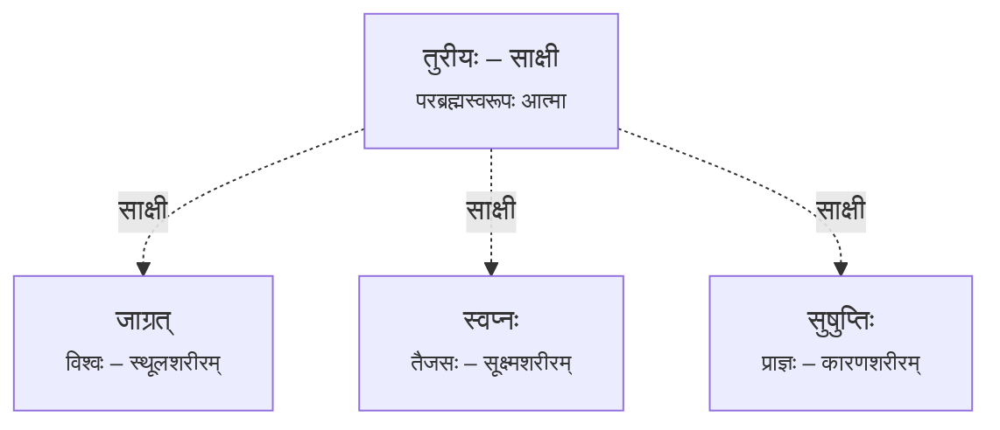
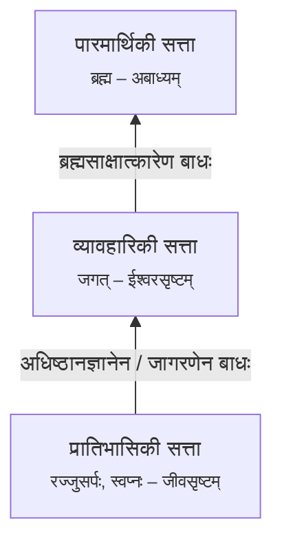
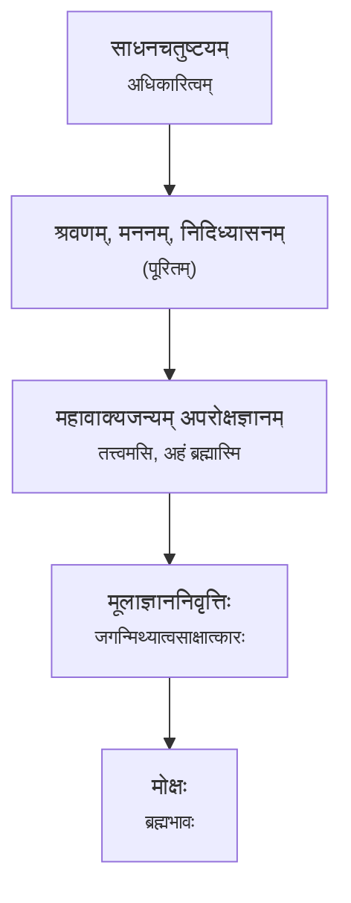

## परिचयः

तत्र सर्वेषां दर्शनानां मध्ये "वेदान्तदर्शनमेव दर्शनीयतमं दर्शनम्" ।

* **वेदस्य अन्तः** – अन्तशब्दः, अन्तभागपरः ।
* **निर्णयः** – अन्तशब्दो निर्णयवाची ।

वेदान्तो नाम उपनिषदः एव । तथा च आहुः –

उपेत्य वा निषण्णं वा तच्छ्रेय आत्यन्तिकं यतः ।  
तस्मादुपनिषज्ज्ञेया ग्रन्थस्तु स्यात्तदर्थतः ॥

**दश मुख्योपनिषदः** –

ईशकेनकठप्रश्नमुण्डमाण्डूक्यतित्तिरिः ।  
ऐतरेयं च छान्दोग्यं बृहदारण्यकं तथा ॥

## प्रस्थानत्रयम्

अद्वैतवेदान्ते प्रस्थानत्रयं विलसति –

| प्रस्थानम् | ग्रन्थः |
| --- | --- |
| **श्रुतिप्रस्थानम्** | उपनिषदः |
| **स्मृतिप्रस्थानम्** | श्रीमद्भगवद्गीता |
| **सूत्रप्रस्थानम्** <small>(न्यायप्रस्थानम्)</small> | ब्रह्मसूत्राणि <small>(वेदान्तसूत्राणि, शारीरकसूत्राणि)</small> |

### सूत्रप्रस्थानम्

| अध्यायः | प्रतिपाद्यः विषयः | नाम | पादाः |
| --- | --- | --- | --- |
| प्रथमः | श्रुतिवाक्यानां ब्रह्मणि समन्वयः | समन्वयाध्यायः | चत्वारः |
| द्वितीयः | साङ्ख्यादिभिः विरोधपरिहारः | अविरोधाध्यायः | चत्वारः |
| तृतीयः | ब्रह्मप्राप्तिसाधनानां निरूपणम् | साधनाध्यायः | चत्वारः |
| चतुर्थः | मोक्षस्य स्वरूपवर्णनम् | फलाध्यायः | चत्वारः |

## प्रमुखानि तत्त्वानि

| विषयः | उपविषयाः |
| --- | --- |
| **अद्वितीयं ब्रह्म** | ब्रह्मणि त्रिविधभेदानाम् अभावः, ब्रह्मणः अनन्तत्वम्, ब्रह्मणः सच्चिदानन्दस्वरूपत्वम् |
| **माया** | मायायाः स्वरूपम्, मायाऽविद्ययोरभेदः, मायाया अस्वातन्त्र्यं निवृत्तिश्च, बोधप्रश्नाः |
| **जगत्सृष्टिः** | ब्रह्मणः अभिन्ननिमित्तोपादानकारणत्वम्, परिणामवादः, विवर्तवादः – अध्यासः – अनिर्वचनीयख्यातिः |
| **मोक्षः तस्य साधनं च** | साधनचतुष्टयम्, ज्ञानसाधनानि, ज्ञानादेव तु कैवल्यम्, मोक्षस्वरूपम् |
| **प्रमाणानि** | प्रत्यक्षम्, अनुमानम्, उपमानम्, आगमः, अर्थापत्तिः, अनुपलब्धिः |
| **अन्यत्** | प्रमुखाः आचार्याः तथा पारिभाषिकपदानि |

## ब्रह्म

* √बृह्, √बृहि (वृद्धौ) इति धातुना निष्पन्नं पदं = ब्रह्म ।
* बृहत्त्वात् बृंहणत्वात् ब्रह्म इति गीयते ।
* अद्वितीयं ब्रह्म इति वेदान्तिनां परमः सिद्धान्तः ।
* "यत् साक्षादपरोक्षाद् ब्रह्म" इति श्रुतिः । (बृ० उ० ३।४।१)

### ब्रह्मणः लक्षणद्वयम्

| लक्षणम् | स्वरूपम् |
| --- | --- |
| **स्वरूपलक्षणम्** | सत्यं ज्ञानम् अनन्तम् |
| **तटस्थलक्षणम्** | सृष्टिस्थितिलयकर्तृत्वम् |

### ब्रह्मस्वरूपम्

| रूपम् | अर्थः |
| --- | --- |
| **सद्रूपम्** | वस्तुतः विद्यमानम् |
| **चिद्रूपम्** | प्रकाशस्वरूपम् |
| **आनन्दरूपम्** | दुःखरहितम् |
| **अनन्तरूपम्** | अन्तरहितम् |

### ब्रह्मणः अनन्तत्वम्

| | घटपटादिकार्याणि (अन्तवन्ति) | ब्रह्म (अनन्तम्) |
| --- | --- | --- |
| **देशतः** | अन्तवन्ति | अन्तरहितम् |
| **कालतः** | अन्तवन्ति | अन्तरहितम् |
| **वस्तुतः** | अन्तवन्ति | अन्तरहितम् |

### त्रिविधभेदराहित्यम्

ब्रह्म – सगुणं ब्रह्म / निर्गुणं ब्रह्म (सगुणम् उपासनानिमित्तम् एवम् उक्तम्) । निर्गुणं ब्रह्म –

* स्वगतभेदरहितम्
* सजातीयभेदरहितम्
* विजातीयभेदरहितम्

## महावाक्यानि

| महावाक्यम् | उपनिषत् | वेदः |
| --- | --- | --- |
| प्रज्ञानं ब्रह्म <small>• प्रज्ञानम् = सर्वप्राणिषु अनुस्यूतं चैतन्यम् • ब्रह्म = परमात्मा</small> | ऐतरेयोपनिषत् (५।३) | ऋग्वेदः |
| अहं ब्रह्मास्मि <small>• अहम् = अल्पज्ञत्वावच्छिन्नः जीवः • ब्रह्म = परमात्मा • अस्मि = अभेदः</small> | बृहदारण्यकोपनिषत् (१।४।१०) | यजुर्वेदः |
| तत्त्वमसि <small>• तत् = ब्रह्म • त्वम् = जीवः • असि = अभेदः</small> | छान्दोग्योपनिषत् (६।८।७) | सामवेदः |
| अयमात्मा ब्रह्म <small>• अयम् = देहावच्छिन्नः • आत्मा = जीवात्मा • ब्रह्म = परमात्मा • (सामानाधिकरण्येन) अभेदः</small> | माण्डूक्योपनिषत् (२) | अथर्ववेदः |

## जीवः

जीवो नाम कः ?

* जीवः कर्माध्यक्षः अवस्थात्रयवान् च ।
* अन्तःकरणावच्छिन्नं चैतन्यं जीवः ।
* कर्तृत्वभोक्तृत्ववान् जीवः ।
* जीवः अनादिः किन्तु अन्तवानपि ।

### अवस्थात्रयं शरीरत्रयं च

| अवस्था | शरीरम् | अभिमानी आत्मा | प्रज्ञा |
| --- | --- | --- | --- |
| जाग्रदवस्था | स्थूलशरीरम् | विश्वः (वैश्वानरः) | बहिष्प्रज्ञः |
| स्वप्नावस्था | सूक्ष्मशरीरम् | तैजसः | अन्तःप्रज्ञः |
| सुषुप्त्यवस्था | कारणशरीरम् | प्राज्ञः | प्रज्ञानघनः |
| तुरीयम् | — (साक्षी) | परब्रह्मस्वरूपः आत्मा | नान्तःप्रज्ञं न बहिष्प्रज्ञम् |

### अवस्थात्रयविवेकः

* **जाग्रदवस्था** – इन्द्रियैः स्थूलविषयाणां यत्र ग्रहणं भवति सा जाग्रदवस्था । त्रिपुटी स्पष्टतया भासते ।
* **स्वप्नावस्था** – बाह्येन्द्रियाणां व्यापाराभावेऽपि, जाग्रदवस्थायाः वासनाभिः (संस्कारैः) निर्मितं सूक्ष्मविषयं यत्र अन्तःकरणं पश्यति सा स्वप्नावस्था । अत्र अन्तःप्रज्ञः आत्मा केवलं वासनामयं सूक्ष्मप्रपञ्चम् अनुभवति ।
* **सुषुप्त्यवस्था** – विषयः न गृह्यते, अन्तःकरणमपि कारणे (अज्ञाने) विलीयते, सा सुषुप्त्यवस्था । केवलम् अज्ञानस्य (तमसः) स्वरूपभूतानन्दस्य च अनुभवः भवति ("सुखमहमस्वाप्सं न किञ्चिदवेदिषम्" इति उत्थितस्य स्मरणात्) ।
* **तुरीयम्** (वस्तुतया नास्ति 'अवस्था') – अवस्थात्रयसाक्षी, साक्षात् परब्रह्मस्वरूपः आत्मा । अवस्थात्रयं मायिकम्, तस्य साक्षी तुरीयः आत्मा एव परमार्थसत्यः ।

## ब्रह्मणः जगत्कारणत्वम्

ब्रह्मणः एव उत्पद्यन्ते –

* पञ्चमहाभूतानि
* एकादश इन्द्रियाणि
* सर्वे देवाः
* चतुर्दश भुवनानि
* चतुर्विधशरीराणि
* सर्वे प्राणिनः जीवाश्च
* वायवः

यथोर्णनाभिः सृजते गृह्णते च यथा पृथिव्यामोषधयः सम्भवन्ति ।  
यथा सतः पुरुषात् केशलोमानि तथाक्षरात् सम्भवतीह विश्वम् ॥ (मुण्डकोपनिषत् १।१।७)

**ब्रह्मैव प्रपञ्चं प्रति उपादानकारणं निमित्तकारणं च** (अभिन्ननिमित्तोपादानकारणम्) । "तत् सृष्ट्वा तदेवानुप्राविशत्" इति श्रुतिः प्रमाणम् ।

## माया अज्ञानं च

### मायास्वरूपम्

* सच्चिदानन्दस्वरूपं ब्रह्म । तच्च नित्यं, शुद्धं, बुद्धं, मुक्तं भवति ।
* तदेव ब्रह्म जगतः उत्पत्ति-स्थिति-लयकारणम् इत्यपि प्रसिद्धम् ।
* उत्पन्नं च जगत् अनित्यम्, मिथ्या इति च प्रतिपाद्यते । अतः मिथ्याभूतस्य जगतः कारणं किम् इति संशये जाते, यत्किञ्चित् कारणं वक्तव्यम् इति ज्ञानिनः माया जगत्कारणम् इति उक्तवन्तः ।
* **मायासहितं ब्रह्म जगत्कारणम् ।**

मायायाः नामान्तराणि – प्रकृतिः, अव्यक्तम्, अव्याकृतम्, अविद्या, परमात्मशक्तिः इत्यादीनि ।

### अज्ञानम्

अज्ञानं तु सदसद्भ्याम् अनिर्वचनीयं त्रिगुणात्मकं ज्ञानविरोधि भावरूपं यत्किञ्चित् इति वदन्ति, "अहमज्ञः" इत्याद्यनुभवात् ।

> अज्ञानेनावृतं ज्ञानं तेन मुह्यन्ति जन्तवः । (भगवद्गीता ५।१५)

### अज्ञानस्य शक्तिद्वयम्

| शक्तिः | स्वरूपम् | दृष्टान्तः |
| --- | --- | --- |
| **आवरणशक्तिः** | अपरिच्छिन्नमपि आत्मानम् आच्छादयति । | घनच्छिन्न... |
| **विक्षेपशक्तिः** | आकाशादिप्रपञ्चम् उद्भावयति । | असर्पभूतरज्जौ सर्पादिकम् उद्भावयति । |

> विक्षेपशक्तिर्लिङ्गादिब्रह्माण्डान्तं जगत् सृजेत् । (वाक्यसुधा १३)

## अध्यारोपः अपवादश्च

"अध्यारोपापवादाभ्यां निष्प्रपञ्चं प्रपञ्च्यते" इति ।

### अध्यारोपः

अध्यारोपः नाम **"वस्तुनि अवस्त्वारोपः अध्यारोपः"** ।

| | वस्तु (अधिष्ठानम्) | अवस्तु (आरोपितः पदार्थः) |
| --- | --- | --- |
| दृष्टान्तः | रज्जुः | सर्पः |
| दार्ष्टान्तिकः | ब्रह्म | अज्ञानादिसकलजडसमूहः (प्रपञ्चः) |

अध्यासः, अध्यारोपः इति अनर्थान्तरम् । वेदान्तसिद्धान्ते अध्यासप्रक्रियायाः महत् स्थानं विद्यते । अध्यासस्य लक्षणस्वरूपनिर्णयकाले विद्वांसः परस्परं विवदन्ते; प्रत्येकं दार्शनिकस्य मतानुसारेण अध्यासस्य स्वरूपं भिद्यते ।

अध्यासः नाम सत्ये वस्तुनि असत्यस्य (अनृतस्य) पदार्थस्य आरोपणम्, यथा – रज्जौ सर्पस्य आरोपः । सत्ये रज्जुरूपे वस्तुनि असत्यस्य (अविद्यमानस्य) सर्पस्य अज्ञानेन आरोपं कृत्वा "अयं सर्पः" इति जायमानः भ्रमः एव अध्यारोपः । अत्र रज्जुः अधिष्ठानम्, सर्पः आरोपितः पदार्थः । सर्वत्र अध्यारोपे अधिष्ठानस्य अज्ञानमेव कारणम् । यथा रज्जौ सर्पस्य आरोपः, तथा ब्रह्मणि प्रपञ्चस्य आरोपः ।

ब्रह्मरूपवस्तुनि अध्यारोपितं जगत् –

* पञ्चमहाभूतानि
* इन्द्रियाणि
* कोशाः
* चतुर्दश लोकाः
* चतुर्विधशरीराणि

### अपवादः

* अधिष्ठानज्ञानेन आरोपितपदार्थस्य बाधनम् अपवादः । "रज्जुरियम्, नायं सर्पः" ।
* अपवादः नाम रज्जुविवर्तस्य सर्पस्य रज्जुमात्रज्ञानवत्, वस्तुविवर्तस्य अवस्तुनः अज्ञानादेः वस्तु(ब्रह्म)मात्रज्ञानम् ।
* "नेति नेति" इति निराकरणम् ।

## जगन्मिथ्यात्वविचारः

अद्वैतसिद्धान्ते **"ब्रह्म सत्यं जगन्मिथ्या जीवो ब्रह्मैव नापरः"** इति परमोद्घोषः । अत्र 'मिथ्या' इत्यस्य अर्थः शशविषाणवत् (वन्ध्यापुत्रवत् वा) सर्वथा 'तुच्छत्वम्' (अत्यन्ताभावः) इति न, अपि तु सदसद्विलक्षणत्वम् इति ।

### मिथ्यात्वस्य शास्त्रीयलक्षणम्

अद्वैतवेदान्ते मिथ्यात्वस्य अनेकानि लक्षणानि सन्ति (यथा अद्वैतसिद्धौ उक्तानि पञ्चलक्षणानि) । मुख्यं लक्षणमिदम् –

**"प्रतिपन्नोपाधौ त्रैकालिकनिषेधप्रतियोगित्वं मिथ्यात्वम् ।"**

अर्थः – यस्मिन् अधिकरणे (ब्रह्मणि) यत् (जगत्) प्रतीयते, तस्मिन् एव अधिकरणे भूत-भविष्यत्-वर्तमानकालेषु तस्य पूर्णतया अभावः एव मिथ्यात्वम् । यथा रज्जौ सर्पः प्रतीयते, किन्तु तत्र कालत्रयेऽपि सर्पः नास्ति, तथैव अधिष्ठाने ब्रह्मणि अज्ञानवशात् जगत् प्रतीयते, किन्तु परमार्थतः कालत्रयेऽपि तत्र जगत् नास्ति ।

### विवर्तवादः

वेदान्ते 'परिणामवादः' (यथा दुग्धात् दधि भवति) न अङ्गीक्रियते, अपि तु 'विवर्तवादः' ।

* **विवर्तलक्षणम्** – "अतत्त्वतोऽन्यथाप्रथा विवर्त इत्युदीरितः ।" स्वरूपे अविकृतं सत्, अज्ञानात् (मायया) भिन्नरूपेण भासमानत्वं विवर्तः ।
* एकम् अद्वितीयं निर्गुणं परब्रह्म एव अज्ञानवशात् नानारूपेण जगदाकारेण भासते (यथा शुक्तौ रजतस्य भ्रमः – शुक्तिरजतन्यायः) ।

| परिणामवादः | विवर्तवादः |
| --- | --- |
| कारणं तत्त्वतः कार्याकारेण विकरोति | कारणम् अविकृतमेव सत् अन्यथा भासते |
| दुग्धात् दधि | रज्जौ सर्पः, शुक्तौ रजतम् |
| कार्यं कारणवत् सत्यम् | कार्यं मिथ्या, अधिष्ठानमेव सत्यम् |

### सत्तात्रयम्

शङ्कराचार्याः जगतः अनुभवं न अपलपन्ति, अतः तैः 'सत्तात्रयम्' अङ्गीकृतम् –

| सत्ता | स्वरूपम् | उदाहरणम् |
| --- | --- | --- |
| **पारमार्थिकी** | यस्य कालत्रयेऽपि बाधो न भवति तत् पारमार्थिकं सत्यम् । | केवलं ब्रह्म |
| **व्यावहारिकी** | यावत् आत्मज्ञानं (ब्रह्मसाक्षात्कारः) न भवति, तावत् प्रमातृ-प्रमाण-प्रमेय-व्यवहारः सत्य इव प्रतीयते । अत्र ईश्वरसृष्टं जगत् अन्तर्भवति । | घटपटादिः (जगत्) |
| **प्रातिभासिकी** | केवलं प्रतीतिकालमात्रे यत् सत्यं प्रतीयते । एतत् जीवसृष्टम् । | शुक्तिरजतादिः, स्वप्नप्रपञ्चः, रज्जुसर्पः |

अद्वैतवेदान्ते जगत् 'व्यावहारिकसत्यम्' किन्तु 'पारमार्थिकमिथ्या' अस्ति ।

### निष्कर्षः

यथा रज्जुज्ञानेन सर्पभ्रमः नश्यति, तथा "तत्त्वमसि", "अहं ब्रह्मास्मि" इति महावाक्यजन्य-अपरोक्षज्ञानेन (अधिष्ठानब्रह्मज्ञानेन) मूलाज्ञानस्य निवृत्तिः भवति । तदा जगतः मिथ्यात्वं साक्षात्क्रियते, अवस्थात्रयस्य च बाधः भवति । इयमेव मोक्षावस्था ।

## मनः (अन्तःकरणम्)

> मनो नाम महाव्याघ्रो विषयारण्यभूमिषु ।  
> चरत्यत्र न गच्छन्तु साधवो ये मुमुक्षवः ॥ (विवेकचूडामणिः)

* **मनसः वृत्तिः** – सङ्कल्पविकल्पात्मकम् ।  
  "कामः सङ्कल्पो विचिकित्सा श्रद्धाऽश्रद्धा धृतिरधृतिर्ह्रीर्धीर्भीरित्येतत्सर्वं मन एव ।" (बृहदारण्यकोपनिषत् १।५।३)
* **पाञ्चभौतिकं मनः** – "अन्नमयं हि सोम्य मनः ।" (छान्दोग्योपनिषत् ६।५।४)
* **बन्धमोक्षयोः कारणम्** –

मन एव मनुष्याणां कारणं बन्धमोक्षयोः ।  
बन्धाय विषयासक्तं मुक्त्यै निर्विषयं स्मृतम् ॥ (अमृतबिन्दूपनिषत् २)

## प्रमाणानि

अद्वैतवेदान्ते (वेदान्तपरिभाषानुसारं) व्यवहारे भाट्टमतवत् षट् प्रमाणानि अङ्गीक्रियन्ते –

* **प्रत्यक्षम्** – प्रत्यक्षप्रमाकरणं प्रत्यक्षम्; अन्तःकरणवृत्त्यवच्छिन्नचैतन्यस्य विषयचैतन्येन अभेदः ।
* **अनुमानम्** – अनुमितिकरणम् अनुमानम्; व्याप्तिज्ञानं करणम् ।
* **उपमानम्** – सादृश्यप्रमाकरणम् उपमानम् ।
* **आगमः (शब्दः)** – यस्य वाक्यस्य तात्पर्यविषयीभूतसंसर्गः मानान्तरेण न बाध्यते तद्वाक्यं प्रमाणम् ।
* **अर्थापत्तिः** – उपपाद्यज्ञानेन उपपादककल्पनम् अर्थापत्तिः ।
* **अनुपलब्धिः** – ज्ञानकरणाजन्याभावानुभवासाधारणकारणम् अनुपलब्धिः ।

ब्रह्मविषये तु शास्त्रम् (उपनिषद्वाक्यम्) एव मुख्यं प्रमाणम् । वस्तुतया ब्रह्म स्वप्रकाशं किन्तु शास्त्रं लक्षणया ज्ञापयति ।

## साधनचतुष्टयम्

नित्यानित्यविवेकश्च फलभोगविरागिता ।  
शमादिषट्कसम्पत्तिः मुमुक्षा च तथापरा ॥

### नित्यानित्यवस्तुविवेकः

* आत्मैव नित्यः नाशकाभावात्; आत्मनः व्यतिरिक्तं सर्वम् अनित्यं नाशकसत्त्वात् घटवत् इति निश्चयः नित्यानित्यवस्तुविवेकः ।
* आत्मा नित्यः, आत्मातिरिक्तं सर्वम् अनित्यम् इति ज्ञानं नित्यानित्यवस्तुविवेकः ।

ब्रह्म सत्यं जगन्मिथ्या इत्येवंरूपो विनिश्चयः ।  
सोऽयं नित्यानित्यवस्तुविवेकः समुदाहृतः ॥

तत्र च प्रमाणम् – "तद्यथेह कर्मचितो लोकः क्षीयते, एवमेवामुत्र पुण्यचितो लोकः क्षीयते" इति । (छान्दोग्योपनिषत् ८।१।६)

### इहामुत्रफलभोगविरागः

ऐहिकानां स्रक्चन्दनवनितादिविषयभोगानाम्, आमुष्मिकाणां स्वर्गादिफलभोगानां च कर्मजन्यत्वेन अनित्यत्वात् तेषु अत्यन्तं वैराग्यम् इहामुत्रफलभोगविरागः । "*परीक्ष्य लोकान् कर्मचितान् ब्राह्मणो निर्वेदमायात्*" इति श्रुतिः (मुण्डकोपनिषत् १।२।१२) ।

### शमादिषट्कसम्पत्तिः

| साधनम् | लक्षणम् |
| --- | --- |
| **शमः** | अन्तरिन्द्रियस्य मनसः निग्रहः |
| **दमः** | चक्षुरादेः बहिरिन्द्रियस्य निग्रहः |
| **उपरतिः** | विधिपूर्वकं सर्वकर्मत्यागः |
| **तितिक्षा** | शीतोष्ण-सुखदुःख-मानावमानादि-परस्परविरुद्धविषयद्वयसहनम् |
| **समाधानम्** | चित्तस्य एकाग्रता |
| **श्रद्धा** | गुरुवेदान्तवाक्येषु विश्वासः |

### मुमुक्षुत्वम्

* संसारस्य अत्यन्तोपरतिरूपः मोक्षः मम भवतु इति अत्युत्कटा इच्छा मुमुक्षा ।
* आत्मनः अन्तःकरणदेहादिना साकं सम्बन्धः बन्धः । बन्धस्य विच्छेदः मोक्षः । मोक्तुम् इच्छा मुमुक्षा । तस्याः भावः मुमुक्षुत्वम् ।
* तत्र "मुमुक्षुर्वै शरणमहं प्रपद्ये" इति श्रुतिः प्रमाणम् ।

### मोक्षमार्गः

ज्ञानादेव तु कैवल्यम् ।

अभ्यासप्रश्नाः

### अवस्थात्रयविवेकसम्बद्धाः प्रश्नाः

1. माण्डूक्योपनिषदनुसारम् अवस्थात्रयं किम्? तासु अवस्थासु स्थूल-सूक्ष्म-कारणशरीराभिमानिनः आत्मनः कानि नामानि सन्ति?
2. 'विश्वः' तथा 'तैजसः' इत्यनयोः मध्ये को भेदः? प्रमातृ-प्रमाण-प्रमेय-त्रिपुटी कस्याम् अवस्थायां स्पष्टतया भासते?
3. सुषुप्त्यवस्थायां जीवः किं स्वरूपं प्राप्नोति? तस्याम् अवस्थायां तस्य नाम 'प्राज्ञः' इति किमर्थं कथ्यते?
4. "सुखमहमस्वाप्सं न किञ्चिदवेदिषम्" इति उत्थितस्य स्मरणं सुषुप्त्यवस्थायाः कस्याः स्थितेः (अज्ञानस्य आनन्दस्य च) प्रमाणम् अस्ति? स्पष्टयत ।
5. 'तुरीयावस्था' अवस्थात्रयात् कथं भिन्ना अस्ति? "नान्तःप्रज्ञं न बहिष्प्रज्ञम् …" इति श्रुतेः आधारेण तुरीयस्य पारमार्थिकं स्वरूपं विवृणुत ।
6. अवस्थात्रयस्य विश्लेषणेन आत्मनः 'असङ्गत्वं' (निर्लिप्तत्वं) 'नित्यत्वं' च कथं सिद्ध्यति?

### जगन्मिथ्यात्वसम्बद्धाः प्रश्नाः

7. अद्वैतवेदान्ते 'मिथ्या' इत्यस्य कः अर्थः? किं मिथ्या नाम शशविषाणवत् 'अत्यन्ताभावः' अस्ति? सदसद्विलक्षणत्वम् इत्यनेन किं ज्ञायते?
8. "प्रतिपन्नोपाधौ त्रैकालिकनिषेधप्रतियोगित्वं मिथ्यात्वम्" – अस्य मिथ्यात्वलक्षणस्य रज्जुसर्पदृष्टान्तेन सोदाहरणं व्याख्यां कुरुत ।
9. परिणामवादस्य विवर्तवादस्य च कः भेदः? वेदान्तिनः परिणामवादं त्यक्त्वा विवर्तवादं किमर्थम् अङ्गीकुर्वन्ति?
10. "अतत्त्वतोऽन्यथाप्रथा विवर्त इत्युदीरितः" इति श्लोकार्थं शुक्तिरजतन्यायेन विशदयत ।
11. शङ्कराचार्यैः प्रतिपादितं 'सत्तात्रयम्' किम्? व्यावहारिकसत्तायाः प्रातिभासिकसत्तायाः च को भेदः?
12. अद्वैतसिद्धान्ते जगतः 'व्यावहारिकसत्यत्वं' तथा 'पारमार्थिकमिथ्यात्वम्' इत्येतयोः समन्वयः कथं क्रियते?
13. स्वप्नप्रपञ्चः कस्याः सत्तायाः अन्तर्गतः भवति? तस्य बाधः कदा भवति, व्यावहारिकजगतः च बाधः कदा भवति?

### सिद्धान्तसमन्वयसम्बद्धाः (विश्लेषणात्मकाः) प्रश्नाः

14. अधिष्ठानज्ञानं विना भ्रमनिवृत्तिः न भवति इति सिद्धान्तं "तत्त्वमसि", "अहं ब्रह्मास्मि" इति महावाक्यजन्य-अपरोक्षज्ञानस्य सन्दर्भेण विवृणुत ।
15. "यदि जगत् मिथ्या, तर्हि बन्धमोक्षयोः, गुरुशिष्यपरम्परायाः, वेदान्तशास्त्रस्य च का सार्थकता?" – अस्य पूर्वपक्षस्य अद्वैतसिद्धान्तानुसारं समाधानं कुरुत ।

