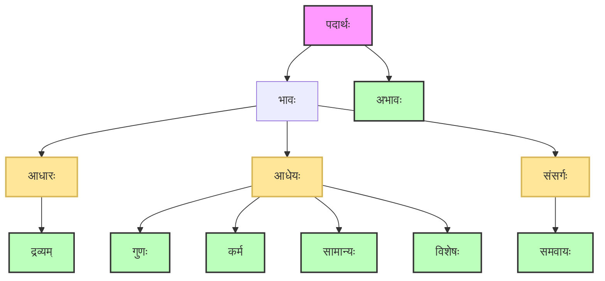
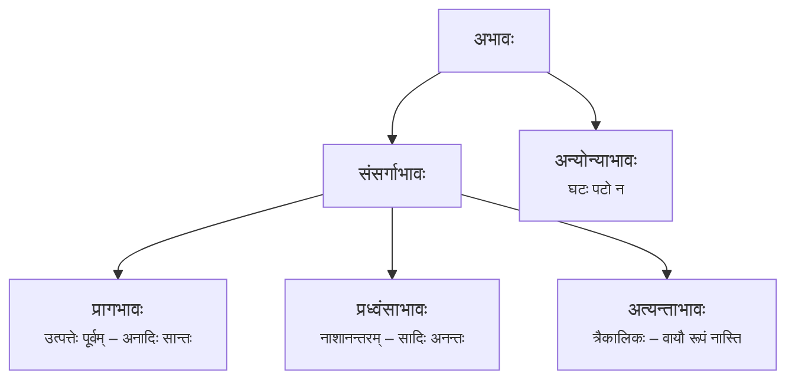
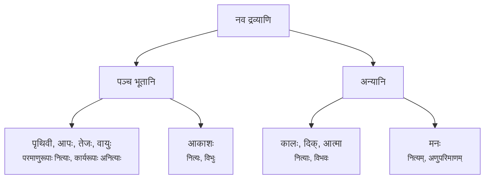
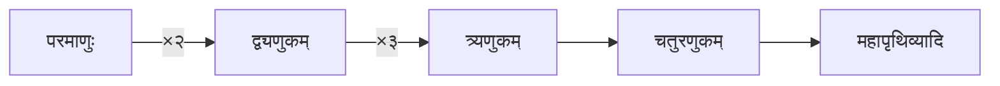

* विशेषम् अधिकृत्य कृतं दर्शनम् (विशेषः ठक्, इति वैशेषिकम्)
* शासनात् संशनात् शास्त्रम् ।

शास्त्रस्य त्रिधा प्रवृत्तिः – उद्देशः, लक्षणं, परीक्षा ।

| प्रवृत्तिः | स्वरूपम् |
| --- | --- |
| **उद्देशः** | नाम्ना वस्तुसङ्कीर्तनम् उद्देशः । |
| **लक्षणम्** | असाधारणधर्मः लक्षणम् । |
| **परीक्षा** | लक्षितस्य लक्षणमुपपद्यते न वा इति प्रमाणैः अवधारणं परीक्षा । |

*लक्षणप्रमाणाभ्यां वस्तुसिद्धिः ।*

## आचार्याः

| भूमिका | ग्रन्थः | आचार्यः |
| --- | --- | --- |
| **सूत्रकारः** | वैशेषिकसूत्राणि | कणादमुनिः |
| **भाष्यकारः** | पदार्थधर्मसङ्ग्रहः (प्रशस्तपादभाष्यम्) | प्रशस्तपादः |
| **टीका** | न्यायकन्दली | श्रीधरः |
| **टीका / प्रकरणम्** | किरणावली, न्यायकुसुमाञ्जलिः | उदयनाचार्यः |

* औलूक्यदर्शनम् इति नामान्तरम् ।
* कणान् अत्ति इति कणादः ।

## पदार्थाः

* सप्तपदार्थाः
    * द्रव्यम्, गुणः, कर्म, सामान्यम्, विशेषः, समवायः, अभावः ।
* नव द्रव्याणि
    * पृथिवी, आपः, तेजः, वायुः (अनित्यं, नित्यं च)
    * आकाशः, कालः, दिक्, आत्मा (विभुः)
    * मनः (परमाणुः)
* चतुर्विंशतिः गुणाः
    * रूपम्, रसः, गन्धः, स्पर्शः, संख्या, परिमाणम्, पृथक्त्वम्, संयोगः, विभागः, परत्वम्,
      अपरत्वम्, बुद्धिः, सुखम्, दुःखम्, इच्छा, द्वेषः, प्रयत्नः, गुरुत्वम्, द्रवत्वम्, स्नेहः,
      संस्कारः, धर्मः, अधर्मः, शब्दः ।
* पञ्च कर्माणि
    * उत्क्षेपणम्, अपक्षेपणम्, आकुञ्चनम्, प्रसारणम्, गमनम् ।

### सप्तपदार्थानां सारांशः

| पदार्थः | वर्गः | भेदसङ्ख्या | भेदाः |
| --- | --- | --- | --- |
| **द्रव्यम्** | भावः – आधारः | ९ | पृथिवी, आपः, तेजः, वायुः, आकाशः, कालः, दिक्, आत्मा, मनः |
| **गुणः** | भावः – आधेयः | २४ | रूपादयः (अधः द्रष्टव्यम्) |
| **कर्म** | भावः – आधेयः | ५ | उत्क्षेपणम्, अपक्षेपणम्, आकुञ्चनम्, प्रसारणम्, गमनम् |
| **सामान्यम्** | भावः – आधेयः | २  | परम् (सत्ता), अपरम् (द्रव्यत्वादि) |
| **विशेषः** | भावः – आधेयः | अनन्ताः | नित्यद्रव्यवृत्तयः |
| **समवायः** | भावः – संसर्गः | १ | नित्यसम्बन्धः |
| **अभावः** | अभावः | ४  | प्रागभावः, प्रध्वंसाभावः, अत्यन्ताभावः, अन्योन्याभावः |

**अभावभेदाः**

### नव द्रव्याणि

| द्रव्यम् | नित्यानित्यत्वम् | परिमाणम् | विशेषगुणः |
| --- | --- | --- | --- |
| **पृथिवी** | परमाणुरूपा नित्या, कार्यरूपा अनित्या | — | गन्धः |
| **आपः** | परमाणुरूपाः नित्याः, कार्यरूपाः अनित्याः | — | शीतस्पर्शः, स्नेहः |
| **तेजः** | परमाणुरूपं नित्यम्, कार्यरूपम् अनित्यम् | — | उष्णस्पर्शः |
| **वायुः** | परमाणुरूपः नित्यः, कार्यरूपः अनित्यः | — | अनुष्णाशीतस्पर्शः (रूपरहितः) |
| **आकाशः** | नित्यः | विभुः | शब्दः |
| **कालः** | नित्यः | विभुः | — |
| **दिक्** | नित्या | विभुः | — |
| **आत्मा** | नित्यः | विभुः | बुद्ध्यादयः (ज्ञानाधिकरणम्) |
| **मनः** | नित्यम् | परमाणुः | — |

### चतुर्विंशतिः गुणाः

| वर्गः | गुणाः | आश्रयः |
| --- | --- | --- |
| **भूतविशेषगुणाः** | रूपम्, रसः, गन्धः, स्पर्शः | रूपम् – पृथिव्यप्तेजस्सु; रसः – पृथिव्यप्सु; गन्धः – पृथिव्याम्; स्पर्शः – पृथिव्यप्तेजोवायुषु |
| **आकाशगुणः** | शब्दः | आकाशे |
| **सामान्यगुणाः** | संख्या, परिमाणम्, पृथक्त्वम्, संयोगः, विभागः | सर्वेषु द्रव्येषु |
| | परत्वम्, अपरत्वम् | पृथिव्यादिचतुष्टये मनसि च |
| **अन्ये भौतिकगुणाः** | गुरुत्वम्, द्रवत्वम्, स्नेहः | गुरुत्वम् – पृथिव्यप्सु; द्रवत्वम् – पृथिव्यप्तेजस्सु; स्नेहः – जले एव |
| **उभयवृत्तिः** | संस्कारः | वेगः – मूर्तद्रव्येषु; स्थितिस्थापकः – पृथिव्याम्; भावना – आत्मनि |
| **आत्मविशेषगुणाः** | बुद्धिः, सुखम्, दुःखम्, इच्छा, द्वेषः, प्रयत्नः, धर्मः, अधर्मः | आत्मनि एव |

## परमाण्वारम्भवादः

| क्रमः | उत्पत्तिक्रमः | नाशक्रमः |
| --- | --- | --- |
| १ | ईश्वरस्य चिकीर्षावशात् परमाणुषु क्रिया | संजिहीर्षावशात् परमाणुषु क्रिया |
| २ | ततः परमाणुद्वयसंयोगः | क्रियया परमाणुद्वयविभागः |
| ३ | ततो द्व्यणुकम् | ततो द्व्यणुकनाशः |
| ४ | त्रिभिः द्व्यणुकैः त्र्यणुकम् | ततः त्र्यणुकनाशः |
| ५ | एवं चतुरणुकादिक्रमेण | ततश्चतुरणुकनाशः |
| ६ | महती पृथिवी, महत्यः आपः, महत् तेजः, महान् वायुः उत्पद्यते । | एवं महापृथिव्यादिनाशः |

## प्रमाणविचारः

### प्रत्यक्षम्

*सन्निकर्षषट्कजन्यं ज्ञानं प्रत्यक्षम्*  
*तत्करणमिन्द्रियम्*  
*तस्मादिन्द्रियं प्रत्यक्षप्रमाणमिति सिद्धम्*

प्रत्यक्षज्ञानहेतुः इन्द्रियार्थसन्निकर्षः षड्विधः –

| सन्निकर्षः | ग्राह्यम् | उदाहरणम् |
| --- | --- | --- |
| **संयोगः** | द्रव्यम् | घटप्रत्यक्षम् (चक्षुर्घटसंयोगः) |
| **संयुक्तसमवायः** | द्रव्ये समवेतं गुणकर्मादि | घटरूपप्रत्यक्षम् |
| **संयुक्तसमवेतसमवायः** | गुणादौ समवेतं सामान्यम् | रूपत्वसामान्यप्रत्यक्षम् (श्वेतत्वम्) |
| **समवायः** | शब्दः | श्रोत्रेण शब्दसाक्षात्कारः |
| **समवेतसमवायः** | शब्दे समवेतं सामान्यम् | शब्दत्वसाक्षात्कारः |
| **विशेषणविशेष्यभावः** | अभावः, समवायः | घटाभाववद् भूतलम् |

### अनुमानम्

* अनुमितिकरणमनुमानम्
* परामर्शजन्यं ज्ञानमनुमितिः
* व्याप्तिविशिष्टपक्षधर्मताज्ञानं परामर्शः।  
  यथा वह्निव्याप्यधूमवानयं पर्वत इति ज्ञानं परामर्शः ।  
  तज्जन्यं पर्वतो वह्निमानिति ज्ञानमनुमितिः ।

| पदम् | अर्थः | उदाहरणे |
| --- | --- | --- |
| **पक्षः** | सन्दिग्धसाध्यवान् | पर्वतः |
| **साध्यम्** | यत् साध्यते | वह्निः |
| **हेतुः (लिङ्गम्)** | साध्यव्याप्यः | धूमः |
| **व्याप्तिः** | यत्र यत्र धूमः तत्र तत्र वह्निः इति साहचर्यनियमः | महानसे दृष्टः |
| **परामर्शः** | व्याप्तिविशिष्टपक्षधर्मताज्ञानम् | वह्निव्याप्यधूमवानयं पर्वतः |
| **अनुमितिः** | परामर्शजन्यं ज्ञानम् | पर्वतो वह्निमान् |

#### पञ्चावयवाः

परार्थज्ञानाय पञ्चावयवात्मिका अनुमानप्रक्रिया  
*यत्तु स्वयमेव धूमादग्निमनुमाय परप्रतिपत्त्यर्थं पञ्चावयववाक्यं प्रयुङ्क्ते तत्परार्थानुमानम्*

| अवयवः | वाक्यम् |
| --- | --- |
| **प्रतिज्ञा** | पर्वतो वह्निमान् । |
| **हेतुः** | धूमवत्त्वात् । |
| **उदाहरणम्** | यो यो धूमवान् सोऽग्निमान्, यथा महानसम् । |
| **उपनयः** | तथा चायम् । |
| **निगमनम्** | तस्मात्तथा । |
