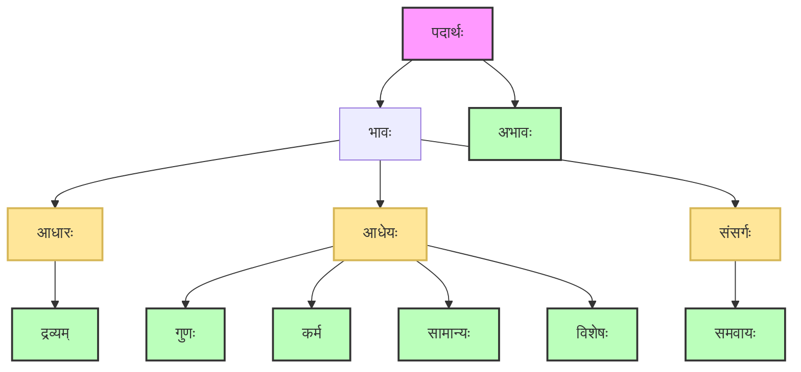

* विशेषम् अधिकृत्य कृतं दर्शनम् (विशेषः ठक्, इति वैशेषिकम्)
* शासनात् संशनात् शास्त्रम् ।

शास्त्रस्य त्रिधा प्रवृत्तिः – उद्देशः, लक्षणं, परीक्षा ।

* नाम्ना वस्तुसङ्कीर्तनम् उद्देशः ।
* असाधारणधर्मः लक्षणम् ।
* लक्षणस्य लक्षणमुपपद्यते न वा इति प्रमाणैः अवधारणं परीक्षा ।

*लक्षणप्रमाणाभ्यां वस्तुसिद्धिः ।*

## आचार्याः
**सूत्रकारः** – कणादमुनिः  
**भाष्यकारः** - प्रशस्तपादः  
न्यायकन्दली – श्रीधरः  
किरणावली & न्यायकुसुमाञ्जलिः - उदयनाचार्यः  

औलूक्ल्यदर्शनम्  
कणान् अत्ति इति कणादः ।

## पदार्थाः

* सप्तपदार्थाः
    * द्रव्यम्, गुणः, कर्म, सामान्यम्, विशेषः, समवायः, अभावः ।
* नव द्रव्याणि
    * पृथिवी, आपः, तेजः, वायुः (अनित्यं, नित्यं च)
    * आकाशः, कालः, दिक्, आत्मा (विभुः)
    * मनः (परमाणुः)
* चतुर्विंशतिः गुणाः
    * रूपम्, रसः, गन्धः, स्पर्शः, संख्या, परिमाणम्, पृथक्त्वम्, संयोगः, विभागः, परत्वम्,
      अपरत्वम्, बुद्धिः, सुखम्, दुःखम्, इच्छा, द्वेषः, प्रयत्नः, गुरुत्वम्, द्रवत्वम्, स्नेहः,
      संस्कारः, धर्मः, अधर्मः, शब्दः ।
* पञ्च कर्माणि
    * उत्क्षेपणम्, अपक्षेपणम्, आकुञ्चनम्, प्रसारणम्, गमनम् ।

## परमाण्वारम्भवादः

* उत्पत्तिक्रमः
    * ईश्वरस्य चिकीर्षावशात् परमाणुषु क्रिया
    * ततः परमाणुद्वयसंयोगः
    * ततो द्व्यणुकम्
    * त्रिभिः द्व्यणुकैः त्र्यणुकम्
    * एवं चतुरणुकादिक्रमेण महती पृथिवी, महत्यः आपः महत् तेजः, माहान् वायुः उत्पद्यते ।
* नाशक्रमः
    * संजिहीर्षावशात् परमाणुषु क्रिया
    * क्रियया परमाणुद्वयविभागः
    * ततो द्व्यणुकनाशः
    * ततः त्र्यणुकनाशः
    * ततश्चतुरणुकनाशः
    * एवं महापृथिव्यादिनाशः

## प्रमाणविचारः

### प्रत्यक्षम्

*सन्निकर्षषट्कजन्यं ज्ञानं प्रत्यक्षम्*  
*तत्करणमिन्द्रियम्*  
*तस्मादिन्द्रियं प्रत्यक्षप्रमाणमिति सिद्धम्*

प्रत्यक्षज्ञानहेतुः इन्द्रियार्थसन्निकर्षः षड्विधः
* संयोगः (घटप्रत्यक्षहेतुः)
* संयुक्तसमवायः (घटरूपप्रत्यक्षहेतुः)
* संयुक्तसमवेतसमवायः (रूपत्वसामान्यप्रत्यक्षहेतुः – श्वेतत्वम् – अस्य प्रत्यक्षज्ञानहेतुः)
* समवायः (श्रोत्रेण शब्दसाक्षात्कारः)
* समवेतसमवायः (शब्दत्वसाक्षात्कारः)
* विशेषणविशेष्यभावः (घटाभाववद् भूतलम्)

### अनुमानम्

* अनुमितिकरणमनुमानम्
* परामर्शजन्यं ज्ञानमनुमितिः
* व्याप्तिविशिष्टपक्षधर्मताज्ञानं परामर्शः।  
  यथा वह्निव्याप्यधूमवानयं पर्वत इति ज्ञानं परामर्शः ।  
  तज्जन्यं पर्वतो वह्निमानिति ज्ञानमनुमितिः ।

#### पञ्चावयवाः

परार्थज्ञानाय पञ्चावयवायात्मिका अनुमानप्रक्रिया  
*यत्तु स्वयमेव धूमादग्निमनुमाय परप्रतिपत्त्यर्थं पञ्चावयववाक्यं प्रयुक्ते तत्परार्थानुमानम्*

* प्रतिज्ञा  
  पर्वतो वह्निमानिति प्रतिज्ञा ।
* हेतुः  
  धूमवत्त्वादिति हेतुः ।
* उदाहरणम्  
  यो यो धूमवान् सोऽग्निमान् यथा महानसम् इत्युदाहरणम् ।
* उपनयः  
  तथा चायमित्युपनयः
* निगमनम्  
  तस्मात्तथेति निगमनम्

