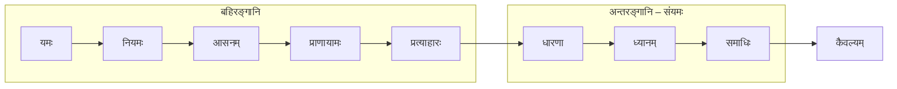
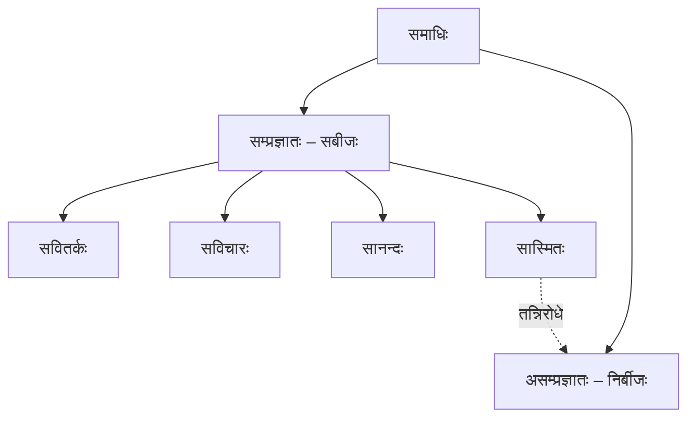
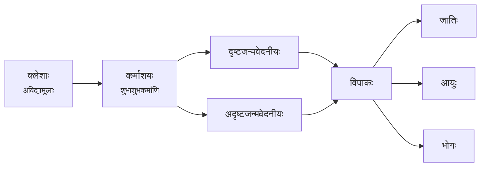
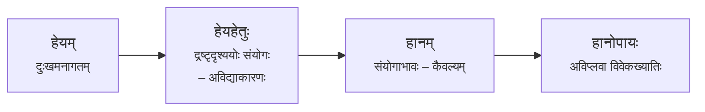

**योगेन चित्तस्य पदेन वाचां मलं शरीरस्य तु वैद्यकेन।  
योऽपाकरोत्तं प्रवरं मुनीनां पतञ्जलिं प्राञ्जलिरानतोऽस्मि ॥**

## प्रयोजनम्

* चित्तशुद्धिः
* बलप्राप्तिः
* मनसः संयमः
* इन्द्रियाणां संयमः
* भय-लोभ-मोह-क्रोधेर्ष्यादीनां त्यागः
* रोगनाशः

टिप्पणी

* योगश्चित्तवृत्तिनिरोधः ।
* आत्मनः जगतः विषये च इदं दर्शनं साङ्ख्यमतं समर्थयति ।
* साङ्ख्योक्तानि पञ्चविंशतिः तत्त्वानि अङ्गीकृतानि। अतिरिक्तम् ईश्वरतत्त्वं च अङ्गीकुर्वन्ति ।
* साङ्ख्योक्तपुरुषः क्लेश-कर्म-विपाक-आशयादिशून्यो भवति।

## आचार्याः

| भूमिका | ग्रन्थः | आचार्यः |
| --- | --- | --- |
| **आदिप्रवर्तकः** | — | ऋषिः हिरण्यगर्भः (याज्ञवल्क्यानुसारम्) |
| **सूत्रकारः** | योगसूत्राणि | महर्षिः पतञ्जलिः |
| **भाष्यकारः** | योगभाष्यम् | भगवान् व्यासः |
| **टीका** | तत्त्ववैशारदी | वाचस्पतिमिश्रः |
| **टीका** | पातञ्जलरहस्यम् | राघवानन्दः |
| **टीका / प्रकरणम्** | योगवार्तिकम्, योगसारसङ्ग्रहः | विज्ञानभिक्षुः |
| **व्याख्या** | भास्वती | हरिहरानन्दः |
| **हठयोगः** | हठयोगप्रदीपिका | नाथयोगी आत्मारामः |

## प्रमाणानि

*प्रत्यक्षानुमानागमाः प्रमाणानि (यो० सू० १।७)*  

साङ्ख्यमतवदेव उपमानादीनामन्तःपातः एतेष्वेव क्रियते।

### प्रमाणविचारः
योगदर्शने प्रमाणव्यापारः चित्तस्य त्रिगुणात्मकस्वभावेन पुरुषस्य चैतन्यप्रतिबिम्बेन च सिध्यति ।

* प्रमाणम् – बाह्यविषयसन्निकर्षेण चित्तस्य विषयाकारा परिणतिः (चित्तवृत्तिः) प्रमाणम् ।
* प्रमा – जडायां चित्तवृत्तौ शुद्धचैतन्यस्वरूपस्य पुरुषस्य प्रतिबिम्बपातात् या अद्विविधा
  बोधरूपा प्रतीतिः उत्पद्यते, सा 'प्रमा' (पौरुषेयबोधः)।
* प्रमाता – शुद्धचैतन्यस्वरूपः पुरुषः।

#### प्रमाणप्रयोजनम्

* सांसारिकज्ञानम् ।
* चित्तवृत्तिषु प्रमाणम् अक्लिष्टरूपेण विविक्तज्ञानं (विवेकख्यातिं) जनयति। ततः तत्त्वं ज्ञात्वा योगसाधने प्रवृत्तः
  योगी अन्ते 'ऋतम्भरायाः प्रज्ञायाः' (सर्वोच्चप्रत्यक्षस्य) साक्षात्करोति ।
  यदा विवेकख्यातिरूपं प्रमाणज्ञानमपि कार्यं समापयति, तदा तस्यापि निरोधे निर्बीजसमाधौ कैवल्यं प्राप्यते।

#### साङ्ख्ययोगयोः प्रमाणविषयकभेदः?

यद्यपि समानानि दृश्यन्ते, तेषां व्याख्यानं (प्रक्रिया) स्वरूपं च भिद्येते । सूक्ष्मभेदाः वर्तन्ते ।

| विषयः | साङ्ख्यम् | योगः |
| --- | --- | --- |
| **प्रमाणनामानि** | दृष्टम्, अनुमानम्, आप्तवचनम् | प्रत्यक्षम्, अनुमानम्, आगमः |
| **प्रमाणस्य स्थानम्** | तत्त्वज्ञानस्य साधनम् | पञ्चसु चित्तवृत्तिषु अन्यतमम् – अतः अन्ते निरोद्धव्यम् |
| **प्रत्यक्षलक्षणम्** | प्रतिविषयाध्यवसायः (बुद्धेः) | विशेषावधारणप्रधाना चित्तवृत्तिः (व्यासभाष्यम्) |
| **योगिप्रत्यक्षम्** | न विशेषतः विवेचितम् | संयमजं प्रत्यक्षम्, ऋतम्भरा प्रज्ञा – विशेषतः प्रतिपादितम् |
| **आगमस्य मूलम्** | आप्तश्रुतिः (निरीश्वरम्) | आप्तः, सर्वज्ञः ईश्वरः अपि आगमस्य मूलम् |

### प्रत्यक्षप्रमाणम्
* **लक्षणम्** – *इन्द्रियप्रणालिकया चित्तस्य बाह्यवस्तूपरागात् तद्विषया सामान्यविशेषात्मनोऽर्थस्य विशेषावधारणप्रधाना वृत्तिः प्रत्यक्षं प्रमाणम्। (व्यासभाष्यम्)*
* **प्रक्रिया** – यदा श्रोत्रादीन्द्रियप्रणालिकया चित्तं बहिर्निर्गत्य बाह्यवस्तुना सम्बध्यते, तदा
  वस्तुना उपरागात् (संसर्गात्) चित्तं तस्य वस्तुनः आकारं गृह्णाति ।
* **स्वरूपम्** – वस्तु सामान्यविशेषात्मकं भवति। तत्र सामान्यधर्मान् गौणीकृत्य
  'विशेषधर्मस्य' अवधारणं प्रत्यक्षवृत्त्या क्रियते ।  
  यथा -'अयं घटः' इत्यत्र कम्बुग्रीवादि-विशेषरूपस्य ज्ञानम्।
* **योगिप्रत्यक्षम्** – एतदतिरिक्तं योगदर्शने इन्द्रियासन्निकर्षेऽपि संयमबलेन देशकालविप्रकृष्टानां सूक्ष्माणाम्
  अतीतानागतानां च वस्तूनां प्रत्यक्षं स्वीक्रियते, यत् 'ऋतम्भरा प्रज्ञा' अथवा 'तारकज्ञानम्' इत्युच्यते।

### अनुमानप्रमाणम्
*अनुमेयस्य तुल्यजातीयेष्वनुवृत्तो भिन्नजातीयेभ्यो व्यावृत्तः सम्बन्धो यस्तद्विषया सामान्यावधारणप्रधाना वृत्तिरनुमानम्। (व्यासभाष्यम्)*

 
व्याप्तिज्ञानम् अनुमाने व्याप्तिज्ञानम् आधारभूतम्। अनुमेयस्य (साध्यस्य) हेतुना सह यः सम्बन्धः, सः

* सपक्षे अनुवृत्तः – तुल्यजातीयेषु अन्वयी (यथा - यत्र यत्र घूमः तत्र तत्र वह्निः, यथा महानसे)।
* विपक्षे व्यावृत्तः – भिन्नजातीयेभ्यः व्यतिरेकी (यथा- जलाशये घूमस्य वद्वेश्च सर्वथा अभावः)।
* स्वरूपम् – प्रत्यक्षे विशेषधर्मस्य प्राधान्यं भवति, किन्तु अनुमाने 'सामान्यधर्मस्य' अवधारणं
  प्रधानं भवति। यथा- 'पर्वतो वह्निमान्' इत्यत्र वह्नेः सामान्यरूपेण ज्ञानं भवति, न तु वह्नेः
  स्थूलविशेषाणां (स्फुलिङ्गादीनां) प्रत्यक्षवत्।
* उदाहरणम् – "यथा देशान्तरप्राप्तेर्गतिमच्चन्द्रतारकं चैत्रवत्, विन्ध्यश्चाप्राप्तेरगतिः"  
  (चन्द्रतारकादीनां देशान्तरप्राप्त्या गतिमत्त्वानुमानम्, विन्ध्यस्य तु देशान्तरगमनाभावात् गतिशून्यत्वम्)।

### आगमप्रमाणम् (शब्दप्रमाणम्)
* **लक्षणम्** – *आप्तेन दृष्टोऽनुमितो वाऽर्थः परत्र स्वबोधसङ्क्रान्तये शब्देनोपदिश्यते, शब्दात्तदर्थविषया वृत्तिः श्रोतुरागमः। (व्यासभाष्यम्)*
* **आप्तलक्षणम्** – आप्तः सः भवति यः साक्षात्कृतधर्मा, यथार्थदर्शी, भ्रम-प्रमाद-विप्रलिप्सा-करणापाटवरहितः, परानुजिघृक्षुश्च।
* **प्रक्रिया** – आप्तेन प्रत्यक्षेण अनुमानेन वा यः अर्थः साक्षात्कृतः, तस्य परेभ्यः बोधनाय प्रयुक्तः
  शब्दः 'आगमः'। तं शब्दं श्रुत्वा श्रोतुः चित्ते जायमाना विषयाकारा वृत्तिः आगमप्रमाणम्।  
  यदि वक्ता अनाप्तः, अतीन्द्रियार्थेषु अप्रमाणिको वा भवति, तर्हि सः शब्दः 'आगमाभासः'
* **स्वतःप्रमाणम्** – वेदवाक्यानि, पतञ्जल्यादि-महर्षीणां सूत्राणि, सर्वज्ञस्य ईश्वरस्य च वचनानि निर्दोषतया स्वतःप्रमाणम्।

### प्रमाणत्रयस्य सारांशः

| प्रमाणम् | प्रधानम् | विषयः | उदाहरणम् |
| --- | --- | --- | --- |
| **प्रत्यक्षम्** | विशेषावधारणम् | इन्द्रियसन्निकृष्टं बाह्यवस्तु (योगिनः – सूक्ष्मम्, व्यवहितम्, विप्रकृष्टम्) | 'अयं घटः' – कम्बुग्रीवादिविशेषज्ञानम् |
| **अनुमानम्** | सामान्यावधारणम् | व्याप्तिबलेन परोक्षं वस्तु | 'पर्वतो वह्निमान्'; चन्द्रतारकं गतिमत् |
| **आगमः** | आप्तोपदेशः | आप्तेन दृष्टः अनुमितो वा अर्थः | वेदवाक्यम्, ऋषिसूत्राणि, ईश्वरवचनम् |

## वृत्तयः

### पञ्च वृत्तयः

| वृत्तिः | लक्षणम् (योगसूत्रम्) | टिप्पणी |
| --- | --- | --- |
| **प्रमाणम्** | प्रत्यक्षानुमानागमाः प्रमाणानि । | उपरि विवेचितम् |
| **विपर्ययः** | विपर्ययो मिथ्याज्ञानमतद्रूपप्रतिष्ठम् । | वस्तुनः मिथ्याज्ञानं विपर्ययः । |
| **विकल्पः** | शब्दज्ञानानुपाती वस्तुशून्यो विकल्पः । | यथा – चैतन्यपुरुषयोः पृथग्ज्ञानम् । |
| **निद्रा** | अभावप्रत्ययालम्बना वृत्तिर्निद्रा । | |
| **स्मृतिः** | अनुभूतविषयासम्प्रमोषः स्मृतिः । | |

एताः वृत्तयः क्लिष्टाः अक्लिष्टाश्च भवन्ति ("*वृत्तयः पञ्चतय्यः क्लिष्टाक्लिष्टाः*") ।

### वृत्तिनिरोधोपायाः

अभ्यासवैराग्याभ्यां वृत्तिनिरोधः।

* स्थितौ यत्नः **अभ्यासः**।
* दृष्टानुश्रविकविषयवितृष्णस्य वशीकारसंज्ञा **वैराग्यम्**।

## चित्तभूमयः

| भूमिः | गुणस्थितिः | योगे स्थानम् <small>(पूरितम्)</small> |
| --- | --- | --- |
| **क्षिप्तम्** | समबलौ रजस्तमोगुणौ सत्त्वापेक्षया न्यूनौ चेत् चित्तं क्षिप्तम् इति । | योगानुपयोगि |
| **मूढम्** | तमोगुणाधिक्यात् मूढम् । | योगानुपयोगि |
| **विक्षिप्तम्** | तमोगुणे क्षीणे, रजोगुणापेक्षया च सत्त्वाधिक्ये विक्षिप्तम् । | कदाचित् स्थैर्यम्, किन्तु योगपक्षे न वर्तते |
| **एकाग्रम्** | रजस्तमोगुणयोः विनाशे सत्त्वाधिक्ये एकाग्रम् । | सम्प्रज्ञातसमाधिः |
| **निरुद्धम्** | सकलवृत्तिनिरोधे निरुद्धम् इति । | असम्प्रज्ञातसमाधिः |

## क्लेशाः अक्लेशाः च
अविद्या क्षेत्रमुत्तरेषां प्रसुप्ततनुविच्छिन्नोदाराणाम् । (क्षेत्रम् = कारणम्, उत्तरेषाम् = अस्मितादिक्लेशानाम्)

| क्लेशः | लक्षणम् (योगसूत्रम्) | साङ्ख्यनाम |
| --- | --- | --- |
| **अविद्या** | अनित्याशुचिदुःखानात्मसु नित्यशुचिसुखात्मख्यातिरविद्या । | तमः |
| **अस्मिता** | दृग्दर्शनशक्त्योरेकात्मतेवास्मिता । | मोहः |
| **रागः** | सुखानुशयी रागः । | महामोहः |
| **द्वेषः** | दुःखानुशयी द्वेषः । | तामिस्रः |
| **अभिनिवेशः** | स्वरसवाही विदुषोऽपि तथारूढोऽभिनिवेशः । | अन्धतामिस्रः |

 
क्लेशविपरीतम् अक्लेशाः।

## अष्टाङ्गानि

क्लेशेभ्यः मुक्त्यर्थम् अष्टौ अङ्गानि।

यमनियमासनप्राणायामप्रत्याहारधारणाध्यानसमाधयोऽष्टावङ्गानि ।

| वर्गः | अङ्गानि |
| --- | --- |
| **बहिरङ्गानि** | यमः, नियमः, आसनम्, प्राणायामः, प्रत्याहारः |
| **अन्तरङ्गानि** (त्रयमेकत्र संयमः) | धारणा, ध्यानम्, समाधिः |

### यमाः

अहिंसासत्यास्तेयब्रह्मचर्यापरिग्रहा यमाः ।

| यमः | प्रतिष्ठायां फलम् (योगसूत्रम्) |
| --- | --- |
| **अहिंसा** | अहिंसाप्रतिष्ठायां तत्सन्निधौ वैरत्यागः । |
| **सत्यम्** | सत्यप्रतिष्ठायां क्रियाफलाश्रयत्वम् । |
| **अस्तेयम्** | अस्तेयप्रतिष्ठायां सर्वरत्नोपस्थानम् । |
| **ब्रह्मचर्यम्** | ब्रह्मचर्यप्रतिष्ठायां वीर्यलाभः । |
| **अपरिग्रहः** | अपरिग्रहस्थैर्ये जन्मकथन्तासम्बोधः । |

### नियमाः

शौचसन्तोषतपःस्वाध्यायेश्वरप्रणिधानानि नियमाः ।

| नियमः | फलम् (योगसूत्रम्) |
| --- | --- |
| **शौचम्** | शौचात्स्वाङ्गजुगुप्सा परैरसंसर्गः । |
| **सन्तोषः** | सन्तोषादनुत्तमसुखलाभः । |
| **तपः** | कायेन्द्रियसिद्धिरशुद्धिक्षयात्तपसः । |
| **स्वाध्यायः** | स्वाध्यायादिष्टदेवतासम्प्रयोगः । |
| **ईश्वरप्रणिधानम्** | समाधिसिद्धिरीश्वरप्रणिधानात् । |

### आसनम्, प्राणायामः, प्रत्याहारः, धारणा, ध्यानम्, समाधिः च

| अङ्गम् | लक्षणम् (योगसूत्रम्) |
| --- | --- |
| **आसनम्** | स्थिरसुखमासनम् । |
| **प्राणायामः** | तस्मिन् सति श्वासप्रश्वासयोर्गतिविच्छेदः प्राणायामः । |
| **प्रत्याहारः** | स्वविषयासम्प्रयोगे चित्तस्य स्वरूपानुकार इवेन्द्रियाणां प्रत्याहारः । |
| **धारणा** | देशबन्धश्चित्तस्य धारणा । |
| **ध्यानम्** | तत्र प्रत्ययैकतानता ध्यानम् । |
| **समाधिः** | तदेवार्थमात्रनिर्भासं स्वरूपशून्यमिव समाधिः । |

सम्प्रज्ञातासम्प्रज्ञातभेदेन समाधिः द्विविधः –

* सवितर्क-सविचार-सानन्द-सास्मितारूपानुगमात् सम्प्रज्ञातः।  
* तन्निरोधे निर्बीजः असम्प्रज्ञातः इति।

## योगसूत्राणि

### ग्रन्थविषयानुक्रमणिका
| पादः | नाम | सूत्राणि | प्रमुखविषयाः |
| --- | --- | --- | --- |
| प्रथमः | समाधिपादः | ५१ | सिद्धिप्राप्तिः, मनोनिग्रहणं कथं कर्तव्यम्; योगलक्षणम्, वृत्तयः, अभ्यासवैराग्ये, समाधिभेदाः, ईश्वरः |
| द्वितीयः | साधनपादः | ५५ | क्रियायोगः, क्लेशाः, कर्मविपाकः, दृश्यद्रष्टृसंयोगः, अष्टाङ्गानां प्रथमानि पञ्च |
| तृतीयः | विभूतिपादः | ५५ | धारणाध्यानसमाधयः, संयमः, परिणामाः, अणिमादिसिद्धिप्राप्तिः |
| चतुर्थः | कैवल्यपादः | ३४ | दर्शनप्रतिपादनम् (मोक्षो नाम किम्?), सिद्धिहेतवः, निर्माणचित्तम्, विज्ञानवादखण्डनम्, धर्ममेघः, कैवल्यम् |
| | | **१९५** | |

### समाधिपादः

अस्य विषयाः उपरि प्रतिपादिताः (प्रमाणविचारः, वृत्तयः, क्लेशाः, अष्टौ अङ्गानि, ...) ।

### साधनपादः

**क्रियायोगः**  
मन्द-मध्यमाधिकारिणां चित्तप्रसादनाय क्लेशतनूकरणाय च साधनत्रयं प्रतिपादितम् ।
अनेन क्लेशाः शिथिलीभवन्ति, समाधेश्च योग्यता जायते।

* क्रियायोगः = तपः, स्वाध्यायः, ईश्वरप्रणिधानम्

**क्लेशानां सूक्ष्मावस्थाः**  
पञ्चक्लेशानां सूक्ष्मावस्थाः चतस्रः अवस्थाः भवन्ति-

| अवस्था | स्वरूपम् |
| --- | --- |
| **प्रसुप्तः** | संस्काररूपेण सुप्तः |
| **तनुः** | क्रियायोगेन प्रतिपक्षभावनया वा दुर्बलितः |
| **विच्छिन्नः** | अन्येन बलवता क्लेशेन तिरोहितः |
| **उदारः** | कार्यकाले प्रत्यक्षम् उद्भूतः |

एतेषु 'अविद्या' एव इतरेषां बीजभूमिः।

**कर्मविपाकसिद्धान्तः**  
क्लेशमूलकः शुभाशुभकर्मणां समूहः 'कर्माशयः' कथ्यते। तस्य फलं द्विविधम्  

* दृष्टजन्मवेदनीयः (अस्मिन्नेव जन्मनि भुज्यमानः)
* अदृष्टजन्मवेदनीयः (जन्मान्तरे भुज्यमानः)।

सति मूले तद्विपाको जात्यायुर्भोगाः – तस्य विपाकः त्रिधा भवति –

| विपाकः | अर्थः |
| --- | --- |
| **जातिः** | योनिः |
| **आयुः** | जीवनावधिः |
| **भोगः** | सुखदुःखे |

**दुःखमीमांसा (परिणाम-ताप-संस्कार-दुःखानि)**

"परिणामतापसंस्कारदुःखैर्गुणवृत्तिविरोधाच्च दुःखमेव सर्वं विवेकिनः" ।

| दुःखम् | कथं विषयसुखं दुःखम् |
| --- | --- |
| **परिणामदुःखम्** | विषयसुखं परिणामे दुःखदम् । |
| **तापदुःखम्** | तृष्णायाम् अतृप्तत्वात् तापात्मकम् । |
| **संस्कारदुःखम्** | भोगात् संस्कारजनकतया दुःखदम् । |

**दृश्यस्य स्वरूपं स्वभावश्च**

दृश्यं प्रकाश (सत्त्वम्), क्रिया (रजः), स्थिति (तमः) स्वभावकं भवति। दृश्यस्य प्रयोजनं द्विविधम् – भोगः (अनुभवः) अपवर्गश्च (मुक्तिः)। इदं दृश्यं केवलं 'पुरुषार्थम्' एव वर्तते; कृतार्थं प्रति नष्टमपि अनष्टम् अन्यान् पुरुषान् प्रति।

| दृश्यस्य अवस्था (गुणपर्वाणि) | तत्त्वानि |
| --- | --- |
| **विशेषः** | स्थूलभूतानि (इन्द्रियाणि मनश्च <small>– पूरितम्</small>) |
| **अविशेषः** | तन्मात्राणि (अहङ्कारश्च <small>– पूरितम्</small>) |
| **लिङ्गमात्रम्** | महत्तत्त्वम् |
| **अलिङ्गम्** | मूलप्रकृतिः |

**संयोगस्वरूपं हानोपायश्च** – द्रष्टुः (पुरुषस्य) दृश्यस्य (बुद्धेः) च अनादिरूपः परस्परं संसर्गः 'संयोगः'। अस्य कारणम् अविद्या। अस्य आत्यन्तिकः विच्छेदः एव हानम् (कैवल्यम्)। अस्य हानस्य उपायः अचलप्रतिष्ठा विवेकख्यातिः, या सप्तधा प्रान्तभूमिप्रज्ञां जनयति।

**हेय-हेयहेतु-हान-हानोपायाः (चतुर्व्यूहः)** <small>(पूरितम् – सूत्रपदानि)</small>

### विभूतिपादः

* **संयमः** = धारणाम्, ध्यानम्, समाधिं च एकत्र विषये प्रयुज्यमानम् अङ्गत्रयं संयमः इत्युच्यते ।  
  अस्य जयेन प्रज्ञालोकः (तत्त्वज्ञानदीप्तिः) प्रसरति।

**चित्तस्य त्रिविधपरिणामाः**

| परिणामः | स्वरूपम् |
| --- | --- |
| **निरोधपरिणामः** | व्युत्थानसंस्काराणाम् अभिभवः, निरोधसंस्काराणां च प्रादुर्भावः । |
| **समाधिपरिणामः** | सर्वार्थतायाः (नानार्थभ्रमस्य) क्षयः, एकाग्रतायाः (एकविषयतायाः) उदयः । |
| **एकाग्रतापरिणामः** | शान्तोदितयोः प्रत्यययोः (अतीतानागतवृत्त्योः) साम्यम् । |

**भूतेन्द्रियेषु धर्म-लक्षण-अवस्थापरिणामाः**

| परिणामः | स्वरूपम् | उदाहरणम् |
| --- | --- | --- |
| **धर्मपरिणामः** | द्रव्यस्य धर्मान्तरप्राप्तिः । | मृत्तिकायाः घटत्वम् |
| **लक्षणपरिणामः** | वर्तमान-अतीत-अनागत-कालाध्वसु परिवर्तनम् । | वस्तुनः (शिशोः) गच्छता कालेन परिणामः |
| **अवस्थापरिणामः** | नूतन-पुरातनाद्यवस्थासु प्रतिक्षणं जीर्णतादिभेदः । | जीर्णतां याति वस्तु |

### कैवल्यपादः

* **पञ्चविधसिद्धिहेतवः**  
  (मोक्षहेतवः)  
  सिद्धिः न केवलं समाधिना, अपितु पञ्चभिः कारणैः लभ्यते - "जन्मौषधिमन्त्रतपःसमाधिजाः सिद्धयः"।

    | हेतुः | अर्थः |
    | --- | --- |
    | जन्म | पूर्वजन्मना |
    | ओषधिः | रसायनैः |
    | मन्त्रः | मन्त्रजपेन |
    | तपः | सन्ततपरिश्रमेण |
    | समाधिः | समाधिना |

* **जात्यन्तरपरिणामः (प्रकृत्यापूरवादः)**  
  एका जातिः अन्यां जातिं परिणमते (यथा कीटः मनुष्यत्वं प्राप्नोति), तत्र बाह्यं
  कर्म न प्रेरयति, अपितु प्रकृत्यापूरात् भवति। कर्म केवलं प्रतिबन्धकं भिनत्ति, यथा
  कृषिकः जलमार्गे सेतुं भिनत्ति (वरणभेदस्तु ततः क्षेत्रिकवत्)।
* **निर्माणचित्तमीमांसाः**  
  योगी योगबलेन एकदैव युगपद् बहूनि शरीराणि रचयति। तानि शरीराणि सञ्चालयितुम्
  अस्मितातत्त्वात् 'निर्माणचित्तानि' उत्पादयति। तेषां सर्वासां नियमनं योगिनः एकम् एव
  मुख्यं चित्तं करोति। समाधिजं चित्तम् अनाशयं (निष्कामं) भवति।
* **कर्मचातुर्विध्यम्** – कर्माशुक्लाकृष्णं योगिनस्त्रिविधमितरेषाम् ।

    | कर्म | स्वरूपम् | कर्तारः |
    | --- | --- | --- |
    | कृष्णम् | अधार्मिकम् / पापम् | असुराः (दुरात्मानः) |
    | शुक्लकृष्णम् | मिश्रितम् | मनुष्याः |
    | शुक्लम् | पुण्यकर्म | तपस्विनः |
    | अशुक्लाकृष्णम् | निष्कामकर्म | संन्यासिनः योगिनश्च |

* **क्षणिकविज्ञानवादस्य बौद्धमतस्य खण्डनम्**  
    * **वस्तुनः स्वतन्त्रसत्त्वम्** – चित्तं वस्तु च भिन्नम्। एकस्मिन् वस्तुनि अनेकचित्तानां भिन्ना दृष्टिः भवति,
      अतः वस्तु चित्ताधीनं नास्ति ।
    * **चित्तस्य जडत्वम्** – चित्तं स्वप्रकाशकं न भवति, दृश्यत्वात् इन्द्रियवत् (दृश्यत्वात् नात्मप्रकाशम्)।
    * **अपरिणामी पुरुषः** – पुरुषः अपरिणामी, नित्यश्च, अत एव सः चित्तवृत्तीनां
      सदा ज्ञाता भवति (सदा ज्ञाताश्चित्तवृत्तयस्तत्प्रभोः पुरुषस्यापरिणामित्वात्)। यदि चित्तमेव
      ज्ञाता भवेत्, तर्हि स्मृत्यनवस्था-बुद्धिबुद्धीनाम् अनवस्थाप्रसङ्गः स्यात्।
* **धर्ममेघसमाधिः कैवल्यप्राप्तिश्च**  
  यदा सर्वथा विवेकख्यातावपि विरक्तिः जायते (सर्वथा विवेकज्ञानाभिमानस्यापि त्यागः),
  तदा धर्ममेघसमाधिः आविर्भवति। अनेन सर्वक्लेशाः कर्माणि च समूलमुच्छिद्यन्ते। गुणाः पुरुषार्थशून्याः
  सन्तः स्वकारणे (प्रकृतौ) प्रलीनाः भवन्ति, चितिशक्तिः च स्वरूपे प्रतिष्ठिता भवति-इदमेव कैवल्यम्।

